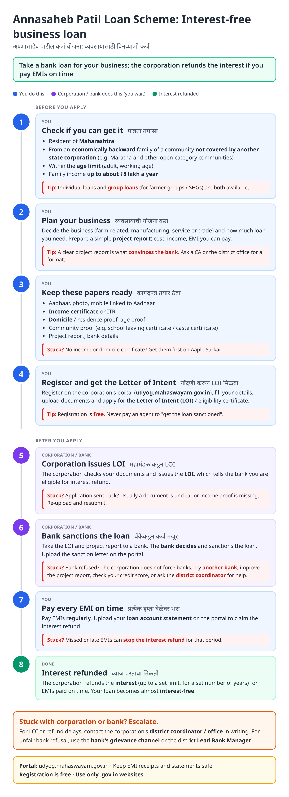
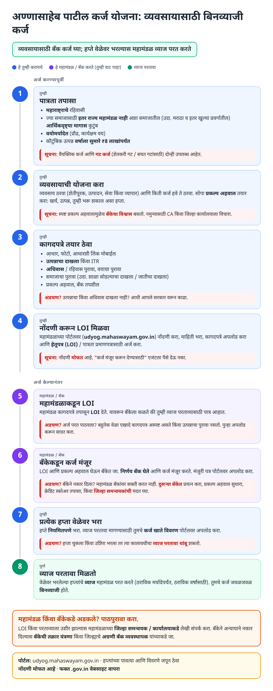
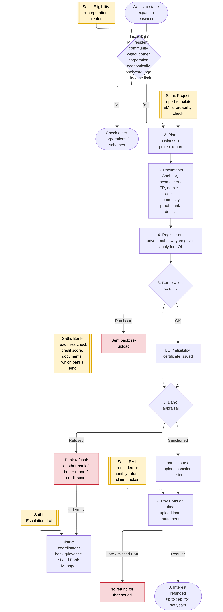
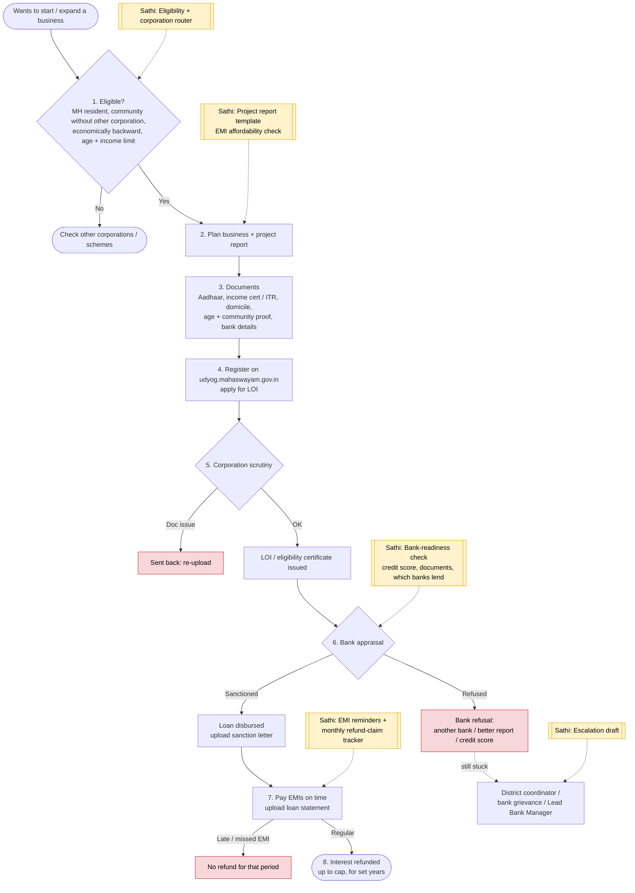

# Annasaheb Patil Loan Scheme (Interest Refund) - End-to-End Workflow

Annasaheb Patil Arthik Magas Vikas Mahamandal: for economically backward families of communities not covered by another state development corporation (e.g. Maratha and other open-category communities). The beneficiary takes a **bank** loan for a business; the corporation **refunds the interest** for EMIs paid on time. Individual and group loan options. Portal: https://udyog.mahaswayam.gov.in.

## For citizens: step by step

Blue = you do this. Purple = corporation / bank does this (you wait). Green = interest refunded. Red = what to do if stuck. Orange = how to escalate.

### English

### मराठी (Marathi)

Sources: [`annasaheb-patil-guide.html`](annasaheb-patil-guide.html), [`annasaheb-patil-guide-mr.html`](annasaheb-patil-guide-mr.html), generated from [`annasaheb_patil_content.py`](annasaheb_patil_content.py) with `python3 gen_guide.py annasaheb_patil_content.py`. Marathi text pending native-speaker review.

## For the Sathi team: system workflow

Yellow boxes = where Sathi plugs in. Red boxes = common blockers.

Mermaid source (editable)

## Stages

| # | Stage | Owner | Common blocker | Sathi action |
|---|---|---|---|---|
| 1 | Eligibility | Citizen | Wrong corporation for their community | Eligibility + corporation router |
| 2 | Business plan | Citizen | Weak / no project report | Project report template, EMI affordability check |
| 3 | Documents | Citizen | Missing income / domicile certificate | Readiness; links to [income](income-certificate.md) and [domicile](domicile-certificate.md) guides |
| 4 | Register + LOI request | Citizen | Agent fraud | Free-registration messaging |
| 5 | LOI issued | Corporation | Sent back for documents | Decode reason |
| 6 | Bank sanction | Bank | **Bank refusal** (biggest drop-off) | Bank-readiness check: credit score, documents, which banks are lending |
| 7 | EMI + claim | Beneficiary | Late EMI → refund lost; forgets monthly claim | EMI reminders + refund-claim tracker |
| 8 | Interest refund | Corporation | Refund delayed | Escalation draft to district coordinator |

**Why this matters for Sathi:** this is the first scheme in the set where the money comes from a **bank**, not the government. The real bottleneck is bank sanction, not the corporation's LOI. A bank-readiness score (documents, credit, project report quality) and an EMI/refund tracker are high-value features, and they open a B2B channel with banks and CAs, matching the brief's "Banks for loans" idea.

> Note: Working assumptions, not yet verified: eligible communities, age and income limits, loan and interest-refund caps, refund period, group-loan options, portal name and flow, claim frequency, and escalation channels. Verify against current Annasaheb Patil Mahamandal GRs and udyog.mahaswayam.gov.in before building.
