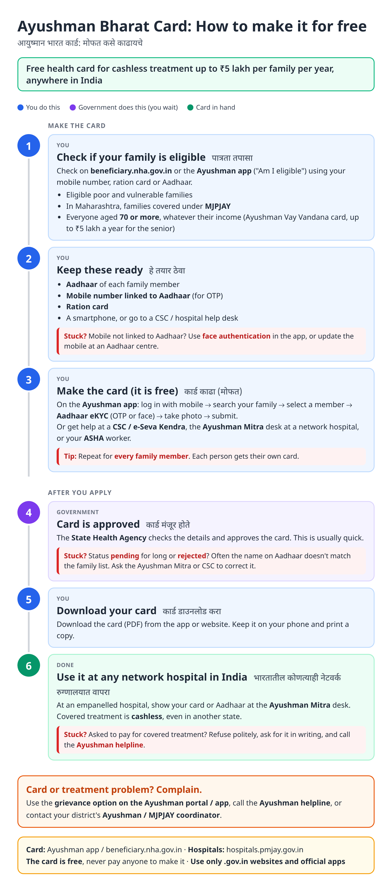
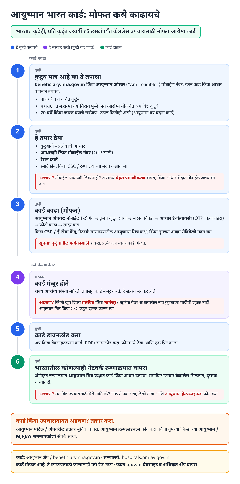
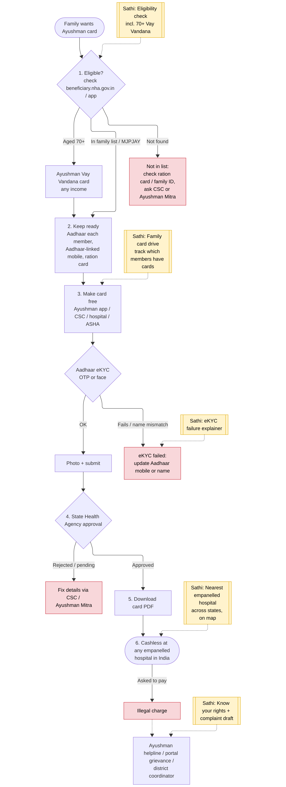
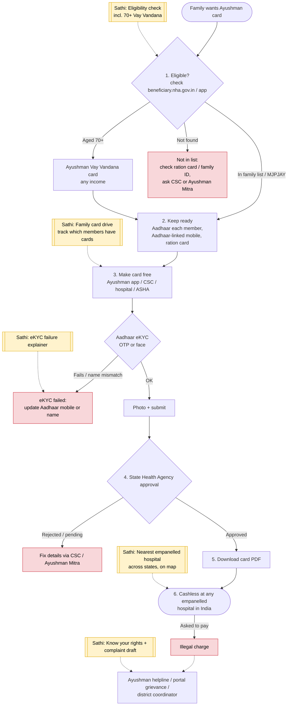

# Ayushman Bharat (PM-JAY) Card - End-to-End Workflow

How to make the free Ayushman Bharat health card for each family member and use it for cashless treatment at empanelled hospitals across India. Includes the Ayushman Vay Vandana card for everyone aged 70+. Card: Ayushman app / https://beneficiary.nha.gov.in. In Maharashtra the same card is used with [MJPJAY](mjpjay.md).

## For citizens: step by step

Blue = you do this. Purple = government does this (you wait). Green = card in use. Red = what to do if stuck. Orange = how to complain.

### English

### मराठी (Marathi)

Sources: [`ayushman-card-guide.html`](ayushman-card-guide.html), [`ayushman-card-guide-mr.html`](ayushman-card-guide-mr.html), generated from [`ayushman_card_content.py`](ayushman_card_content.py) with `python3 gen_guide.py ayushman_card_content.py`. Marathi text pending native-speaker review.

## Official links

Use only these addresses. Checked on 27 Oct 2026 through search results; the government sites could not be opened directly from our build environment. "Third-party sites only" means several non-government sites agree on the address but no government page confirmed it yet, so open it and check before you share it.

| What | Link | Checked via |
| :--- | :--- | :--- |
| Ayushman card: create / download | <https://beneficiary.nha.gov.in> | Third-party sites only |
| PM-JAY: scheme and hospitals | <https://pmjay.gov.in> | Third-party sites only |
| Helpline: 14555 | - | Third-party sites only |

## For the Sathi team: system workflow

Yellow boxes = where Sathi plugs in. Red boxes = common blockers.

Mermaid source (editable)

## Stages

| # | Stage | Owner | Common blocker | Sathi action |
|---|---|---|---|---|
| 1 | Eligibility | Family | Not found in list; 70+ unaware of Vay Vandana | Eligibility check incl. 70+ |
| 2 | Keep ready | Family | Mobile not linked to Aadhaar | Explain face-auth option / Aadhaar mobile update |
| 3 | Make card + eKYC | Family / CSC / Ayushman Mitra / ASHA | eKYC fails on name mismatch; only one member done | eKYC failure explainer; family card drive tracker |
| 4 | SHA approval | State Health Agency | Pending / rejected | Explain reason, route to CSC |
| 5 | Download | Family | Card lost | Store in family vault |
| 6 | Use at hospital | Family / hospital | Asked to pay; doesn't know portability across states | Nearest empanelled hospital (any state); rights + complaint draft |

**Why this matters for Sathi:** the card is the gateway to both PM-JAY and MJPJAY. A "family card drive" (who in the family has a card, who doesn't) is a cheap, high-trust first action that brings every family member into the Sathi profile, and the 70+ Vay Vandana card is an easy win for elderly parents.

## Verification (27 Oct 2026, batch 1)

- **Confirmed:** Ayushman Vay Vandana card for everyone **70+** regardless of income; covers **the senior individually** up to ₹5 lakh/year; apply on beneficiary.nha.gov.in or the Ayushman app (senior enrolment option + Aadhaar eKYC), or at empanelled hospitals / CSCs.
- **Changed in guide:** added that Vay Vandana cover is up to ₹5 lakh a year for the senior.
- **Not added:** helpline numbers (14555 not confirmed for Vay Vandana; 1800 11 0770 appears only on a third-party site).

Sources: [Business Today: Ayushman Vaya Vandana card](https://www.businesstoday.in/amp/personal-finance/insurance/story/ayushman-vaya-vandana-card-2024-how-to-apply-for-the-card-online-offline-check-eligibility-documents-needed-452296-2024-11-02) · [Outlook Money: get your Ayushman card](https://www.outlookmoney.com/personal-finance/get-your-ayushman-card-in-15-minutes-how-to-apply) · [Angel One: Vaya Vandana eligibility](https://www.angelone.in/news/ayushman-vaya-vandana-yojana-check-eligibility-how-to-download-and-more)
