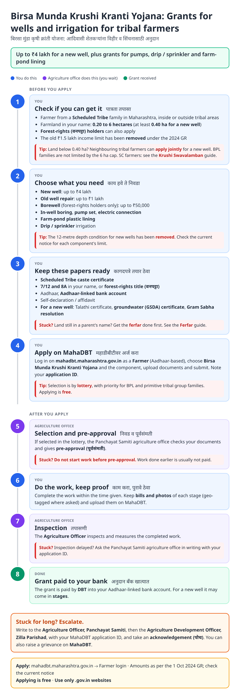
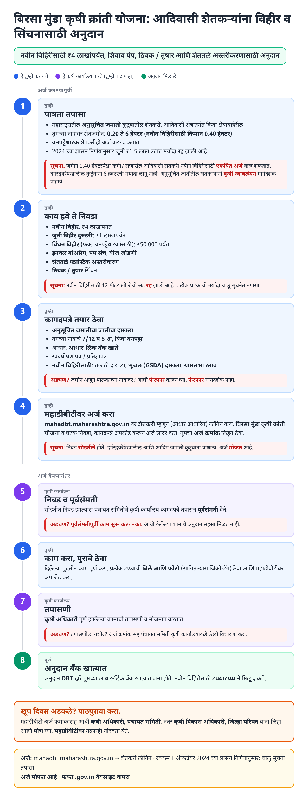
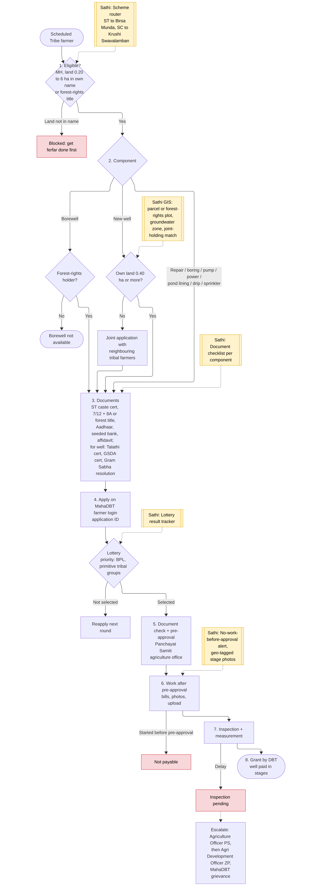
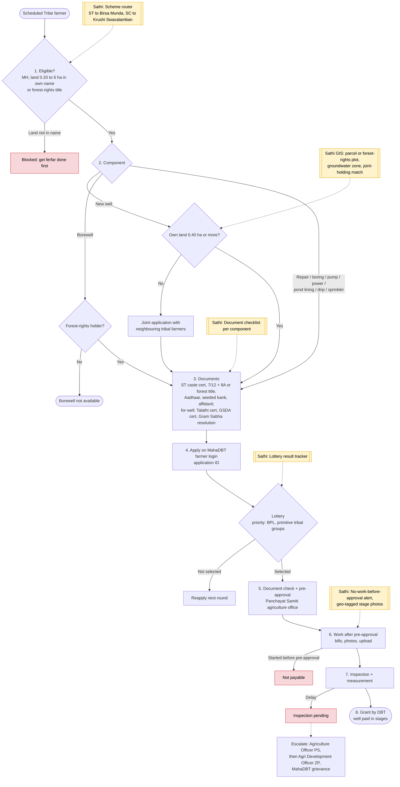

# Birsa Munda Krushi Kranti Yojana - End-to-End Workflow

100% state-funded scheme giving **Scheduled Tribe** farmers (inside and outside tribal sub-plan areas, including forest-rights / वनपट्टा holders) grants for a new well, well repair, borewell (forest-rights holders), in-well boring, pump set, electric connection, farm-pond lining and drip / sprinkler. Applied for on the MahaDBT farmer portal; selection by lottery. The SC / Nav-Bauddha counterpart is [Krushi Swavalamban Yojana](krushi-swavalamban.md).

Related: [Ferfar](ferfar.md), [Caste certificate](caste-certificate.md), [Caste validity](caste-validity.md) (ST validity via eTribe Validity).

## For farmers: step by step

Blue = you do this. Purple = agriculture office does this (you wait). Green = grant received. Red = what to do if stuck. Orange = how to escalate.

### English

### मराठी (Marathi)

Sources: [`birsa-munda-guide.html`](birsa-munda-guide.html), [`birsa-munda-guide-mr.html`](birsa-munda-guide-mr.html), generated from [`birsa_munda_content.py`](birsa_munda_content.py) with `python3 gen_guide.py birsa_munda_content.py`. Marathi text pending native-speaker review.

## For the Sathi team: system workflow

Yellow boxes = where Sathi plugs in. Red boxes = common blockers.

Mermaid source (editable)

## Stages

| # | Stage | Owner | Common blocker | Sathi action |
|---|---|---|---|---|
| 1 | Eligibility | Farmer | Land not in own name; forest-rights title not recognised | Scheme router (ST vs SC); land readiness via [Ferfar](ferfar.md) |
| 2 | Component | Farmer | New well with under 0.40 ha; borewell without forest title | Joint-holding match with neighbouring tribal farmers; component eligibility check |
| 3 | Documents | Farmer | Missing GSDA certificate / Gram Sabha resolution | Component-wise checklist |
| 4 | Apply + lottery | Farmer / MahaDBT | Not selected | Lottery result tracker; reapply reminder |
| 5 | Pre-approval | Panchayat Samiti agriculture office | Work started early | "No work before approval" alert |
| 6 | Work | Farmer | Missing bills / stage photos | Geo-tagged stage photo prompts |
| 7 | Inspection | Agriculture Officer | Inspection pending | Pending clock + escalation draft |
| 8 | DBT payment | Agriculture Dept | Bank not seeded; staged well payments delayed | Bank check; stage-payment tracker |

**Why this matters for Sathi (and GIS):** two features are uniquely spatial here: **forest-rights plots** (often unmapped in the regular 7/12 layer) and **joint applications** for fragmented holdings under 0.40 ha. Matching adjacent small tribal holdings into an eligible joint well site, using parcel adjacency, groundwater zones and forest-rights boundaries, is a narrowly scoped GIS + AI idea with clear social impact.

## Verification (27 Oct 2026)

- **Confirmed (1 Oct 2024 GR via Mahasamvad / Agrowon):** new well limit raised **₹2.5 lakh → ₹4 lakh**; old well repair **₹50,000 → ₹1 lakh**; 12 m depth condition removed; borewell **₹50,000 for forest-rights holders only**; application, selection and payment through **MahaDBT**.
- **Confirmed (ZP Satara 2024-25):** land **0.20-6 ha** (new well needs **0.40 ha** in own name); 6 ha cap does not apply to BPL beneficiaries; joint application allowed for holdings under 0.40 ha; **₹1.5 lakh income limit waived**.
- **Reported (secondary):** lottery selection with priority to BPL and primitive tribal groups; documents include ST caste certificate, 7/12, 8A, Aadhaar.
- **Not added (unconfirmed for this scheme):** exact limits for in-well boring, pump, power connection, pond lining and drip / sprinkler (the matching SC scheme lists ₹40,000 / ₹40,000 / ₹20,000 / ₹2 lakh / ₹97,000 / ₹47,000). One source also says the 500-ft gap rule between irrigation wells was dropped; not confirmed.

Sources: [Mahasamvad: Birsa Munda criteria revised](https://mahasamvad.in/144994/) · [Mahasamvad: Agriculture Minister's appeal on both schemes](https://www.mahasamvad.in/146971/) · [Agrowon: subsidy increase under Birsa Munda](https://agrowon.esakal.com/agro-special/increase-in-the-subsidy-under-the-birsa-munda-kranti-scheme) · [Agrowon: up to ₹4 lakh for wells](https://agrowon.esakal.com/agro-special/subsidy-up-to-rs-4-lakh-will-now-be-available-for-wells-start-the-application-process) · [ZP Satara: Birsa Munda 2024-25](https://www.zpsatara.gov.in/en/scheme/birsa-munda-agricultural-revolution-scheme-for-the-year-2024-25/) · [MahaDBT: scheme data](https://mahadbt.maharashtra.gov.in/Farmer/SchemeData/SchemeData?str=E9DDFA703C38E51ACA98B76653871714) · [MS Dhulap: criteria update](https://www.msdhulap.com/birsa-munda-krishi-kranti-yojana-update/) · [Bayer FarmRise: Birsa Munda](https://farmrise.bayer.com/en/govt-scheme/birsa-munda-krushi-kranti-yojana)
