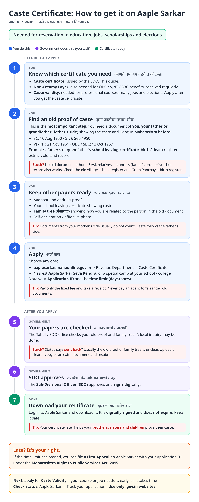
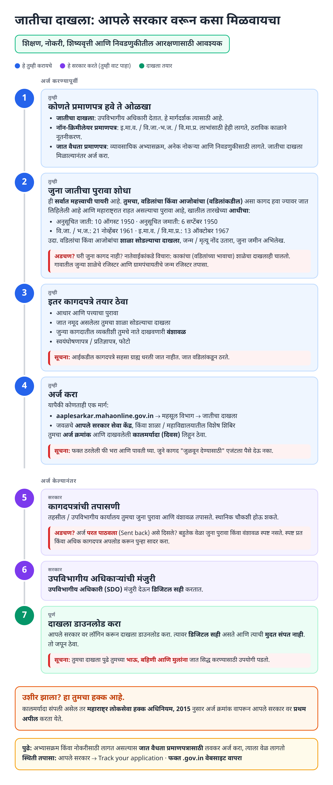
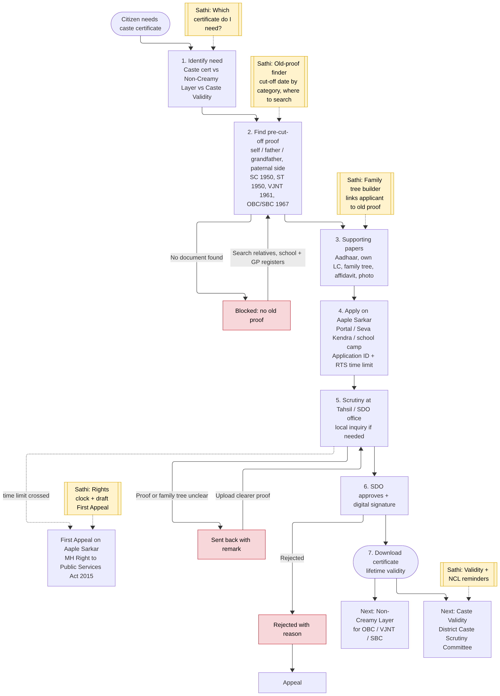
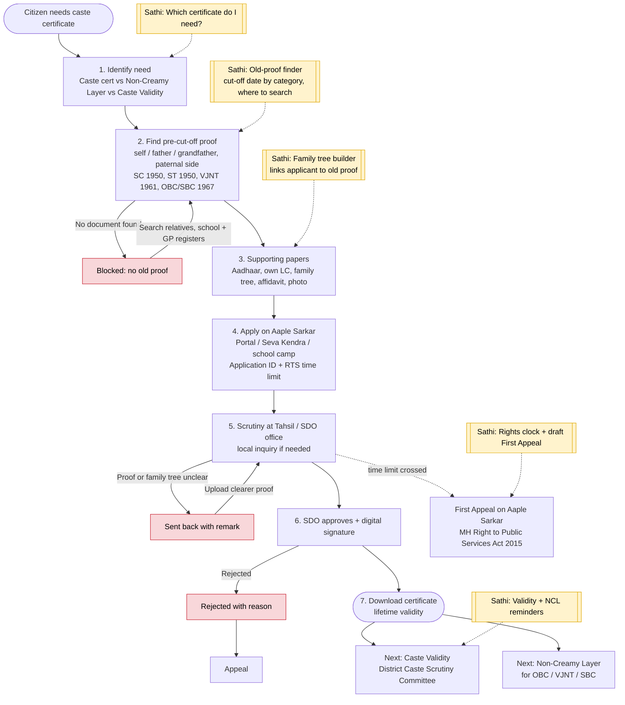

# Caste Certificate (Maharashtra) - End-to-End Workflow

Official site: https://aaplesarkar.mahaonline.gov.in (Revenue Department → Caste Certificate). Issued by the Sub-Divisional Officer (SDO).

## For citizens: step by step

Blue = you do this. Purple = government does this (you wait). Green = certificate ready. Red = what to do if stuck. Orange = your rights if it is late.

### English

### मराठी (Marathi)

Sources: [`caste-certificate-guide.html`](caste-certificate-guide.html), [`caste-certificate-guide-mr.html`](caste-certificate-guide-mr.html), generated from [`caste_certificate_content.py`](caste_certificate_content.py) with `python3 gen_guide.py caste_certificate_content.py`. Marathi text pending native-speaker review.

## Official links

Use only these addresses. Checked on 27 Oct 2026 through search results; the government sites could not be opened directly from our build environment. "Third-party sites only" means several non-government sites agree on the address but no government page confirmed it yet, so open it and check before you share it.

| What | Link | Checked via |
| :--- | :--- | :--- |
| Aaple Sarkar: apply and track | <https://aaplesarkar.mahaonline.gov.in> | Third-party sites only |
| BARTI: caste certificate verification | <https://www.barti.in/department/cast-certificate-verification> | Government page |
| Social Justice Dept: Acts, rules, GRs | <https://sjsa.maharashtra.gov.in/en/document-category/acts-rules/> | Government page |

## For the Sathi team: system workflow

Yellow boxes = where Sathi plugs in. Red boxes = common blockers.

Mermaid source (editable)

## Stages

| # | Stage | Owner | Common blocker | Sathi action |
|---|---|---|---|---|
| 1 | Identify need | Citizen | Confuses caste cert, NCL and caste validity | "Which certificate do I need?" |
| 2 | Old proof before cut-off date | Citizen | No pre-cut-off document in family | Old-proof finder: cut-off by category, where to search |
| 3 | Supporting papers | Citizen | Family tree doesn't link applicant to old proof | Family tree builder |
| 4 | Apply | Citizen / Seva Kendra / school camp | Agent "arranging" documents | Official fee, Application ID, time limit |
| 5 | Scrutiny + local inquiry | Tahsil / SDO office | Sent back: proof or family tree unclear | Decode remark in Marathi |
| 6 | Approval | SDO | Rejected | Explain reason, appeal route |
| 7 | Download | Citizen | Didn't plan for validity / NCL | Validity + NCL reminders; feeds [MahaDBT scholarship](mahadbt-scholarship.md) |
| - | Late beyond time limit | Citizen | Doesn't know about appeal | Auto-draft First Appeal |

**Why this matters for Sathi:** step 2 (finding pre-cut-off proof) is the hardest part for families and where agents charge the most. A guided "old-proof finder" plus family-tree builder is a strong, defensible feature and a candidate for narrow patent claims (linking applicant lineage to historical records).

## Verification (27 Oct 2026, batch 2)

- **Confirmed (Caste Certificate Rules, 2012, via secondary text):** "deemed date" cut-offs **SC 10 Aug 1950**, **VJ/NT 21 Nov 1961**, **OBC/SBC 13 Oct 1967**. Governing law: Maharashtra Caste Certificate Act, 2000 (Act 23 of 2001) and Rules, 2012.
- **Not confirmed:** **ST 6 Sep 1950** (date of the Constitution (Scheduled Tribes) Order; no search result stated it as the Maharashtra cut-off). Kept in guide; confirm against Rule text.
- **Changed in guide:** issuing officer now reads "SDO, or the competent officer in your taluka", since sources say Tehsildar / SDO.
- **Still unverified:** paternal-side rule wording, lifetime validity, RTS notification, Aaple Sarkar menu path.

Sources: [Indian Kanoon: Caste Certificate Act, 2000](https://indiankanoon.org/doc/95388956/) · [SJSA Maharashtra: Acts & Rules](https://sjsa.maharashtra.gov.in/en/document-category/acts-rules/) · [BARTI: Caste Certificate Verification](https://www.barti.in/department/cast-certificate-verification) · [mahadocguide: caste certificate documents](https://mahadocguide.in/documents-required-caste-certificate-maharashtra/)
