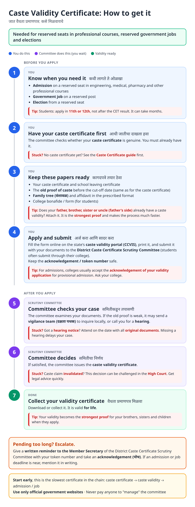
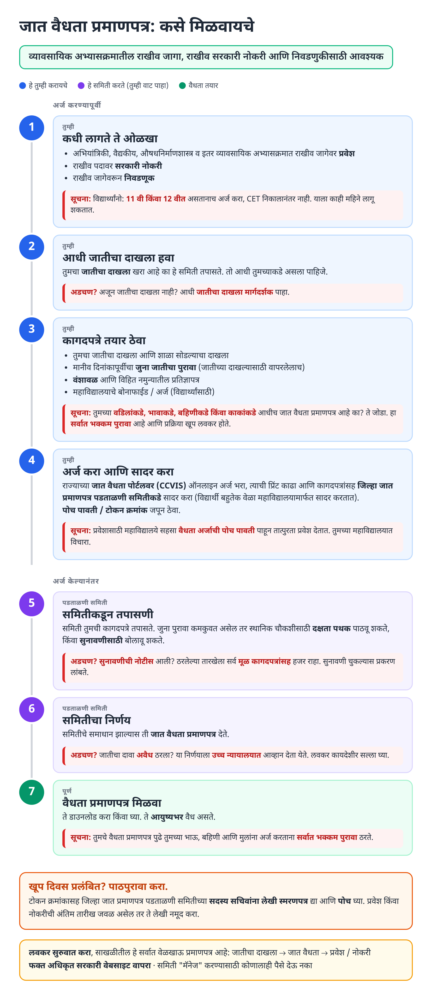
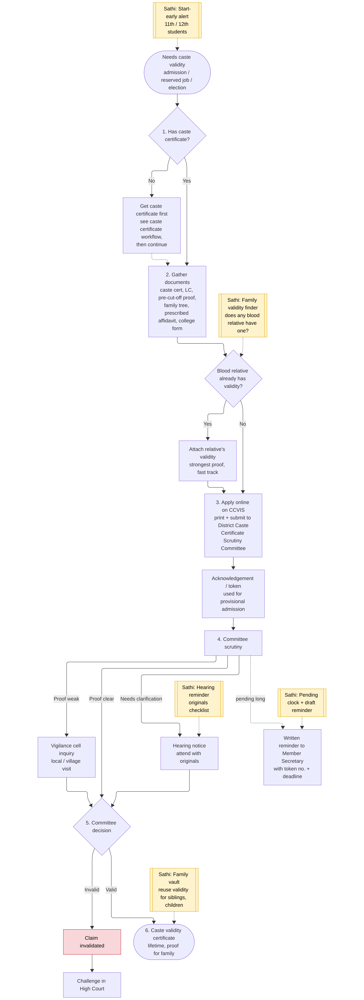
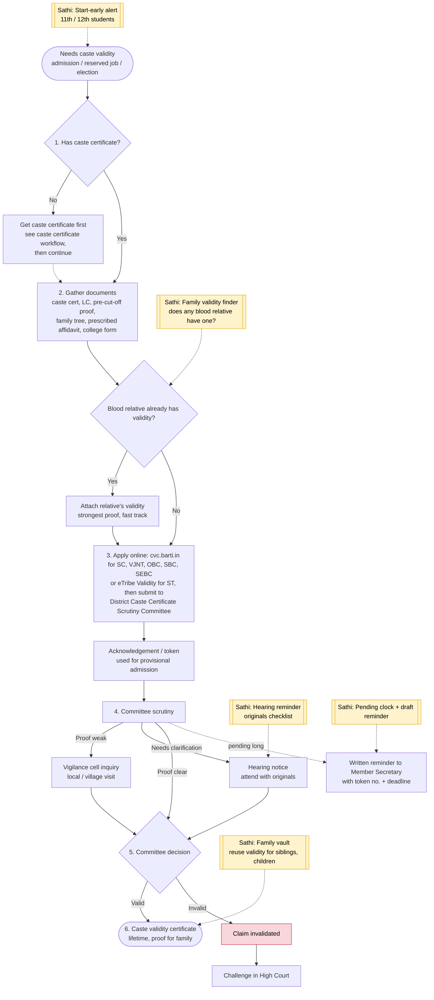

# Caste Validity Certificate (Maharashtra) - End-to-End Workflow

Issued by the **District Caste Certificate Scrutiny Committee** (जिल्हा जात प्रमाणपत्र पडताळणी समिती). Applied for online on BARTI's **cvc.barti.in** (SC, VJ/NT, OBC, SBC, SEBC; replaced CCVIS in Oct 2026) or the **eTribe Validity** portal (ST). Requires a [caste certificate](caste-certificate.md) first.

## For citizens: step by step

Blue = you do this. Purple = committee does this (you wait). Green = validity ready. Red = what to do if stuck. Orange = how to follow up.

### English

### मराठी (Marathi)

Sources: [`caste-validity-guide.html`](caste-validity-guide.html), [`caste-validity-guide-mr.html`](caste-validity-guide-mr.html), generated from [`caste_validity_content.py`](caste_validity_content.py) with `python3 gen_guide.py caste_validity_content.py`. Marathi text pending native-speaker review.

## Official links

Use only these addresses. Checked on 27 Oct 2026 through search results; the government sites could not be opened directly from our build environment. "Third-party sites only" means several non-government sites agree on the address but no government page confirmed it yet, so open it and check before you share it.

| What | Link | Checked via |
| :--- | :--- | :--- |
| CCVIS (BARTI): SC / OBC / VJNT / SBC validity | <https://ccvis.barti.in/home_menu.php> | Government page |
| e-Tribe Validity (TRTI): ST validity | <https://etribevalidity.trti-maha.in/> | Government page |
| BARTI: caste certificate verification | <https://www.barti.in/department/cast-certificate-verification> | Government page |

## For the Sathi team: system workflow

Yellow boxes = where Sathi plugs in. Red boxes = common blockers.

Mermaid source (editable)

## Stages

| # | Stage | Owner | Common blocker | Sathi action |
|---|---|---|---|---|
| 1 | Need + caste certificate | Student / candidate | Starts after CET result; no caste certificate | Start-early alert in 11th / 12th; link to [caste certificate guide](caste-certificate.md) |
| 2 | Documents | Citizen | Weak old proof; family tree gaps | Family validity finder (blood relative's validity = fast track) |
| 3 | Apply + submit | Citizen / college | Lost acknowledgement; misses provisional admission | Store token in family vault |
| 4 | Scrutiny, vigilance, hearing | Scrutiny Committee | Misses hearing; vigilance inquiry delays | Hearing reminder + originals checklist |
| 5 | Decision | Scrutiny Committee | Claim invalidated | Explain High Court route; recommend legal advice |
| 6 | Validity issued | Citizen | Family doesn't reuse it | Family vault: reuse for siblings and children |
| - | Pending too long | Citizen | No escalation path known | Pending clock + draft reminder to Member Secretary |

**Why this matters for Sathi:** caste validity is the slowest, highest-stakes certificate in the chain (caste → validity → admission / job), and a blood relative's validity is the single biggest accelerator. A family-level vault that knows "your cousin already has validity" turns a months-long process into a fast one. Combined with the caste certificate's old-proof finder, this is a strong candidate for narrow patent claims around lineage-linked document reuse.

## Verification (27 Oct 2026, batch 2)

- **Changed in guide (important):** BARTI has moved applications to a **new portal, cvc.barti.in** (announced on CCVIS, effective 13 Oct 2026) for SC, VJ/NT, OBC, SBC and SEBC. **ST** applicants use the separate **eTribe Validity** portal (TRTI). Guide and diagram updated.
- **Confirmed:** validity issued by **District Caste Certificate Scrutiny Committees** (36 districts; BARTI DG is chief coordinator); committee should decide within **3 months** (plus 2 in exceptional cases). Added to the escalation box.
- **Still unverified:** vigilance-cell process, hearing procedure, blood-relative validity rule, provisional-admission practice, High Court remedy wording, offline submission details.

Sources: [CCVIS (BARTI) home with new-portal notice](https://ccvis.barti.in/home_menu.php) · [CVC BARTI: About](https://cvc.barti.in/home/pages/about) · [e-Tribe Validity Portal (TRTI)](https://etribevalidity.trti-maha.in/) · [BARTI: Caste Certificate Verification](https://www.barti.in/department/cast-certificate-verification)
