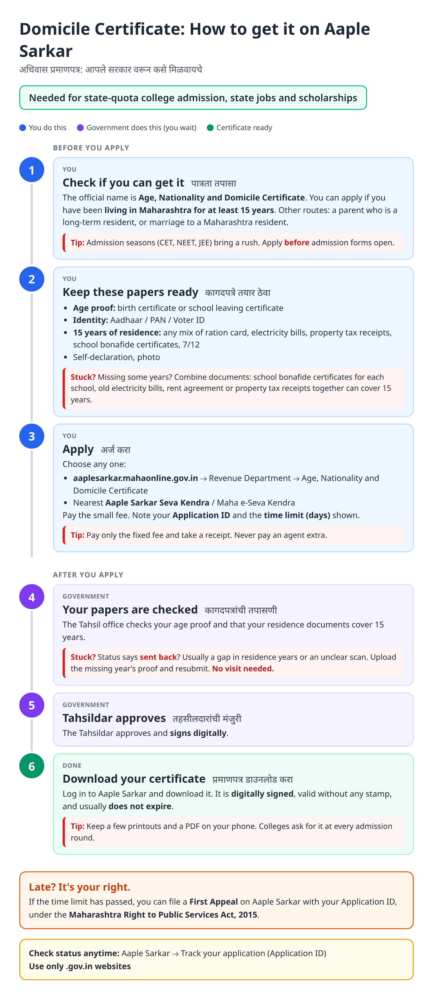
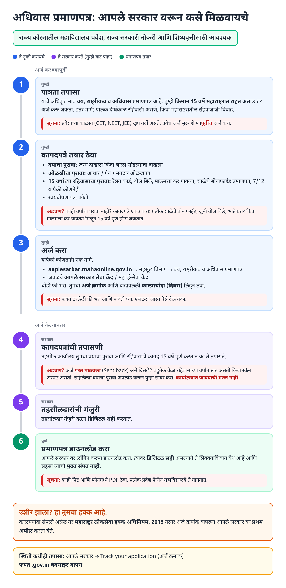
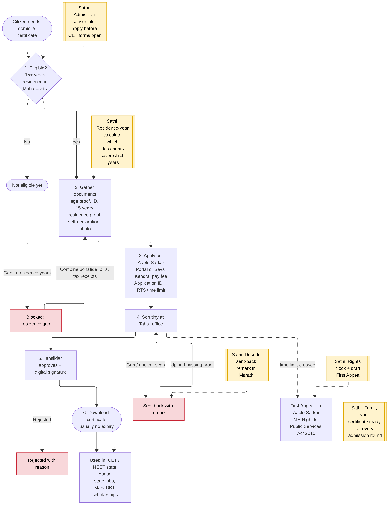
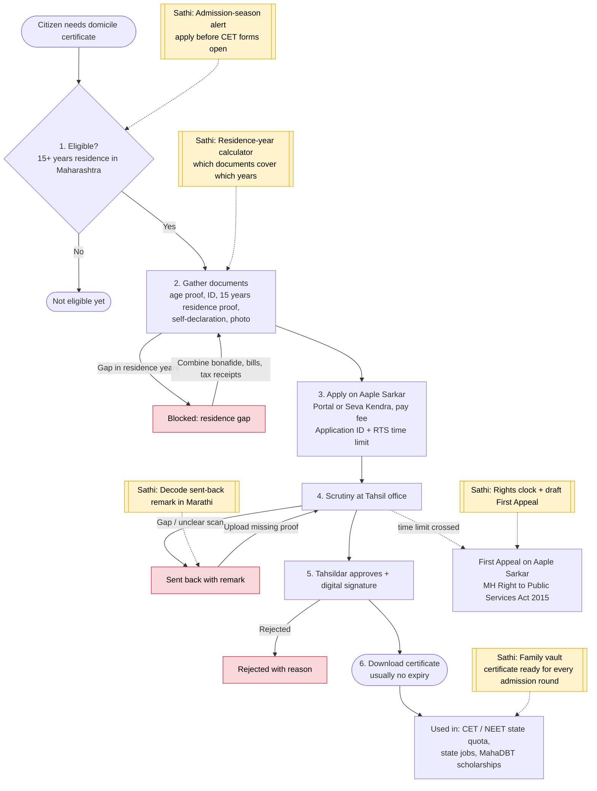

# Domicile Certificate (Maharashtra) - End-to-End Workflow

Official name: **Age, Nationality and Domicile Certificate** (वय, राष्ट्रीयत्व व अधिवास प्रमाणपत्र). Official site: https://aaplesarkar.mahaonline.gov.in (Revenue Department).

## For citizens: step by step

Blue = you do this. Purple = government does this (you wait). Green = certificate ready. Red = what to do if stuck. Orange = your rights if it is late.

### English

### मराठी (Marathi)

Sources: [`domicile-certificate-guide.html`](domicile-certificate-guide.html), [`domicile-certificate-guide-mr.html`](domicile-certificate-guide-mr.html), generated from [`domicile_certificate_content.py`](domicile_certificate_content.py) with `python3 gen_guide.py domicile_certificate_content.py`. Marathi text pending native-speaker review.

## For the Sathi team: system workflow

Yellow boxes = where Sathi plugs in. Red boxes = common blockers.

Mermaid source (editable)

## Stages

| # | Stage | Owner | Common blocker | Sathi action |
|---|---|---|---|---|
| 1 | Eligibility (15+ years residence) | Citizen | Applies during admission rush | Admission-season alert |
| 2 | Documents | Citizen | Gaps in residence years | Residence-year calculator: which documents cover which years |
| 3 | Apply | Citizen / Seva Kendra | Agent overcharging | Official fee, Application ID, time limit |
| 4 | Scrutiny | Tahsil office | Sent back: residence gap or unclear scan | Decode remark in Marathi |
| 5 | Approval | Tahsildar | Rejected | Explain reason |
| 6 | Download | Citizen | Lost / not handy at admission rounds | Family vault; feeds [MahaDBT scholarship](mahadbt-scholarship.md) |
| - | Late beyond time limit | Citizen | Doesn't know about appeal | Auto-draft First Appeal |

## Verification (27 Oct 2026, batch 3)

- **Corrected in guide (important):** residence requirement is **15 years**, not 10 (all sources that state a figure say 15). Alternative routes reported: a parent who is a long-term resident, or marriage to a Maharashtra resident. Guide, Marathi version, diagram and stage table updated.
- **Reported (secondary):** apply on Aaple Sarkar or at Tahsildar / SDO / Collector office; fee around ₹50; about 15 working days; validity lifetime unless cancelled.
- **Still unverified:** exact alternative-route rules, notified RTS time limit.

Sources: [ClearTax: Domicile certificate Maharashtra](https://cleartax.in/s/domicile-certificate-maharashtra) · [TaxBuddy: Domicile certificate Maharashtra](https://www.taxbuddy.com/blog/domicile-certificate-maharashtra) · [Corpseed: Domicile certificate Maharashtra](https://www.corpseed.com/knowledge-centre/domicile-certificate-maharashtra) · [Advocate Gandhi: Maharashtra domicile guide](https://advocategandhi.com/understanding-the-maharashtra-domicile-certificate-a-complete-legal-guide-for-residents-and-students/)
