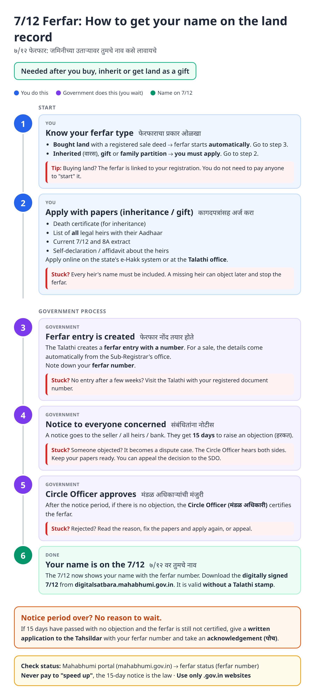
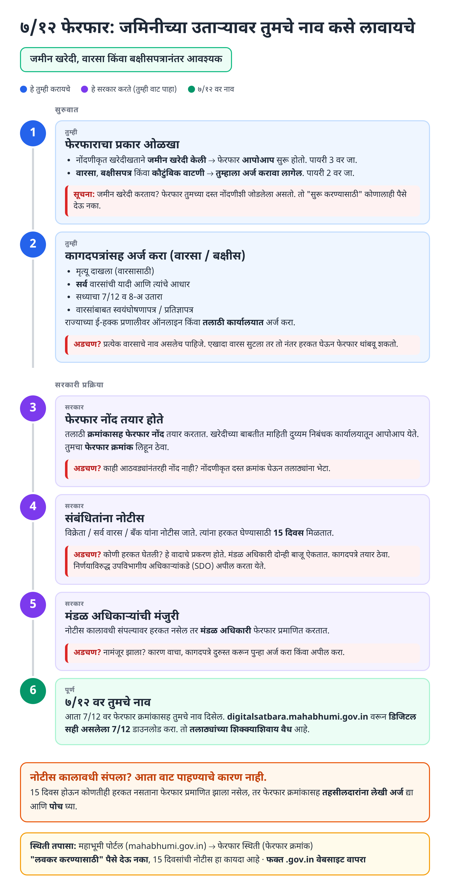
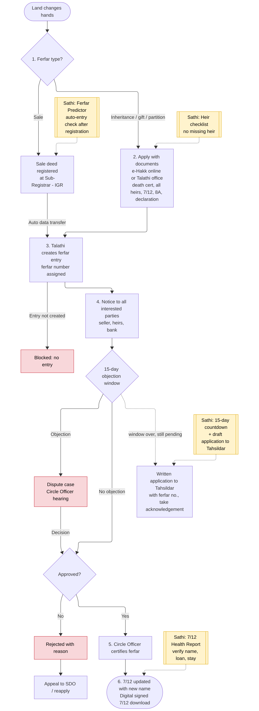
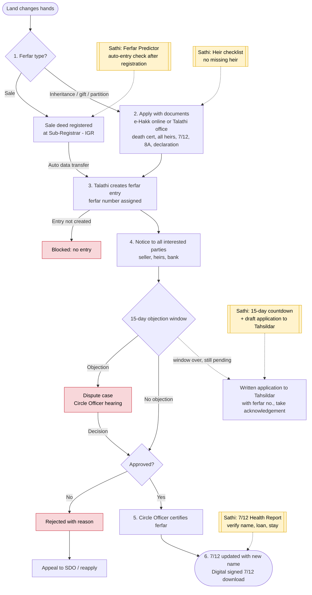

# 7/12 Ferfar (Mutation) - End-to-End Workflow

Covers both paths: **sale** (auto e-mutation after IGR registration) and **inheritance / gift / partition** (citizen applies).

## For citizens: step by step

Blue = you do this. Purple = government does this (you wait). Green = name on 7/12. Red = what to do if stuck. Orange = what to do if it is late.

### English

### मराठी (Marathi)

Sources: [`ferfar-guide.html`](ferfar-guide.html), [`ferfar-guide-mr.html`](ferfar-guide-mr.html), generated from [`ferfar_content.py`](ferfar_content.py) with `python3 gen_guide.py ferfar_content.py`. Marathi text pending native-speaker review.

## For the Sathi team: system workflow

Yellow boxes = where Sathi plugs in. Red boxes = common blockers.

Mermaid source (editable)

## Stages

| # | Stage | Owner | Common blocker | Sathi action |
|---|---|---|---|---|
| 1 | Identify ferfar type | Citizen | Pays agent to "start" an automatic sale ferfar | Explain auto path vs apply path |
| 2 | Apply (inheritance / gift / partition) | Citizen | Missing heir, incomplete papers | Heir checklist, document readiness |
| 3 | Ferfar entry created | Talathi (auto from IGR for sale) | Entry never created | Ferfar Predictor: check entry after registration |
| 4 | Notice + 15-day objection window | Talathi | Objection → dispute case | Countdown, explain hearing process |
| 5 | Certification | Circle Officer | Pending after window, or rejected | Draft written application to Tahsildar; appeal guidance (SDO) |
| 6 | 7/12 updated | System | Wrong name / old encumbrance still shown | 7/12 Health Report |

> Note: Working assumptions, not yet verified: the 15-day notice period, e-Hakk as the online channel for inheritance, Mahabhumi as the status-check portal, Circle Officer as certifying authority, appeal to SDO, and digitalsatbara.mahabhumi.gov.in for signed 7/12. Verify against the Maharashtra Land Revenue Code and live portals before building.
