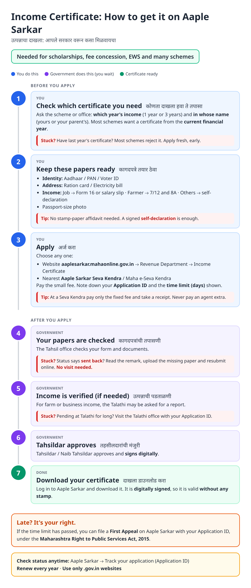
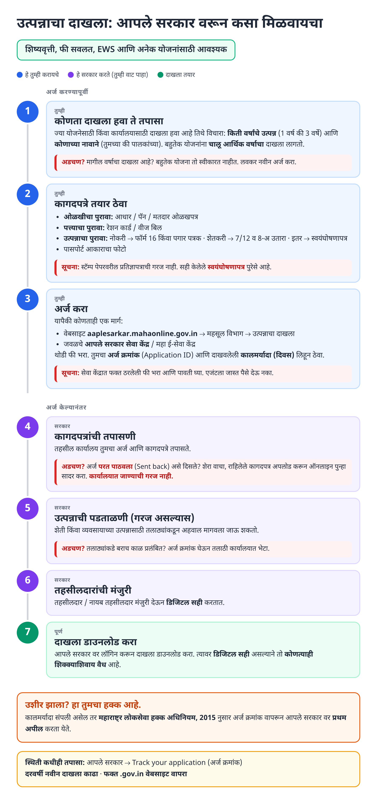
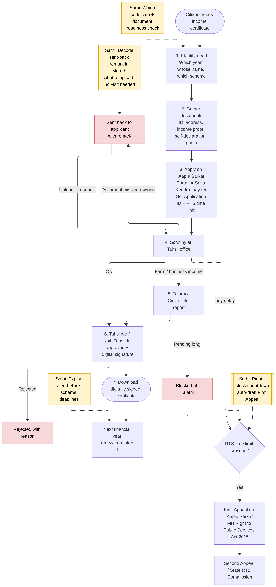
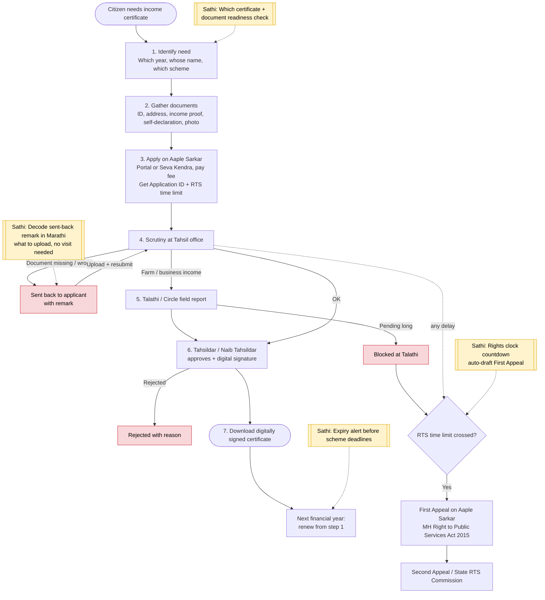

# Aaple Sarkar Income Certificate - End-to-End Workflow

Official site: https://aaplesarkar.mahaonline.gov.in (Revenue Department → Income Certificate).

## For citizens: step by step

Blue = you do this. Purple = government does this (you wait). Green = certificate ready. Red = what to do if stuck. Orange = your rights if it is late.

### English

Source to edit: [`income-certificate-guide.html`](income-certificate-guide.html)

### मराठी (Marathi)

Source to edit: [`income-certificate-guide-mr.html`](income-certificate-guide-mr.html). Both guides are generated by [`gen_income_guide.py`](gen_income_guide.py). Marathi text pending native-speaker review.

## For the Sathi team: system workflow

Yellow boxes = where Sathi plugs in. Red boxes = common blockers.

Mermaid source (editable)

## Stages

| # | Stage | Owner | Common blocker | Sathi action |
|---|---|---|---|---|
| 1 | Identify need | Citizen | Wrong year or wrong name (self vs parent) | Ask scheme → tell which certificate |
| 2 | Gather documents | Citizen | Missing income proof; paying for affidavit unnecessarily | Readiness checklist by occupation |
| 3 | Apply | Citizen / Seva Kendra | Agent overcharging | Show official fee, note Application ID + time limit |
| 4 | Scrutiny | Tahsil office | Sent back with English remark | Decode remark in Marathi, what to upload |
| 5 | Field report (if needed) | Talathi / Circle officer | Pending at Talathi | Rights clock |
| 6 | Approval + digital signature | Tahsildar / Naib Tahsildar | Rejected | Explain reason, fix and re-apply |
| 7 | Download | Citizen | Expires before next scheme deadline | Expiry alert |
| - | Late beyond time limit | Citizen | Doesn't know about appeal | Auto-draft First Appeal (MH Right to Public Services Act, 2015) |

> Note: Working assumptions, not yet verified against the live portal: the exact menu path, status wording ("Sent back"), "Track your application" label, fee amount, the notified time limit for this service, whether a Talathi report is needed, and that a self-declaration replaces an affidavit. Verify before building.
