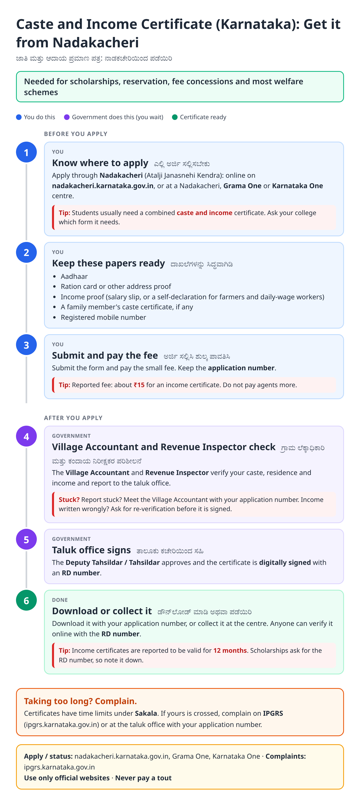
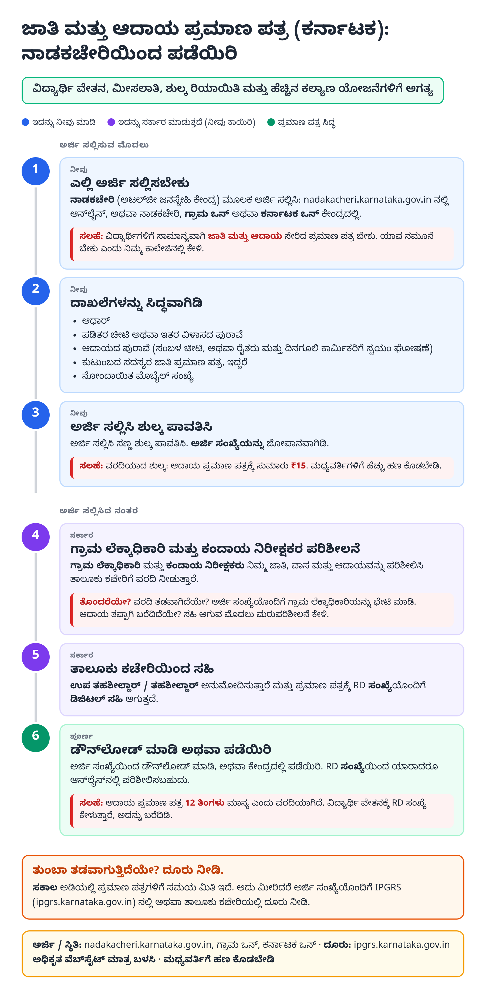
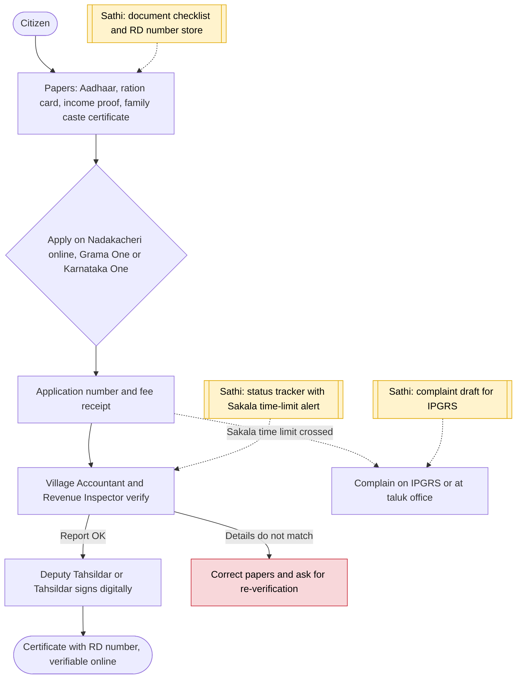

# Caste and income certificate (Karnataka) - End-to-End Workflow

ಜಾತಿ ಮತ್ತು ಆದಾಯ ಪ್ರಮಾಣ ಪತ್ರ · For: Students, job seekers, anyone applying to welfare schemes

## For citizens: step by step

Blue = you do this. Purple = government does this (you wait). Green = done. Red = what to do if stuck. Orange = your rights if it is late.

### English

### ಕನ್ನಡ (Kannada)

Sources: [`ka-caste-income-certificate-guide.html`](ka-caste-income-certificate-guide.html), [`ka-caste-income-certificate-guide-kn.html`](ka-caste-income-certificate-guide-kn.html), generated from [`ka_caste_income_certificate_content.py`](ka_caste_income_certificate_content.py) with `python3 ../gen_guide.py ka_caste_income_certificate_content.py`. Kannada text pending native-speaker review.

## Official links

Use only these addresses. Checked on 27 Oct 2026 through search results; the government sites could not be opened directly from our build environment. "Third-party sites only" means several non-government sites agree on the address but no government page confirmed it yet, so open it and check before you share it.

| What | Link | Checked via |
| :--- | :--- | :--- |
| Nadakacheri (AJSK): certificates | <https://nadakacheri.karnataka.gov.in> | Third-party sites only |
| Tumkur district: Nadakacheri services page | <https://tumkur.nic.in/?p=25892> | Government page |
| IPGRS: Karnataka grievance portal | <https://ipgrs.karnataka.gov.in> | Third-party sites only |

## For the Sathi team: system workflow

## Verification (27 Oct 2026)

- **Reported:** Nadakacheri / Atalji Janasnehi Kendra portal run by the Revenue Department; digitally signed certificates verifiable by RD number; income certificate fee ₹15 and validity 12 months (Tumkur district page).
- **Conflicting:** processing time (7 to 21 days by source); left as 'Sakala time limits'.
- **Still unverified:** exact signing officer per certificate type in the current Sakala list.

Sources: [Tumkur district: Nadakacheri](https://tumkur.nic.in/?p=25892) · [LegalDev: Nadakacheri Karnataka 2026](https://legaldev.in/blog/nadakacheri-karnataka-caste-income-certificate) · [Kanakkupillai: Nadakacheri income and caste certificate](https://kanakkupillai.com/learn/nadakacheri-income-caste-certificate-download-online-in-karnataka) · [Corpseed: Nadakacheri certificate](https://www.corpseed.com/knowledge-centre/nadakacheri-income-caste-certificate-karnataka)
