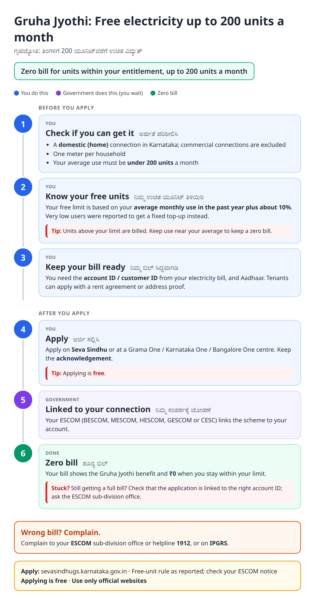
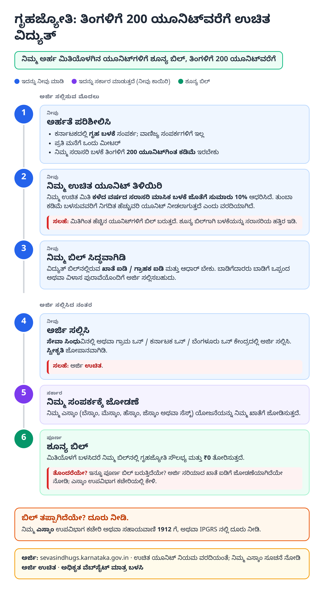
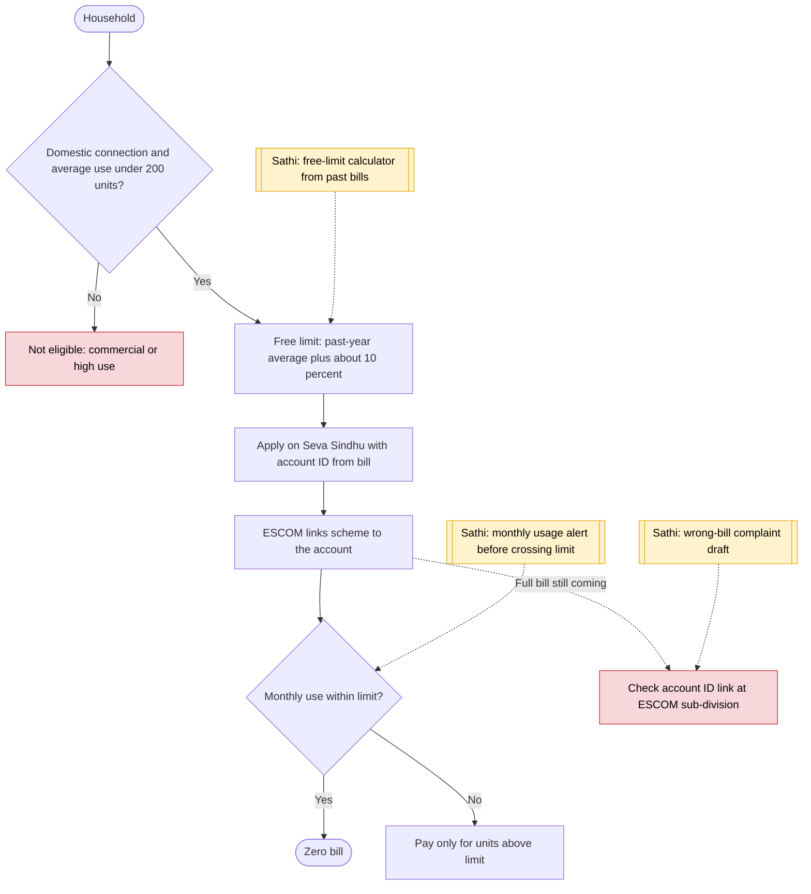

# Gruha Jyothi (free electricity) - End-to-End Workflow

ಗೃಹಜ್ಯೋತಿ · For: Households with a domestic electricity connection

## For citizens: step by step

Blue = you do this. Purple = government does this (you wait). Green = done. Red = what to do if stuck. Orange = your rights if it is late.

### English

### ಕನ್ನಡ (Kannada)

Sources: [`ka-gruha-jyothi-guide.html`](ka-gruha-jyothi-guide.html), [`ka-gruha-jyothi-guide-kn.html`](ka-gruha-jyothi-guide-kn.html), generated from [`ka_gruha_jyothi_content.py`](ka_gruha_jyothi_content.py) with `python3 ../gen_guide.py ka_gruha_jyothi_content.py`. Kannada text pending native-speaker review.

## Official links

Use only these addresses. Checked on 27 Oct 2026 through search results; the government sites could not be opened directly from our build environment. "Third-party sites only" means several non-government sites agree on the address but no government page confirmed it yet, so open it and check before you share it.

| What | Link | Checked via |
| :--- | :--- | :--- |
| Seva Sindhu guarantee schemes portal | <https://sevasindhugs.karnataka.gov.in> | Third-party sites only |
| Vikaspedia: Gruha Jyothi scheme | <https://en.vikaspedia.in/viewcontent/schemesall/state-specific-schemes/welfare-schemes-of-karnataka/gruha-jyothi-scheme-karnataka?lgn=en> | Government page |
| ESCOM electricity helpline: 1912 | - | Third-party sites only |
| IPGRS: Karnataka grievance portal | <https://ipgrs.karnataka.gov.in> | Third-party sites only |

## For the Sathi team: system workflow

## Verification (27 Oct 2026)

- **Reported:** up to 200 units free for domestic connections; limit is past-year average plus 10 percent; one meter per household; commercial excluded.
- **Conflicting:** a later change reportedly gives users under 90 units an extra 10 units instead of 10 percent. The guide mentions a 'fixed top-up' for very low users.
- **Single-source, left out:** 2026 voter-list linkage for guarantee schemes.

Sources: [Vikaspedia: Gruha Jyothi](https://en.vikaspedia.in/viewcontent/schemesall/state-specific-schemes/welfare-schemes-of-karnataka/gruha-jyothi-scheme-karnataka?lgn=en) · [ClearTax: Gruha Jyoti scheme](https://cleartax.in/s/gruha-jyoti-scheme-karnataka) · [Housing.com: Gruha Jyothi scheme](https://housing.com/news/all-about-karnatakas-gruha-jyothi-scheme/) · [BankBazaar: Gruha Jyothi 2026](https://bankbazaar.com/electricity-bill/karnataka-gruha-jyothi-scheme.html)
