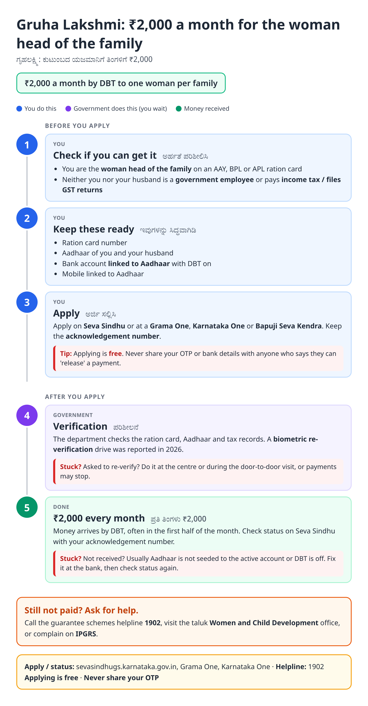
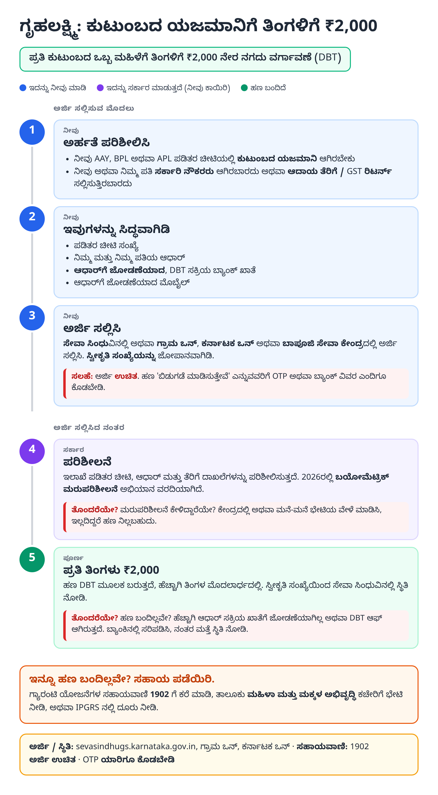
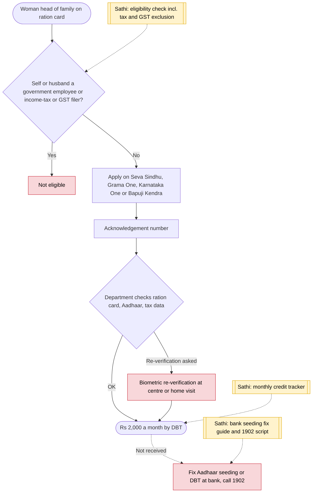

# Gruha Lakshmi - End-to-End Workflow

ಗೃಹಲಕ್ಷ್ಮಿ · For: Woman head of the family on the ration card

## For citizens: step by step

Blue = you do this. Purple = government does this (you wait). Green = done. Red = what to do if stuck. Orange = your rights if it is late.

### English

### ಕನ್ನಡ (Kannada)

Sources: [`ka-gruha-lakshmi-guide.html`](ka-gruha-lakshmi-guide.html), [`ka-gruha-lakshmi-guide-kn.html`](ka-gruha-lakshmi-guide-kn.html), generated from [`ka_gruha_lakshmi_content.py`](ka_gruha_lakshmi_content.py) with `python3 ../gen_guide.py ka_gruha_lakshmi_content.py`. Kannada text pending native-speaker review.

## Official links

Use only these addresses. Checked on 27 Oct 2026 through search results; the government sites could not be opened directly from our build environment. "Third-party sites only" means several non-government sites agree on the address but no government page confirmed it yet, so open it and check before you share it.

| What | Link | Checked via |
| :--- | :--- | :--- |
| Seva Sindhu guarantee schemes portal | <https://sevasindhugs.karnataka.gov.in> | Third-party sites only |
| Vikaspedia: Gruha Lakshmi scheme | <https://en.vikaspedia.in/viewcontent/schemesall/state-specific-schemes/welfare-schemes-of-karnataka/gruha-lakshmi-scheme-karnataka?lgn=en> | Government page |
| Guarantee schemes helpline: 1902 | - | Third-party sites only |
| IPGRS: Karnataka grievance portal | <https://ipgrs.karnataka.gov.in> | Third-party sites only |

## For the Sathi team: system workflow

## Verification (27 Oct 2026)

- **Reported:** ₹2,000 a month by DBT to the woman head of family on AAY / BPL / APL cards; excludes government employees and income-tax or GST filers (self or husband); helpline 1902.
- **Reported 2026:** biometric re-verification drive with door-to-door visits.
- **Single-source, left out:** SMS-based status number.

Sources: [Vikaspedia: Gruha Lakshmi scheme](https://en.vikaspedia.in/viewcontent/schemesall/state-specific-schemes/welfare-schemes-of-karnataka/gruha-lakshmi-scheme-karnataka?lgn=en) · [schemesinindia: Gruha Lakshmi 2026 guide](https://schemesinindia.in/blog/gruha-lakshmi-karnataka-2026-guide) · [Policybazaar: Gruha Lakshmi](https://www.policybazaar.com/investment-plans/government-schemes/gruhalakshmi-scheme/) · [Gracker: Gruhalakshmi 2026 status guide](https://gracker.ai/news/gruhalakshmi-scheme-2026-online-application-and-status-guide)
