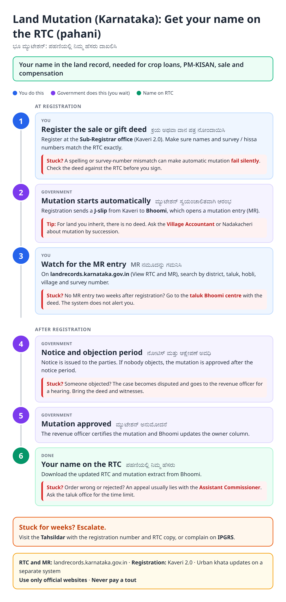
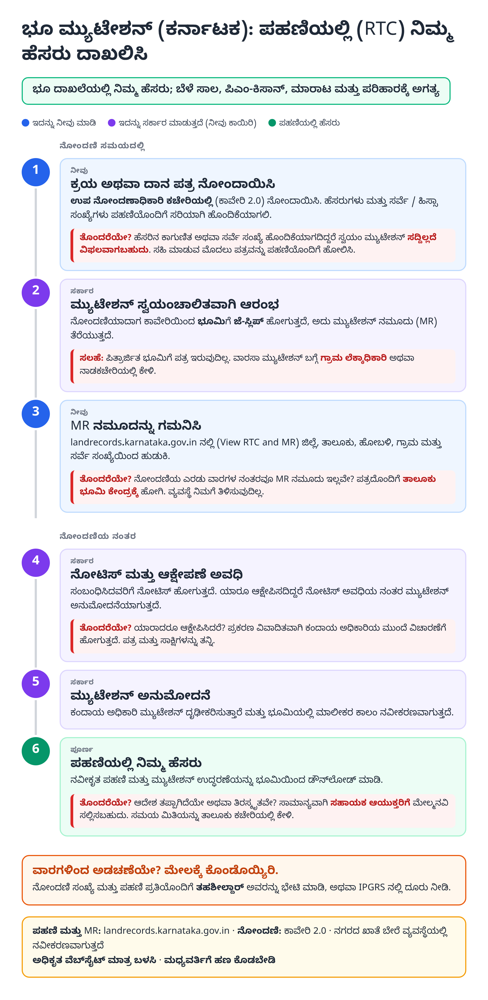
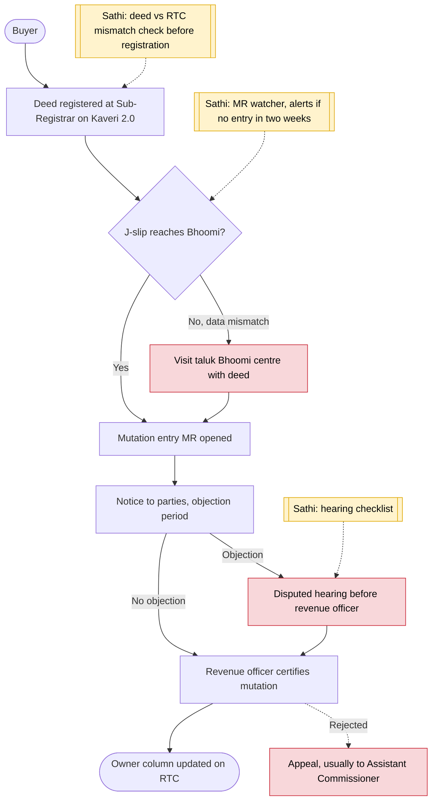

# Land mutation and RTC update (Karnataka) - End-to-End Workflow

ಪಹಣಿ ಖಾತೆ ಬದಲಾವಣೆ (ಮ್ಯುಟೇಶನ್) · For: Land buyers, gift receivers, heirs

## For citizens: step by step

Blue = you do this. Purple = government does this (you wait). Green = done. Red = what to do if stuck. Orange = your rights if it is late.

### English

### ಕನ್ನಡ (Kannada)

Sources: [`ka-land-mutation-guide.html`](ka-land-mutation-guide.html), [`ka-land-mutation-guide-kn.html`](ka-land-mutation-guide-kn.html), generated from [`ka_land_mutation_content.py`](ka_land_mutation_content.py) with `python3 ../gen_guide.py ka_land_mutation_content.py`. Kannada text pending native-speaker review.

## Official links

Use only these addresses. Checked on 27 Oct 2026 through search results; the government sites could not be opened directly from our build environment. "Third-party sites only" means several non-government sites agree on the address but no government page confirmed it yet, so open it and check before you share it.

| What | Link | Checked via |
| :--- | :--- | :--- |
| Bhoomi: View RTC and MR | <https://landrecords.karnataka.gov.in> | Third-party sites only |
| Kaveri 2.0: property registration | <https://kaveri.karnataka.gov.in> | Third-party sites only |
| IPGRS: Karnataka grievance portal | <https://ipgrs.karnataka.gov.in> | Third-party sites only |

## For the Sathi team: system workflow

## Verification (27 Oct 2026)

- **Reported:** registration on Kaveri 2.0 sends a J-slip to Bhoomi to start mutation; failures from name or survey mismatches are not notified; Karnataka reports most transfers now auto-processed.
- **Conflicting, left out:** exact auto-approval day (8th or 16th day reported) and objection window length.
- **Still unverified:** appeal authority and time limit; the guide says 'usually the Assistant Commissioner' and to ask the taluk office.

Sources: [KS&K: Karnataka automatic e-mutation](https://ksandk.com/newsletter/karnatakas-automatic-e-mutation-changes/) · [Adda247: automatic property mutation system](https://currentaffairs.adda247.com/karnataka-introduces-automatic-property-mutation-system-to-speed-up-land-transactions/) · [1acre: Bhoomi mutation](https://1acre.in/guides/karnataka/bhoomi-mutation) · [The Realty Today: 98 percent of khata transfers automated](https://therealtytoday.com/news/news/karnataka-automates-98-of-khata-transfers-over-35-lakh-property-mutations-already-processed/) · [Bajaj Finserv: Bhoomi RTC mutation status](https://www.bajajfinserv.in/bhoomi-rtc-mutation-status)
