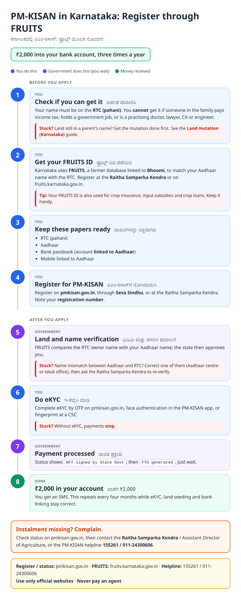
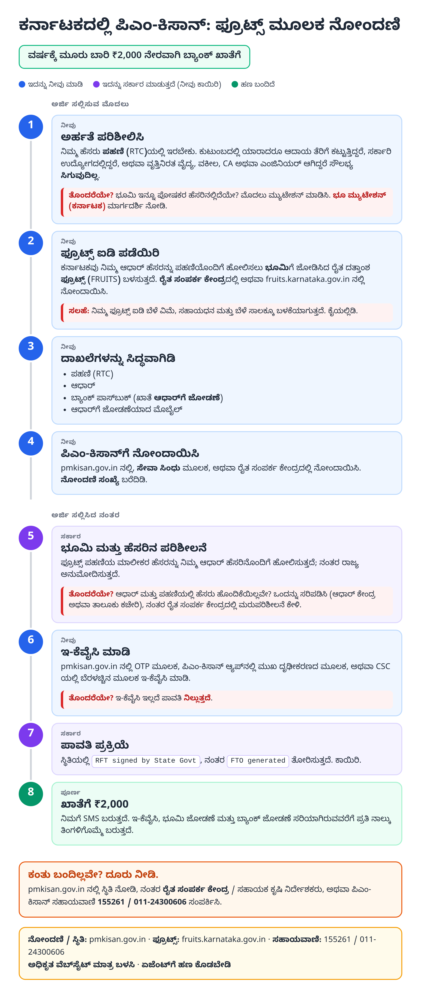
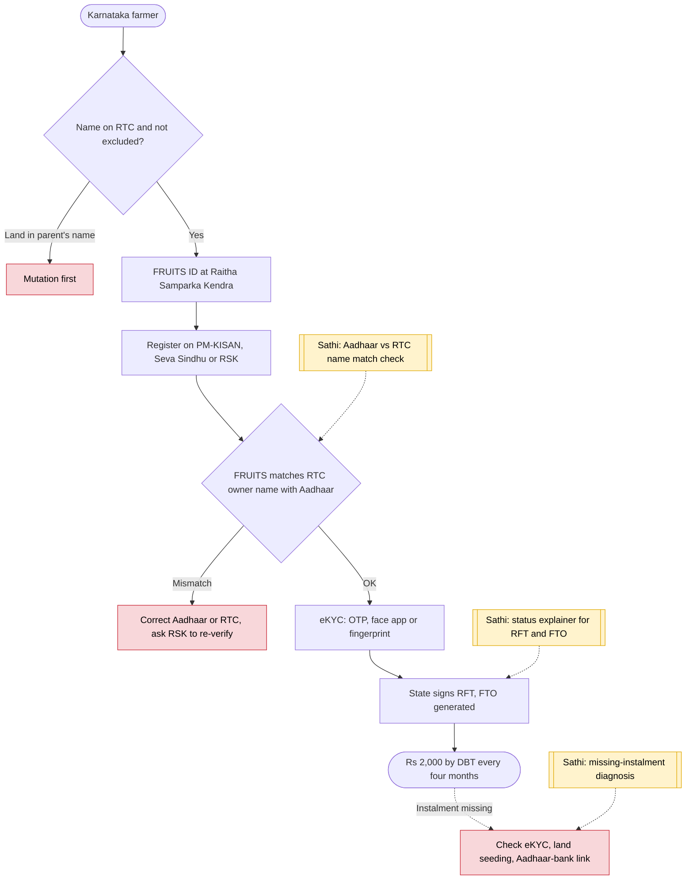

# PM-KISAN (Karnataka, FRUITS) - End-to-End Workflow

ಪಿಎಂ-ಕಿಸಾನ್ (ಕರ್ನಾಟಕ) · For: Landholding farmers in Karnataka

## For citizens: step by step

Blue = you do this. Purple = government does this (you wait). Green = done. Red = what to do if stuck. Orange = your rights if it is late.

### English

### ಕನ್ನಡ (Kannada)

Sources: [`ka-pm-kisan-guide.html`](ka-pm-kisan-guide.html), [`ka-pm-kisan-guide-kn.html`](ka-pm-kisan-guide-kn.html), generated from [`ka_pm_kisan_content.py`](ka_pm_kisan_content.py) with `python3 ../gen_guide.py ka_pm_kisan_content.py`. Kannada text pending native-speaker review.

## Official links

Use only these addresses. Checked on 27 Oct 2026 through search results; the government sites could not be opened directly from our build environment. "Third-party sites only" means several non-government sites agree on the address but no government page confirmed it yet, so open it and check before you share it.

| What | Link | Checked via |
| :--- | :--- | :--- |
| PM-KISAN: register, eKYC, Know Your Status | <https://pmkisan.gov.in> | Government page |
| FRUITS: Karnataka farmer registry | <https://fruits.karnataka.gov.in> | Third-party sites only |
| NeGD: FRUITS state directory entry | <https://negd.gov.in/isl/Directory/statedata/408> | Government page |
| PM-KISAN helpline: 155261 / 011-24300606 | - | Government page |

## For the Sathi team: system workflow

## Verification (27 Oct 2026)

- **Confirmed (government pages):** FRUITS built by DPAR (e-Governance) with NIC; integrated with Bhoomi to validate land and compare owner name with Aadhaar name; PM-KISAN runs with FRUITS in the background.
- **Left out:** the additional state ₹4,000 a year paid in earlier years; whether it continues was not confirmed.
- **Still unverified:** current FRUITS self-registration steps.

Sources: [NeGD: FRUITS](https://negd.gov.in/isl/Directory/statedata/408) · [AgroSpectrum: Karnataka unifies farmers' land data in FRUITS](https://agrospectrumindia.com/news/8/24708/karnataka-unifies-farmers-land-data-in-unique-fruits-portal.html) · [pmkisan.gov.in](https://pmkisan.gov.in/)
