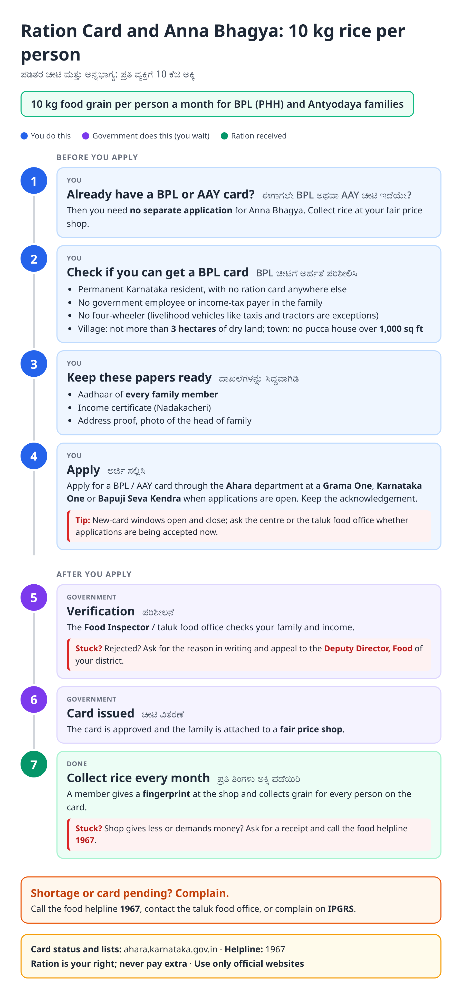
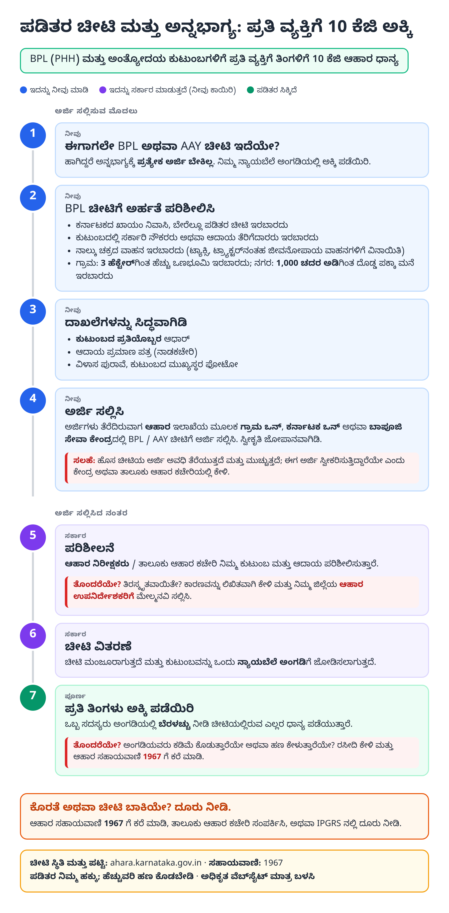
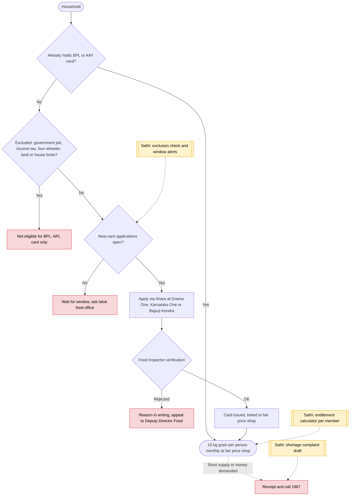

# Ration card and Anna Bhagya (Karnataka) - End-to-End Workflow

ಪಡಿತರ ಚೀಟಿ ಮತ್ತು ಅನ್ನಭಾಗ್ಯ · For: Low-income households

## For citizens: step by step

Blue = you do this. Purple = government does this (you wait). Green = done. Red = what to do if stuck. Orange = your rights if it is late.

### English

### ಕನ್ನಡ (Kannada)

Sources: [`ka-ration-card-guide.html`](ka-ration-card-guide.html), [`ka-ration-card-guide-kn.html`](ka-ration-card-guide-kn.html), generated from [`ka_ration_card_content.py`](ka_ration_card_content.py) with `python3 ../gen_guide.py ka_ration_card_content.py`. Kannada text pending native-speaker review.

## Official links

Use only these addresses. Checked on 27 Oct 2026 through search results; the government sites could not be opened directly from our build environment. "Third-party sites only" means several non-government sites agree on the address but no government page confirmed it yet, so open it and check before you share it.

| What | Link | Checked via |
| :--- | :--- | :--- |
| Ahara (Food and Civil Supplies): card status and lists | <https://ahara.karnataka.gov.in> | Government page |
| Chikkaballapur district: schemes page | <https://chikkaballapur.nic.in/schemes/> | Government page |
| Food helpline: 1967 | - | Third-party sites only |
| IPGRS: Karnataka grievance portal | <https://ipgrs.karnataka.gov.in> | Third-party sites only |

## For the Sathi team: system workflow

## Verification (27 Oct 2026)

- **Reported:** Anna Bhagya gives 10 kg per person per month to BPL / AAY cardholders with no separate registration; BPL exclusions (government job, income tax, four-wheeler, 3 ha dry land, 1,000 sq ft pucca house); helpline 1967; ahara.kar.nic.in now redirects to ahara.karnataka.gov.in (listed on a district site).
- **Conflicting:** whether new BPL applications can be made directly online; one guide says the direct online option was removed. The guide points to service centres when the window is open.
- **Left out:** card fees and issue time (unverified).

Sources: [Chikkaballapur district: schemes](https://chikkaballapur.nic.in/schemes/) · [schemesinindia: Anna Bhagya 2026](https://schemesinindia.in/blog/anna-bhagya-yojana-karnataka-10kg-free-rice-2026) · [ClearTax: Anna Bhagya scheme](https://cleartax.in/s/anna-bhagya-scheme) · [sarkariyojana.com: Ahara ration card](https://sarkariyojana.com/ahara-kar-nic-in-ration-card/)
