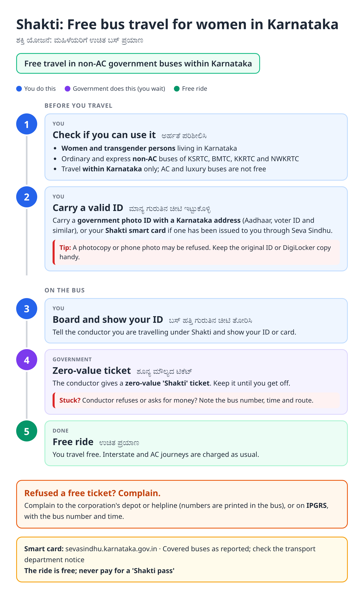
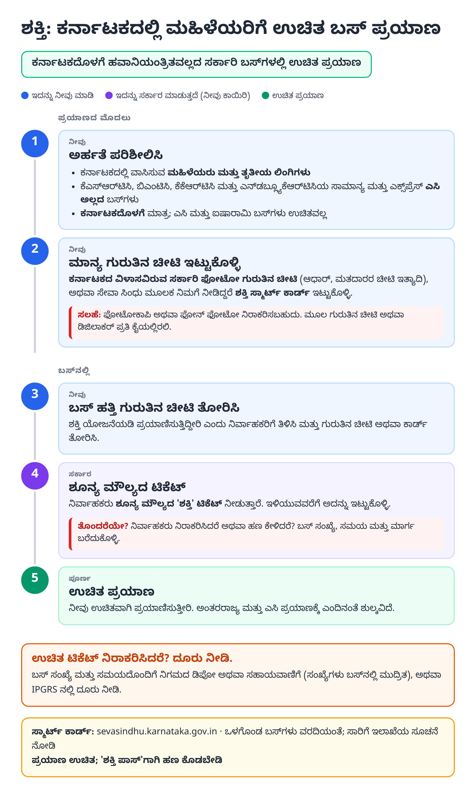
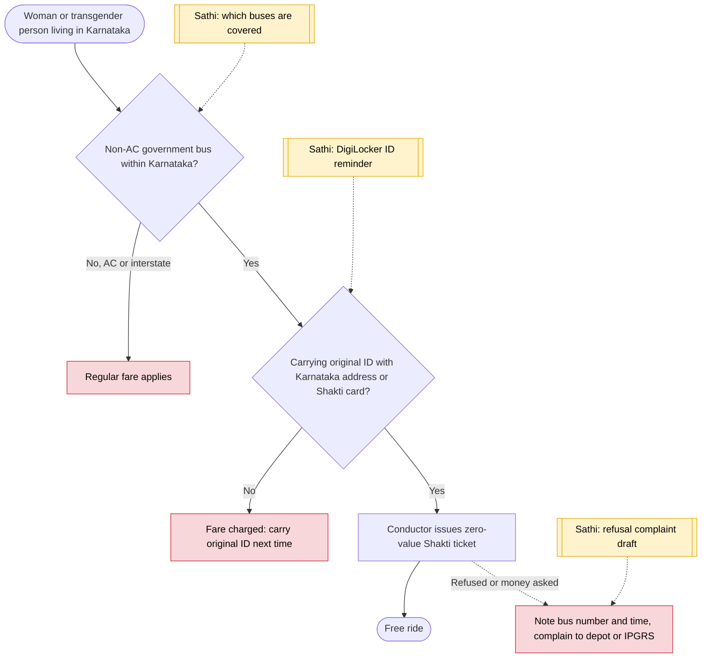

# Shakti (free bus travel for women) - End-to-End Workflow

ಶಕ್ತಿ ಯೋಜನೆ · For: Women and transgender persons living in Karnataka

## For citizens: step by step

Blue = you do this. Purple = government does this (you wait). Green = done. Red = what to do if stuck. Orange = your rights if it is late.

### English

### ಕನ್ನಡ (Kannada)

Sources: [`ka-shakti-guide.html`](ka-shakti-guide.html), [`ka-shakti-guide-kn.html`](ka-shakti-guide-kn.html), generated from [`ka_shakti_content.py`](ka_shakti_content.py) with `python3 ../gen_guide.py ka_shakti_content.py`. Kannada text pending native-speaker review.

## Official links

Use only these addresses. Checked on 27 Oct 2026 through search results; the government sites could not be opened directly from our build environment. "Third-party sites only" means several non-government sites agree on the address but no government page confirmed it yet, so open it and check before you share it.

| What | Link | Checked via |
| :--- | :--- | :--- |
| Seva Sindhu: apply and track | <https://sevasindhu.karnataka.gov.in> | Third-party sites only |
| IPGRS: Karnataka grievance portal | <https://ipgrs.karnataka.gov.in> | Third-party sites only |

## For the Sathi team: system workflow

## Verification (27 Oct 2026)

- **Reported (launch, June 2023):** free travel for women and transgender persons resident in Karnataka on non-AC, non-luxury government buses within the state; zero-value ticket on showing government photo ID with a Karnataka address; Shakti smart cards via Seva Sindhu.
- **Still unverified:** whether smart cards are now mandatory; the guide says to carry original ID or the card if issued.
- **Left out:** 2026 changes (none found).

Sources: [The News Minute: Shakti scheme launched](https://www.thenewsminute.com/karnataka/karnataka-govt-launches-shakti-scheme-free-bus-rides-women-178354) · [Citizen Matters: how to access the five guarantees](https://citizenmatters.in/heres-how-you-can-access-the-five-guarantees-promised-by-the-new-karnataka-government-119111) · [Deccan Herald: smart card may be waived](https://www.deccanherald.com/india/karnataka/govt-may-waive-smartcard-for-free-bus-travel-scheme-1225799.html)
