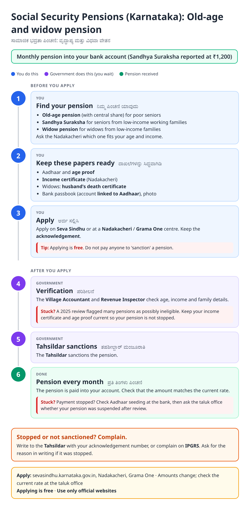
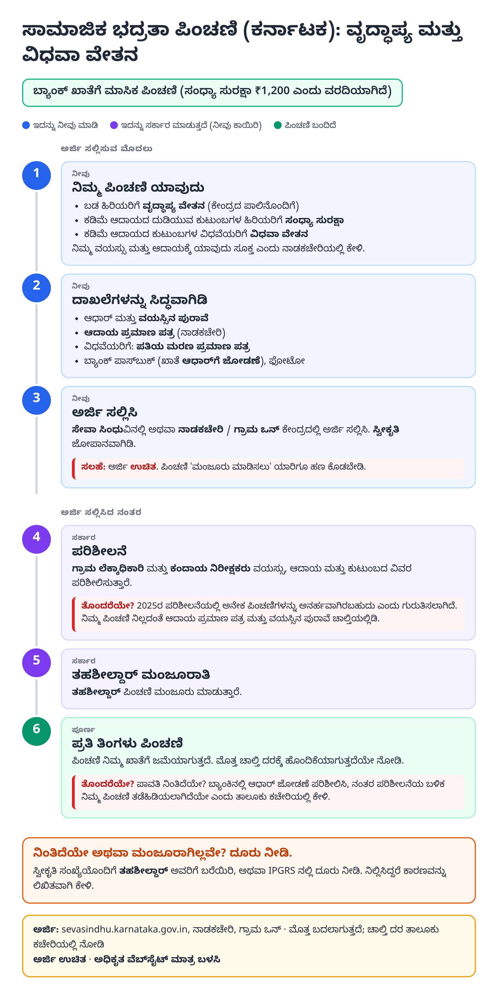
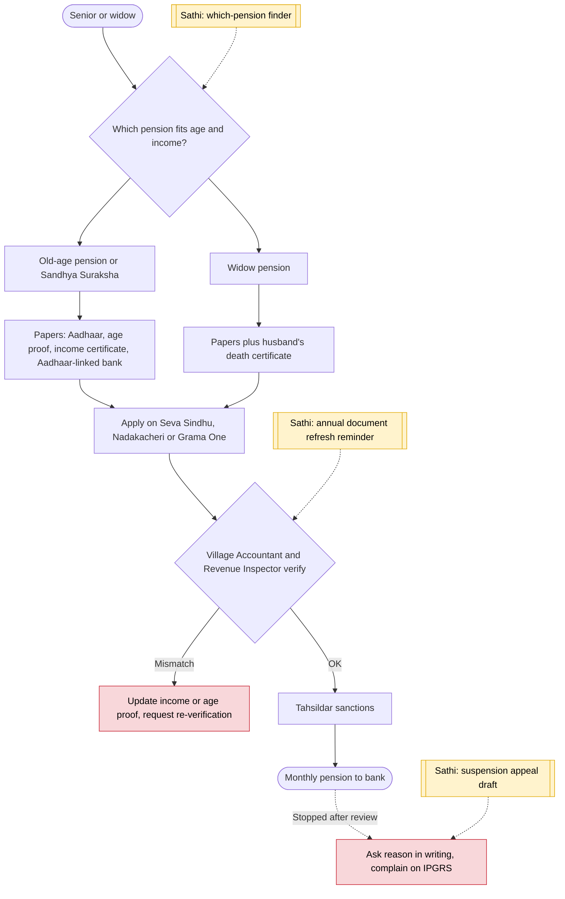

# Old-age and widow pensions (Karnataka) - End-to-End Workflow

ವೃದ್ಧಾಪ್ಯ ಮತ್ತು ವಿಧವಾ ವೇತನ · For: Seniors and widows from low-income families

## For citizens: step by step

Blue = you do this. Purple = government does this (you wait). Green = done. Red = what to do if stuck. Orange = your rights if it is late.

### English

### ಕನ್ನಡ (Kannada)

Sources: [`ka-social-pensions-guide.html`](ka-social-pensions-guide.html), [`ka-social-pensions-guide-kn.html`](ka-social-pensions-guide-kn.html), generated from [`ka_social_pensions_content.py`](ka_social_pensions_content.py) with `python3 ../gen_guide.py ka_social_pensions_content.py`. Kannada text pending native-speaker review.

## Official links

Use only these addresses. Checked on 27 Oct 2026 through search results; the government sites could not be opened directly from our build environment. "Third-party sites only" means several non-government sites agree on the address but no government page confirmed it yet, so open it and check before you share it.

| What | Link | Checked via |
| :--- | :--- | :--- |
| Seva Sindhu: apply and track | <https://sevasindhu.karnataka.gov.in> | Third-party sites only |
| Nadakacheri (AJSK): certificates | <https://nadakacheri.karnataka.gov.in> | Third-party sites only |
| IPGRS: Karnataka grievance portal | <https://ipgrs.karnataka.gov.in> | Third-party sites only |

## For the Sathi team: system workflow

## Verification (27 Oct 2026)

- **Reported:** Sandhya Suraksha raised from ₹1,000 to ₹1,200 a month (GRAAM, citing the state decision); applications via Seva Sindhu, Grama One or Nadakacheri; 2025 revenue department review flagged 23.19 lakh pensioners as possibly ineligible.
- **Not found:** widow pension amount and exact age / income limits for each pension; the guide asks readers to confirm at the Nadakacheri.
- **Still unverified:** sanctioning officer under the current rules (Tahsildar, as commonly described).

Sources: [GRAAM: social security pension amount raised](https://graam.org.in/graams-policy-engagement-brings-advancement-in-social-security-pension-amount/) · [Deccan Herald: 23.19 lakh pensioners flagged](https://www.deccanherald.com/india/karnataka/revenue-dept-identifies-23-19l-ineligible-pensioners-3588887) · [citizennest: Sandhya Suraksha (Kannada)](https://www.citizennest.com/kn/guide/karnataka-sandhya-suraksha-old-age-pension)
