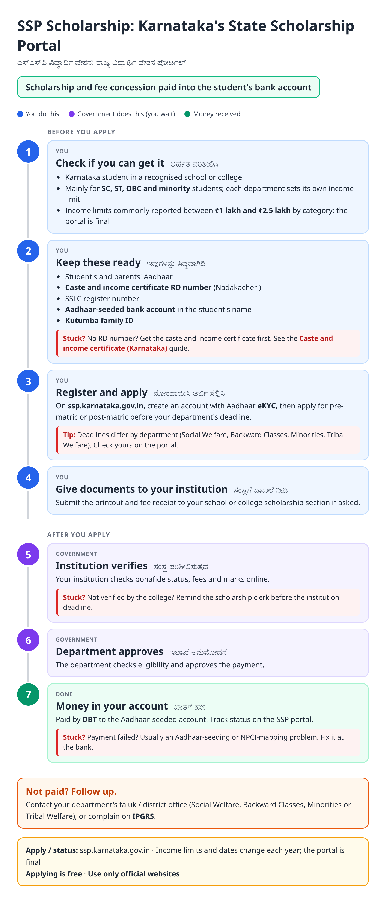
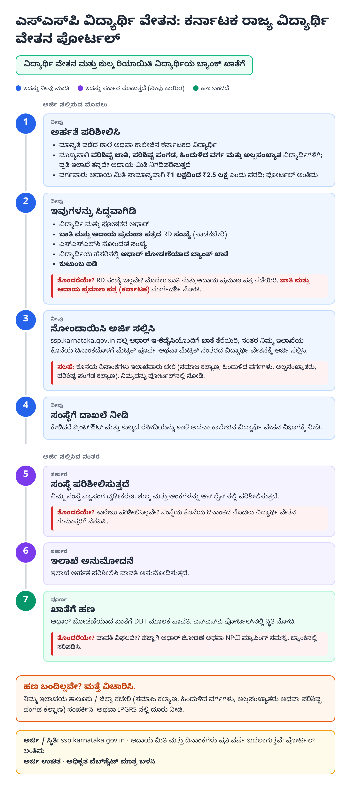
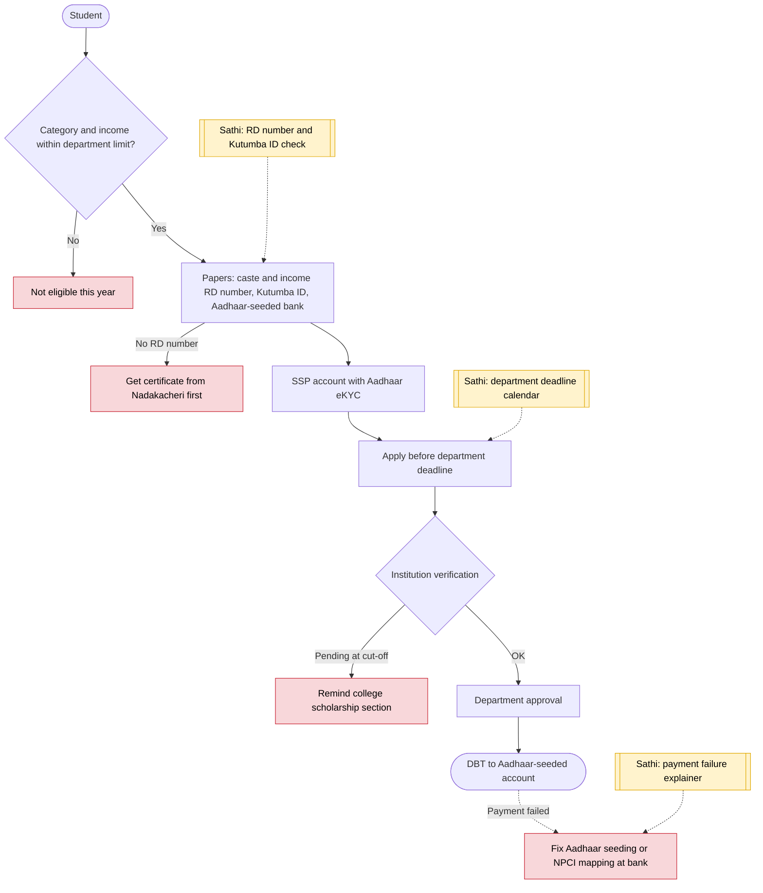

# SSP scholarship (Karnataka) - End-to-End Workflow

ಎಸ್‌ಎಸ್‌ಪಿ ವಿದ್ಯಾರ್ಥಿ ವೇತನ · For: Pre-matric and post-matric students

## For citizens: step by step

Blue = you do this. Purple = government does this (you wait). Green = done. Red = what to do if stuck. Orange = your rights if it is late.

### English

### ಕನ್ನಡ (Kannada)

Sources: [`ka-ssp-scholarship-guide.html`](ka-ssp-scholarship-guide.html), [`ka-ssp-scholarship-guide-kn.html`](ka-ssp-scholarship-guide-kn.html), generated from [`ka_ssp_scholarship_content.py`](ka_ssp_scholarship_content.py) with `python3 ../gen_guide.py ka_ssp_scholarship_content.py`. Kannada text pending native-speaker review.

## Official links

Use only these addresses. Checked on 27 Oct 2026 through search results; the government sites could not be opened directly from our build environment. "Third-party sites only" means several non-government sites agree on the address but no government page confirmed it yet, so open it and check before you share it.

| What | Link | Checked via |
| :--- | :--- | :--- |
| SSP Karnataka: register, apply, status | <https://ssp.karnataka.gov.in> | Third-party sites only |
| SSP post-matric portal | <https://ssp.postmatric.karnataka.gov.in> | Third-party sites only |
| IPGRS: Karnataka grievance portal | <https://ipgrs.karnataka.gov.in> | Third-party sites only |

## For the Sathi team: system workflow

## Verification (27 Oct 2026)

- **Reported:** applications on SSP with Aadhaar eKYC; caste and income certificate RD number and Kutumba ID required; institution verifies before department approval; DBT to Aadhaar-seeded accounts.
- **Conflicting:** income limits by category and 2026-27 deadlines differ across sources; some August deadlines have passed. The guide says the portal is final.
- **Still unverified:** whether ssp.karnataka.gov.in or ssp.postmatric.karnataka.gov.in is the current entry point; both listed.

Sources: [Careers360: SSP post-matric scholarship 2026-27](https://school.careers360.com/articles/ssp-post-matric-scholarship-2026-27) · [IndiaScholarships: SSP income limit](https://www.indiascholarships.in/scholarships/ssp-pre-matric-post-matric-scholarship-karnataka/income-limit) · [IndiaScholarships: SSP selection process](https://www.indiascholarships.in/scholarships/ssp-pre-matric-post-matric-scholarship-karnataka/selection-process)
