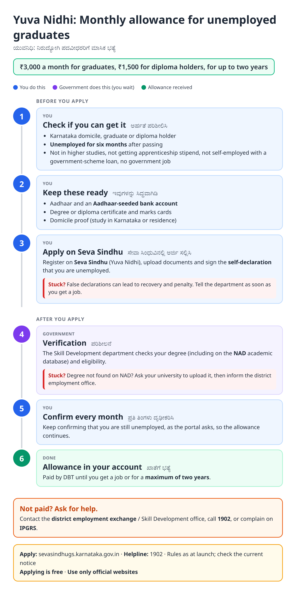
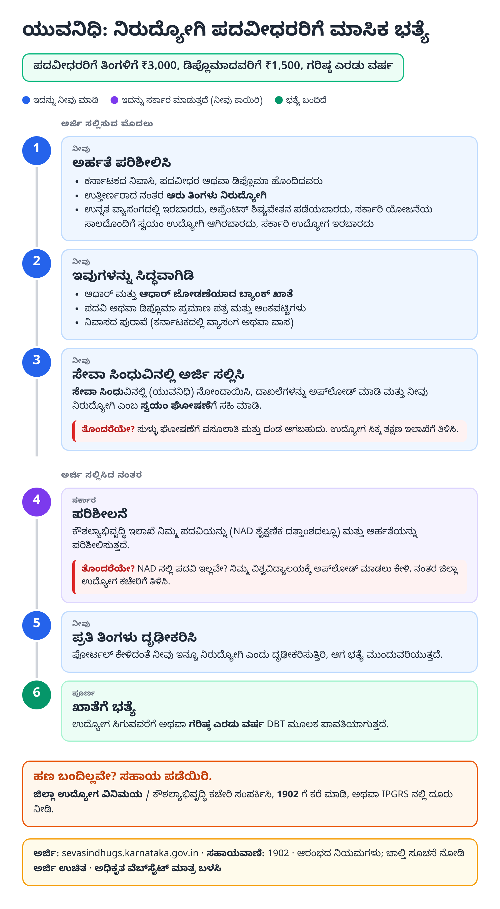
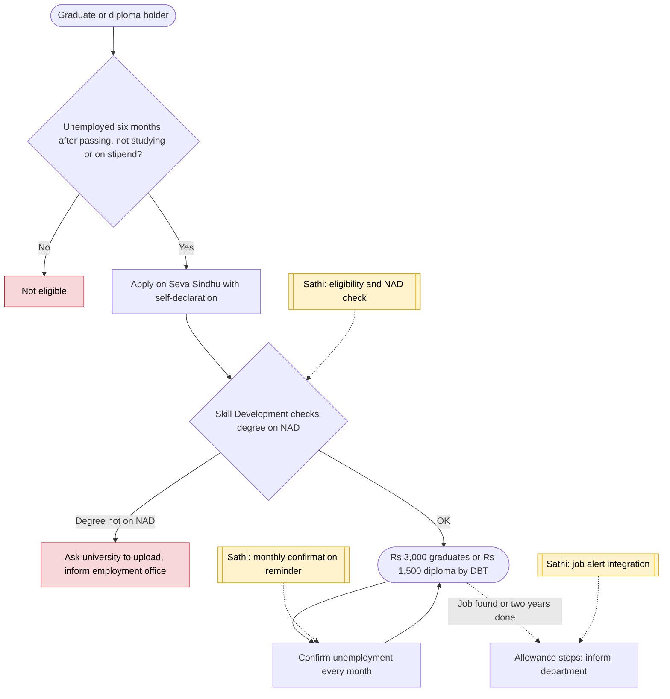

# Yuva Nidhi (unemployment allowance) - End-to-End Workflow

ಯುವನಿಧಿ · For: Unemployed graduates and diploma holders

## For citizens: step by step

Blue = you do this. Purple = government does this (you wait). Green = done. Red = what to do if stuck. Orange = your rights if it is late.

### English

### ಕನ್ನಡ (Kannada)

Sources: [`ka-yuva-nidhi-guide.html`](ka-yuva-nidhi-guide.html), [`ka-yuva-nidhi-guide-kn.html`](ka-yuva-nidhi-guide-kn.html), generated from [`ka_yuva_nidhi_content.py`](ka_yuva_nidhi_content.py) with `python3 ../gen_guide.py ka_yuva_nidhi_content.py`. Kannada text pending native-speaker review.

## Official links

Use only these addresses. Checked on 27 Oct 2026 through search results; the government sites could not be opened directly from our build environment. "Third-party sites only" means several non-government sites agree on the address but no government page confirmed it yet, so open it and check before you share it.

| What | Link | Checked via |
| :--- | :--- | :--- |
| Seva Sindhu guarantee schemes portal | <https://sevasindhugs.karnataka.gov.in> | Third-party sites only |
| Vikaspedia: Yuva Nidhi | <https://en.vikaspedia.in/viewcontent/schemesall/state-specific-schemes/welfare-schemes-of-karnataka/yuva-nidhi-scheme-karnataka?lgn=en> | Government page |
| Guarantee schemes helpline: 1902 | - | Third-party sites only |
| IPGRS: Karnataka grievance portal | <https://ipgrs.karnataka.gov.in> | Third-party sites only |

## For the Sathi team: system workflow

## Verification (27 Oct 2026)

- **Reported (launch, Jan 2024):** ₹3,000 graduates and ₹1,500 diploma holders a month by DBT, for up to two years or until employed; six months unemployed after passing; exclusions for higher studies, apprenticeship stipend and loan-backed self-employment; NAD used for verification; self-declaration with penalties.
- **Not found:** 2026 changes; the guide says 'rules as at launch'.
- **Still unverified:** exact monthly confirmation process; guide says 'as the portal asks'.

Sources: [Vikaspedia: Yuva Nidhi](https://en.vikaspedia.in/viewcontent/schemesall/state-specific-schemes/welfare-schemes-of-karnataka/yuva-nidhi-scheme-karnataka?lgn=en) · [Wikipedia: Yuva Nidhi](https://en.wikipedia.org/wiki/Yuva_Nidhi) · [Outlook Money: Yuva Nidhi](https://www.outlookmoney.com/personal-finance-news/yuva-nidhi-scheme-provides-allowance-to-unemployed-youth-check-how-to-apply) · [Careers360: Yuva Nidhi from January 1](https://news.careers360.com/karnataka-govts-yuva-nidhi-unemployment-allowance-scheme-start-from-january-1)
