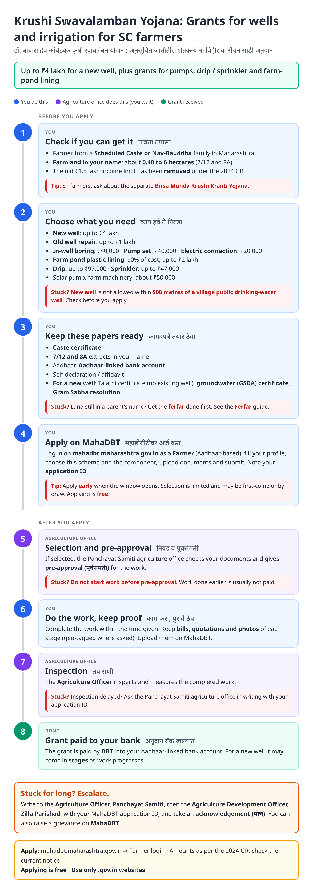
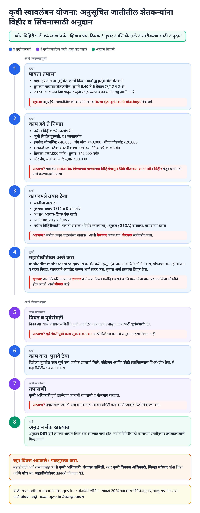
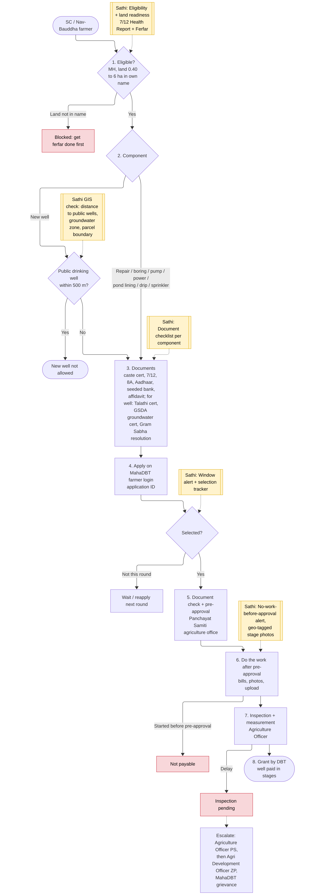
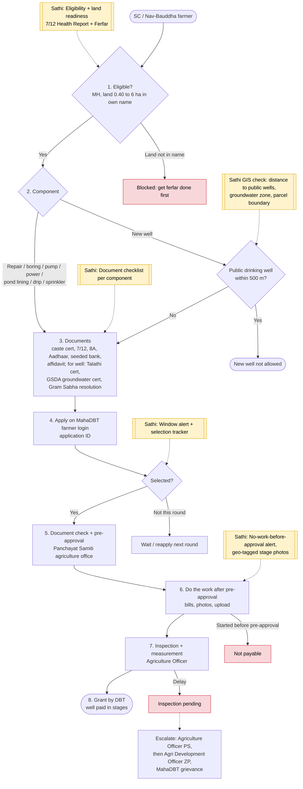

# Dr. Babasaheb Ambedkar Krushi Swavalamban Yojana - End-to-End Workflow

100% state-funded scheme (Agriculture Department, implemented through Zilla Parishad / Panchayat Samiti) giving Scheduled Caste and Nav-Bauddha farmers grants for a new well, well repair, in-well boring, pump set, electric connection, farm-pond lining, drip / sprinkler, solar pump and farm machinery. Applied for on the MahaDBT farmer portal. ST farmers have the separate Birsa Munda Krushi Kranti Yojana.

Related: [Ferfar](ferfar.md) (land must be in the farmer's name), [Caste certificate](caste-certificate.md), [PM-KISAN](pm-kisan.md).

## For farmers: step by step

Blue = you do this. Purple = agriculture office does this (you wait). Green = grant received. Red = what to do if stuck. Orange = how to escalate.

### English

### मराठी (Marathi)

Sources: [`krushi-swavalamban-guide.html`](krushi-swavalamban-guide.html), [`krushi-swavalamban-guide-mr.html`](krushi-swavalamban-guide-mr.html), generated from [`krushi_swavalamban_content.py`](krushi_swavalamban_content.py) with `python3 gen_guide.py krushi_swavalamban_content.py`. Marathi text pending native-speaker review.

## For the Sathi team: system workflow

Yellow boxes = where Sathi plugs in. Red boxes = common blockers.

Mermaid source (editable)

## Stages

| # | Stage | Owner | Common blocker | Sathi action |
|---|---|---|---|---|
| 1 | Eligibility | Farmer | Land not in own name; outside 0.40-6 ha | Land readiness: [7/12 Health Report + Ferfar](ferfar.md) |
| 2 | Choose component | Farmer | New well within 500 m of public drinking well | **GIS check**: distance to public wells, groundwater zone, parcel boundary |
| 3 | Documents | Farmer | Missing GSDA certificate / Gram Sabha resolution for well | Component-wise document checklist |
| 4 | Apply on MahaDBT | Farmer | Misses application window | Window alert |
| 5 | Selection + pre-approval | Panchayat Samiti agriculture office | Not selected this round | Selection tracker; reapply reminder |
| 6 | Work | Farmer | Starts work before pre-approval → not payable | "No work before approval" alert; geo-tagged stage photos |
| 7 | Inspection | Agriculture Officer | Inspection pending | Pending clock + escalation draft |
| 8 | DBT payment | Agriculture Dept | Bank not seeded; staged well payments delayed | Bank check; stage-payment tracker |

**Why this matters for Sathi (and GIS patents):** the new-well rules are spatial: the plot must be in the farmer's name, inside the land-size band, and **not within 500 m of a village public drinking-water well**, and payment depends on geo-tagged stage photos of the right parcel. A pre-application check that combines the 7/12 parcel, public-well locations and groundwater data, and later verifies stage photos against the parcel, is a strong, narrowly scoped GIS + AI validation idea.

## Verification (27 Oct 2026)

- **Confirmed (district ZP page + multiple news sources):** new well up to **₹4 lakh**; old well repair up to **₹1 lakh**; land **0.40-6 ha** in own name; applications via **MahaDBT farmer portal**; payment by **DBT** to Aadhaar-linked account; the old **₹1.5 lakh income limit was abolished**; 12 m well-depth condition removed (2024-25 GR, reported as 1 Oct 2024).
- **Reported (secondary, consistent):** in-well boring ₹40,000; pump set ₹40,000; electric connection ₹20,000; farm-pond lining 90% or ₹2 lakh; drip up to ₹97,000; sprinkler up to ₹47,000; solar pump / machinery about ₹50,000; **no new well within 500 m of a public drinking-water well**; new-well documents include caste certificate, 7/12, 8A, Talathi certificate, GSDA groundwater certificate, Gram Sabha resolution, affidavit.
- **Unclear:** selection method (one source says first-come-first-served on MahaDBT; lottery not confirmed); whether an income certificate is still asked for after the income limit was removed.
- **Still unverified:** exact pre-approval and completion time limits, staged payment split for wells.

Sources: [ZP Palghar: Dr. Babasaheb Ambedkar Krishi Swalamban Yojana](https://www.zppalghar.gov.in/en/dr-babasaheb-ambedkar-krishi-swalamban-yojana/) · [ZP Satara: scheme 2024-25](https://www.zpsatara.gov.in/scheme/%E0%A4%A1%E0%A5%89-%E0%A4%AC%E0%A4%BE%E0%A4%AC%E0%A4%BE%E0%A4%B8%E0%A4%BE%E0%A4%B9%E0%A5%87%E0%A4%AC-%E0%A4%86%E0%A4%82%E0%A4%AC%E0%A5%87%E0%A4%A1%E0%A4%95%E0%A4%B0-%E0%A4%95%E0%A5%83%E0%A4%B7/) · [Mahasamvad: financial criteria increased](https://mahasamvad.in/146716/) · [Agrowon: ₹4 lakh for new wells](https://agrowon.esakal.com/agro-special/state-government-will-provide-rs-4-lakh-subsidy-for-new-wells-state-governments-scheme-for-farmers-rat16) · [Lokmat: new well documents](https://www.lokmat.com/agriculture/smart-farming/latest-news-vihir-yojana-what-documents-are-required-for-new-well-scheme-see-list-of-documents-a-a993/) · [Saam TV: ₹4 lakh well subsidy](https://saamtv.esakal.com/image-story/maharashtra-government-schemes-offer-financial-aid-for-wells-drip-irrigation-and-pumps-beed-farmers-can-get-subsidies-up-to-rs-4-lakh-bbj88) · [Krushi Kranti: document list](https://www.krushikranti.com/blogs/babasaheb-krushi-swavalamban-yojana-navin-vihir-kagdptra) · [Mahiti A1: changes and GR](https://mahitia1.in/babasaheb-ambedkar-khrushi-swavlamban-yojna-big-changes/)
