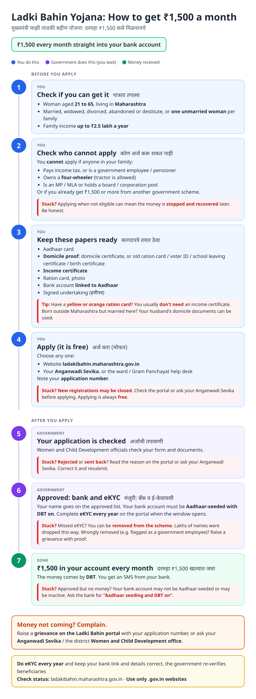
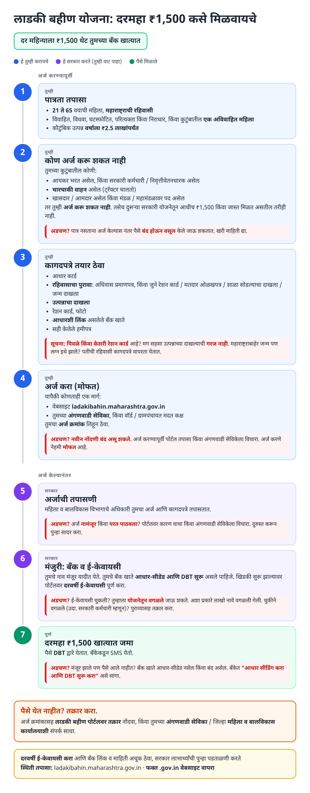
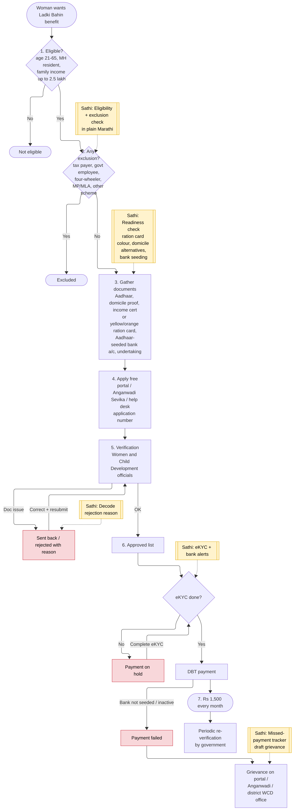
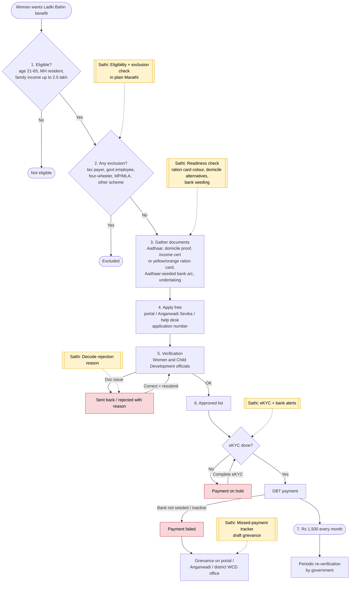

# Mukhyamantri Majhi Ladki Bahin Yojana - End-to-End Workflow

Monthly DBT support for eligible women in Maharashtra. Official site: https://ladakibahin.maharashtra.gov.in (Women and Child Development Department).

## For citizens: step by step

Blue = you do this. Purple = government does this (you wait). Green = money received. Red = what to do if stuck. Orange = how to complain.

### English

### मराठी (Marathi)

Sources: [`ladki-bahin-guide.html`](ladki-bahin-guide.html), [`ladki-bahin-guide-mr.html`](ladki-bahin-guide-mr.html), generated from [`ladki_bahin_content.py`](ladki_bahin_content.py) with `python3 gen_guide.py ladki_bahin_content.py`. Marathi text pending native-speaker review.

## For the Sathi team: system workflow

Yellow boxes = where Sathi plugs in. Red boxes = common blockers.

Mermaid source (editable)

## Stages

| # | Stage | Owner | Common blocker | Sathi action |
|---|---|---|---|---|
| 1 | Eligibility | Citizen | Unsure about age / marital status / income rules | Plain-Marathi eligibility check |
| 2 | Exclusions | Citizen | Applies while excluded → later stopped and recovered | Exclusion check (tax payer, govt job, four-wheeler, other scheme) |
| 3 | Documents | Citizen | No domicile certificate; no income certificate | Readiness: ration-card colour rule, domicile alternatives; links to [domicile](domicile-certificate.md) and [income](income-certificate.md) guides |
| 4 | Apply | Citizen / Anganwadi Sevika | Pays agent for a free form | "It is free" messaging |
| 5 | Verification | WCD officials | Rejected / sent back | Decode reason in Marathi |
| 6 | Approval + eKYC | Citizen / WCD | eKYC not done → payment on hold | eKYC + bank-seeding alerts |
| 7 | Monthly DBT | PFMS / bank | Bank not Aadhaar-seeded; missed months | Missed-payment tracker + draft grievance |
| - | Re-verification | Government | Details out of date | Keep family profile current |

**Why this matters for Sathi:** this is the largest DBT scheme in Maharashtra by beneficiary count and a natural top-of-funnel. Women who come for Ladki Bahin also need income, domicile and bank-seeding fixes, and their families need scholarships and certificates: one profile, many schemes.

## Verification (27 Oct 2026, batch 1)

Official portal (ladakibahin.maharashtra.gov.in) was not reachable from the research environment; checked against news and secondary sources.

- **Confirmed:** ₹1,500/month by DBT; women 21-65; family income up to ₹2.5 lakh; Aadhaar-linked bank account.
- **Changed in guide:** eKYC is now **mandatory and annual**; tens of lakhs of beneficiaries (reported 68-92 lakh) were removed after the 2025-26 eKYC drive; some were wrongly flagged (e.g. as government employees) and later restored. Guide now says eKYC every year, warns about removal, and adds a grievance route for wrongful removal.
- **Added caution:** new registrations **may be closed** (secondary sources say the portal now handles only eKYC, corrections and status). Not confirmed officially.
- **Still unverified:** four-wheeler and other exclusion details, ration-card income exemption, domicile alternatives, max beneficiaries per household.

Sources: [Free Press Journal: 68 lakh accounts closed after eKYC](https://www.freepressjournal.in/mumbai/maharashtras-ladki-bahin-yojana-sees-68-lakh-accounts-closed-after-e-kyc-drive) · [Outlook Money: 92 lakh names dropped](https://www.outlookmoney.com/news/maharashtra-drops-92-lakh-names-from-ladki-bahin-scheme-after-eligibility-checks) · [The Hitavada: 80 lakh ineligible after eKYC deadline](https://www.thehitavada.com/Encyc/2026/6/2/80-lakh-women-become-ineligible-for-ladki-bahin-scheme-after-e-kyc-deadline.html) · [The Hitavada: Won't scrap scheme, says Fadnavis](https://www.thehitavada.com/Encyc/2026/6/3/wont-scrap-ladki-bahin-scheme-says-fadnavis.html) · [sarkariyojana.com: eKYC](https://sarkariyojana.com/ladki-bahin-yojana-ekyc/)
