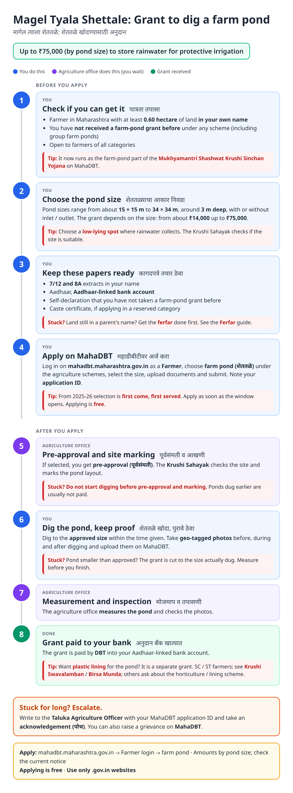
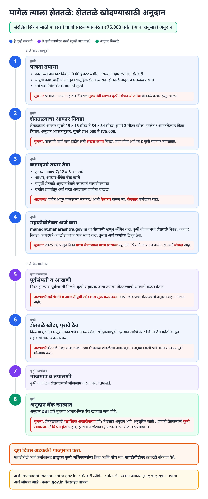
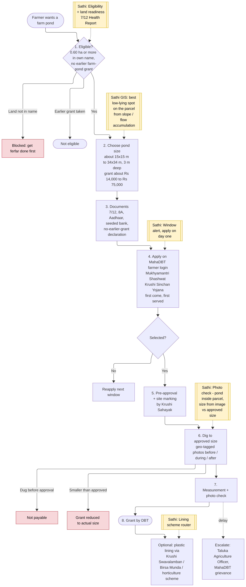
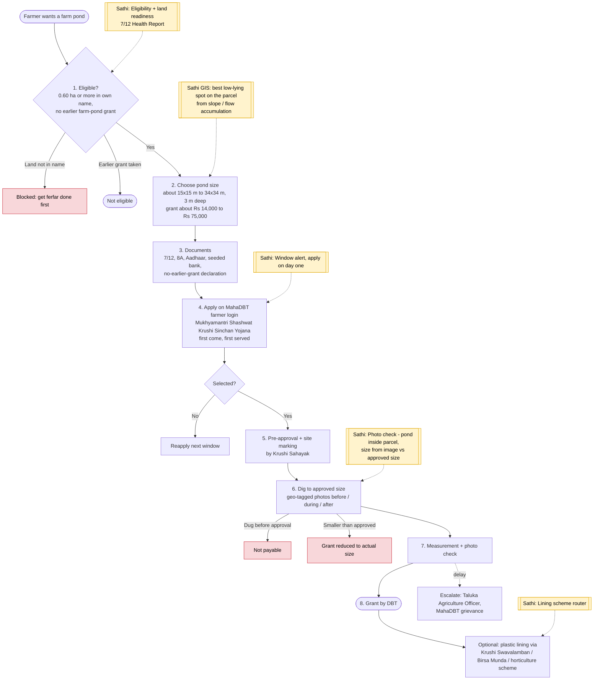

# Magel Tyala Shettale (Farm Pond on Demand) - End-to-End Workflow

Grant for farmers to dig a farm pond (शेततळे) for rainwater storage and protective irrigation. Launched in 2016; now runs as the farm-pond component of the **Mukhyamantri Shashwat Krushi Sinchan Yojana** on the MahaDBT farmer portal. Grant depends on pond size, up to ₹75,000. Open to all categories. Plastic lining is a separate grant (see [Krushi Swavalamban](krushi-swavalamban.md) for SC / Nav-Bauddha and [Birsa Munda](birsa-munda.md) for ST farmers).

Related: [Ferfar](ferfar.md) (land must be in the farmer's name), [PM-KISAN](pm-kisan.md). Once the pond is ready, a solar pump: [Magel Tyala Saur Krushi Pump](saur-krushi-pump.md).

## For farmers: step by step

Blue = you do this. Purple = agriculture office does this (you wait). Green = grant received. Red = what to do if stuck. Orange = how to escalate.

### English

### मराठी (Marathi)

Sources: [`magel-tyala-shettale-guide.html`](magel-tyala-shettale-guide.html), [`magel-tyala-shettale-guide-mr.html`](magel-tyala-shettale-guide-mr.html), generated from [`magel_tyala_shettale_content.py`](magel_tyala_shettale_content.py) with `python3 gen_guide.py magel_tyala_shettale_content.py`. Marathi text pending native-speaker review.

## For the Sathi team: system workflow

Yellow boxes = where Sathi plugs in. Red boxes = common blockers.

Mermaid source (editable)

## Stages

| # | Stage | Owner | Common blocker | Sathi action |
|---|---|---|---|---|
| 1 | Eligibility | Farmer | Under 0.60 ha; land not in own name; earlier farm-pond grant | Eligibility + land readiness ([Ferfar](ferfar.md)) |
| 2 | Pond size + site | Farmer / Krushi Sahayak | Site where water won't collect | **GIS**: suggest the best low-lying spot from slope / flow accumulation |
| 3 | Documents | Farmer | Missing 8A / declaration | Checklist |
| 4 | Apply | Farmer | Misses first-come window | Window alert, apply on day one |
| 5 | Pre-approval + marking | Agriculture office | Digging before approval | "No digging before approval" alert |
| 6 | Dig + photos | Farmer | Pond smaller than approved → grant cut | **Photo check**: pond inside parcel, estimated size vs approved |
| 7 | Measurement | Agriculture office | Delay | Pending clock + escalation draft |
| 8 | DBT + lining | Agriculture Dept | Doesn't know lining is separate | Lining scheme router |

**Why this matters for Sathi (and GIS patents):** farm ponds are one of the clearest GIS + AI fits in the whole set: (1) **site selection** from a DEM (slope, flow accumulation, catchment) inside the farmer's 7/12 parcel, and (2) **automated verification** of geo-tagged photos or satellite imagery: is the pond inside the right parcel, and does the dug area match the approved size? Both are narrowly scoped, defensible patent candidates.

## Verification (27 Oct 2026)

- **Confirmed (multiple sources):** now under the **Mukhyamantri Shashwat Krushi Sinchan Yojana**; grant **capped at ₹75,000** depending on pond size; minimum **0.60 ha** in own name; farmers who already received a farm-pond grant under any scheme (including group ponds) are **not eligible**; applications via **MahaDBT**; agriculture schemes on MahaDBT use **first-come-first-served** selection from 2025-26.
- **Reported (secondary):** minimum grant around **₹14,433** for the smallest size; pond sizes from about 15 × 15 m to 34 × 34 m, about 3 m deep, with or without inlet / outlet.
- **Not used:** one site claims up to ₹1.5 lakh; this contradicts all other sources and was ignored.
- **Still unverified:** exact size-wise grant table, completion time limit, whether caste certificate is needed for category-wise targets. Full original guidelines are reportedly at egs.mahaonline.gov.in/PDF/Shetatle.pdf (not opened).

Sources: [MS Dhulap: farm pond subsidy under MahaDBT](https://www.msdhulap.com/shettale-subsidy-scheme-under-mahadbt/) · [Krushi Davandi: farm pond schemes 2026](https://krushidavandi.in/shet-tale-anudan-yojana-maharashtra-mahiti/) · [MH Shasan: Magel Tyala Shettale 2026](https://mhshasan.com/magel-tyala-shettale/) · [Yojana Parichay: Magel Tyala Shettale 2025](https://yojanaparichay.com/magel-tyala-shettale-yojana/) · [Maha Portal Yojna: Magel Tyala Shettale](https://mahaportalyojna.in/magel-tyala-shettale-yojana/) · [Kisan Suvidha: MahaDBT farmer schemes 2025](https://kisansuvidha.in/mahadbt-farmer-scheme-2025/) · [Sarkari Yojnaye: farm pond scheme](https://sarkariyojnaye.com/magel-tyala-shettale-farm-pond-subsidy-scheme-online-application/)
