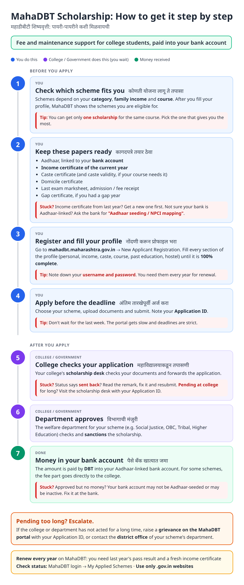
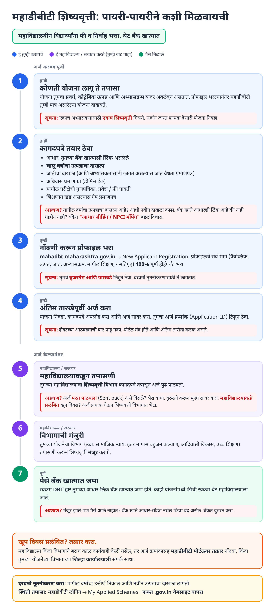
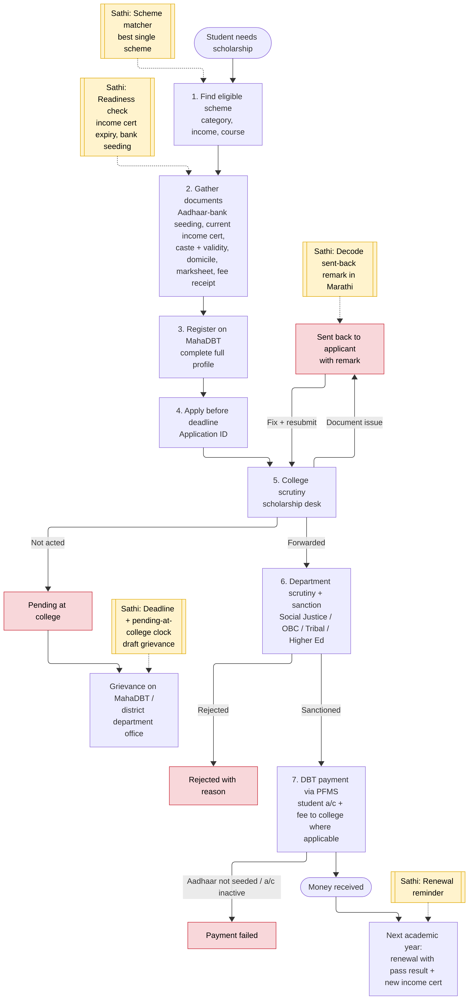
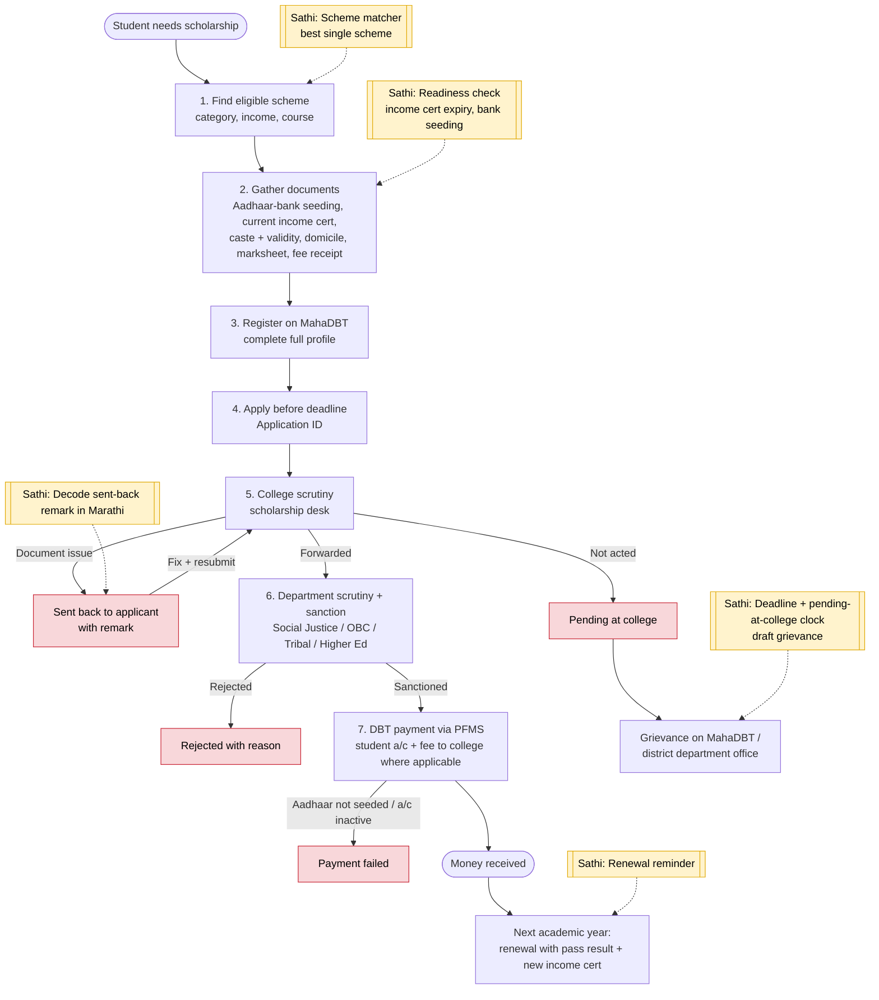

# MahaDBT Scholarship - End-to-End Workflow

Official site: https://mahadbt.maharashtra.gov.in (post-matric and higher-education scholarships across welfare departments).

## For students: step by step

Blue = you do this. Purple = college / government does this (you wait). Green = money received. Red = what to do if stuck. Orange = how to escalate.

### English

### मराठी (Marathi)

Sources: [`mahadbt-scholarship-guide.html`](mahadbt-scholarship-guide.html), [`mahadbt-scholarship-guide-mr.html`](mahadbt-scholarship-guide-mr.html), generated from [`mahadbt_scholarship_content.py`](mahadbt_scholarship_content.py) with `python3 gen_guide.py mahadbt_scholarship_content.py`. Marathi text pending native-speaker review.

## For the Sathi team: system workflow

Yellow boxes = where Sathi plugs in. Red boxes = common blockers.

Mermaid source (editable)

## Stages

| # | Stage | Owner | Common blocker | Sathi action |
|---|---|---|---|---|
| 1 | Find scheme | Student | Applies to wrong / multiple schemes | Scheme matcher: best single scheme |
| 2 | Documents | Student | Expired income certificate, bank not Aadhaar-seeded, caste validity missing | Readiness check; links to [income certificate guide](income-certificate.md) |
| 3 | Register + profile | Student | Incomplete profile, lost login | Profile checklist, credential reminder |
| 4 | Apply | Student | Deadline missed | Deadline countdown |
| 5 | College scrutiny | College scholarship desk | Sent back; pending at college | Decode remark in Marathi; pending clock |
| 6 | Department sanction | Welfare department | Rejected | Explain reason |
| 7 | DBT payment | PFMS / bank | Aadhaar not seeded, account inactive | Bank-side checklist |
| - | Renewal | Student | Forgets renewal; new income cert needed | Renewal reminder |

> Note: Working assumptions, not yet verified: registration menu labels, status wording ("Sent back", "Pending at college"), "My Applied Schemes" label, the one-scholarship rule, which schemes pay fees to the college, and the grievance route. Verify on the live portal and per-scheme GRs before building.
