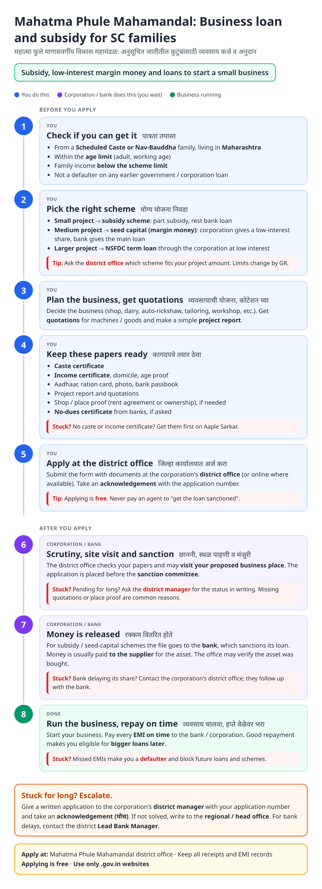
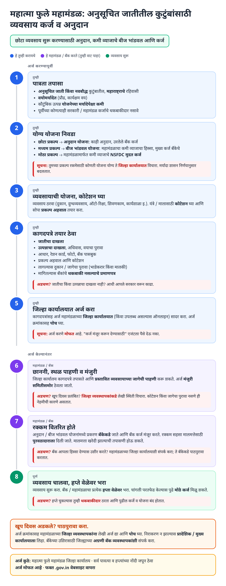
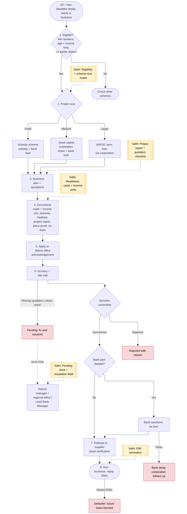
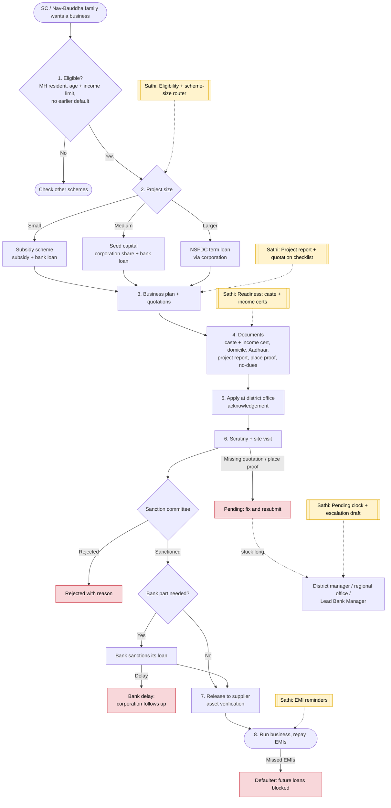

# Mahatma Phule Backward Class Development Corporation (Loan Schemes) - End-to-End Workflow

Mahatma Phule Magasvargiya Vikas Mahamandal: business finance for **Scheduled Caste and Nav-Bauddha** families in Maharashtra. Three common routes by project size: **subsidy scheme** (small projects, subsidy + bank loan), **seed capital / margin money** (corporation share at low interest + bank loan), and **NSFDC term loans** routed through the corporation. Applied at the corporation's district office. For open-category communities, see [Annasaheb Patil loan scheme](annasaheb-patil.md).

## For citizens: step by step

Blue = you do this. Purple = corporation / bank does this (you wait). Green = business running. Red = what to do if stuck. Orange = how to escalate.

### English

### मराठी (Marathi)

Sources: [`mahatma-phule-mahamandal-guide.html`](mahatma-phule-mahamandal-guide.html), [`mahatma-phule-mahamandal-guide-mr.html`](mahatma-phule-mahamandal-guide-mr.html), generated from [`mahatma_phule_mahamandal_content.py`](mahatma_phule_mahamandal_content.py) with `python3 gen_guide.py mahatma_phule_mahamandal_content.py`. Marathi text pending native-speaker review.

## Official links

Use only these addresses. Checked on 27 Oct 2026 through search results; the government sites could not be opened directly from our build environment. "Third-party sites only" means several non-government sites agree on the address but no government page confirmed it yet, so open it and check before you share it.

| What | Link | Checked via |
| :--- | :--- | :--- |
| Mahatma Phule Mahamandal (MPBCDC) | <https://mpbcdc.maharashtra.gov.in> | Third-party sites only |

## For the Sathi team: system workflow

Yellow boxes = where Sathi plugs in. Red boxes = common blockers.

Mermaid source (editable)

## Stages

| # | Stage | Owner | Common blocker | Sathi action |
|---|---|---|---|---|
| 1 | Eligibility | Citizen | Earlier default; wrong corporation | Eligibility + corporation router |
| 2 | Choose scheme | Citizen | Doesn't know subsidy vs seed capital vs NSFDC | Scheme-size router |
| 3 | Plan + quotations | Citizen | No quotations / weak project report | Project report + quotation checklist |
| 4 | Documents | Citizen | Missing caste / income certificate | Readiness; links to [caste](caste-certificate.md) and [income](income-certificate.md) guides |
| 5 | Apply | Citizen | Agent fraud | Free-application messaging |
| 6 | Scrutiny + site visit + committee | District office | Pending on missing quotation / place proof; rejected | Pending clock + escalation draft |
| 7 | Release | Bank / corporation | Bank delays its share | Bank follow-up tracker |
| 8 | Repayment | Beneficiary | Missed EMIs → defaulter, future schemes blocked | EMI reminders |

**Why this matters for Sathi:** together with Annasaheb Patil (open category), this gives Sathi a **"which corporation is mine?"** router across community-specific development corporations, which is a common point of confusion. The same bank-readiness and EMI-tracker features apply to both.

## Verification (27 Oct 2026, batch 3)

- **Reported (secondary):** official website **mpbcdc.maharashtra.gov.in**; small-project subsidy scheme with 50% bank loan + corporation grant (figures unclear: around ₹10,000 grant, projects up to ~₹50,000).
- **Changed in guide:** official website added.
- **Not found:** age / income limits, NSFDC scheme details, online application steps. Guide keeps general wording.

Sources: [MahaBharti: Anudan Yojana for Backward Class (mpbcdc)](https://mahabharti.in/yojana/anudan-yojana-for-backward-class)
