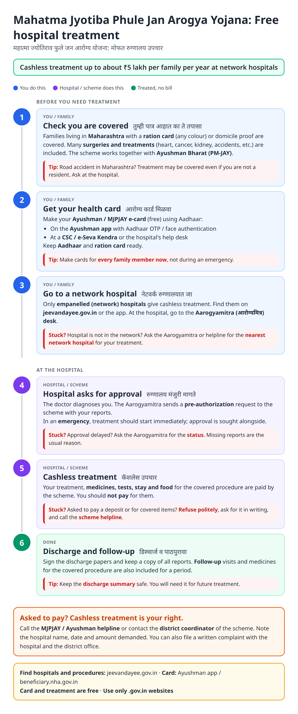
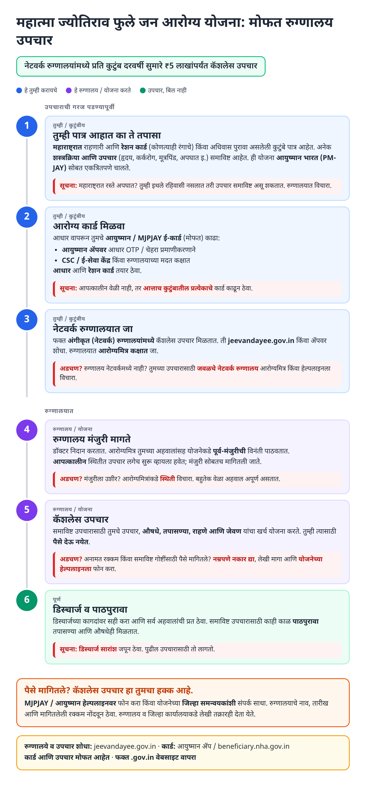
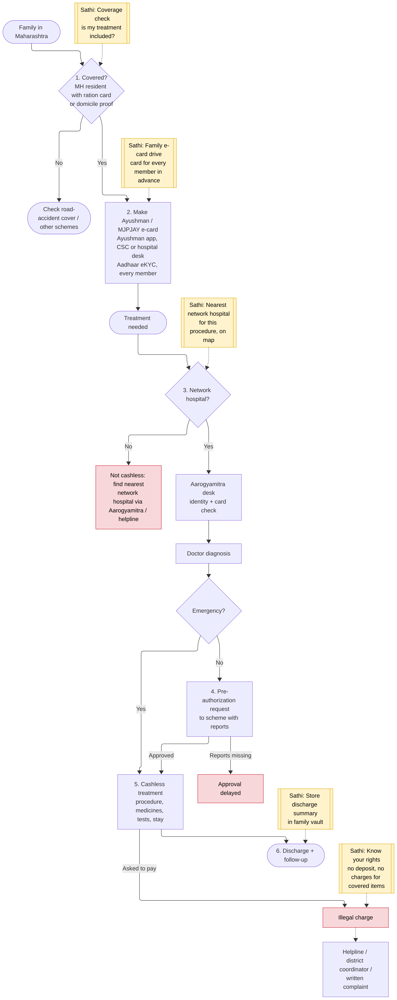
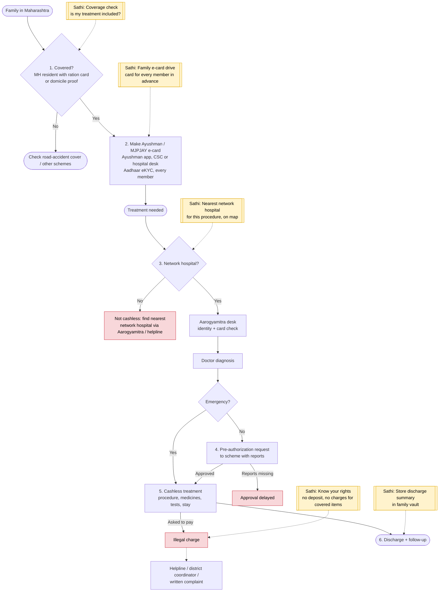

# Mahatma Jyotiba Phule Jan Arogya Yojana (MJPJAY) - End-to-End Workflow

Maharashtra's cashless health assurance scheme, run together with Ayushman Bharat PM-JAY. Covered families get cashless treatment for listed procedures at empanelled (network) hospitals. Official site: https://jeevandayee.gov.in. Health card via the Ayushman app / https://beneficiary.nha.gov.in (see [Ayushman card guide](ayushman-card.md)).

## For citizens: step by step

Blue = you / family do this. Purple = hospital / scheme does this. Green = treated, no bill. Red = what to do if stuck. Orange = your rights if asked to pay.

### English

### मराठी (Marathi)

Sources: [`mjpjay-guide.html`](mjpjay-guide.html), [`mjpjay-guide-mr.html`](mjpjay-guide-mr.html), generated from [`mjpjay_content.py`](mjpjay_content.py) with `python3 gen_guide.py mjpjay_content.py`. Marathi text pending native-speaker review.

## For the Sathi team: system workflow

Yellow boxes = where Sathi plugs in. Red boxes = common blockers.

Mermaid source (editable)

## Stages

| # | Stage | Owner | Common blocker | Sathi action |
|---|---|---|---|---|
| 1 | Coverage | Family | Unsure if covered or if treatment is in the package list | Coverage + procedure check |
| 2 | Health card | Family / CSC / hospital | Card made only during emergency; missing members | Family e-card drive in advance |
| 3 | Network hospital | Family | Goes to non-network hospital, pays out of pocket | Nearest network hospital for this procedure, on a map |
| 4 | Pre-authorization | Aarogyamitra / scheme | Missing reports delay approval | Explain status; checklist of reports |
| 5 | Cashless treatment | Hospital | Deposit or charges for covered items | Know-your-rights card + helpline / complaint draft |
| 6 | Discharge + follow-up | Family | Lost discharge summary | Store in family vault |

**Why this matters for Sathi (and GIS):** a health emergency is the moment families are most likely to be overcharged. Two features carry most of the value: (1) cards made for every family member in advance, and (2) "nearest network hospital that does *this* procedure", which is a geospatial query over the empanelled-hospital list and their package lists. That routing problem is a natural fit for your GIS expertise.

> Note: Working assumptions, not yet verified: coverage amount and eligibility (universal coverage changes since 2024), number of procedures and hospitals, road-accident cover for non-residents, card process, pre-authorization and emergency rules, follow-up period, and helpline numbers. Verify against current State Health Assurance Society notifications, jeevandayee.gov.in and NHA guidelines before building.
