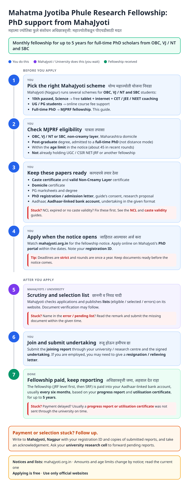
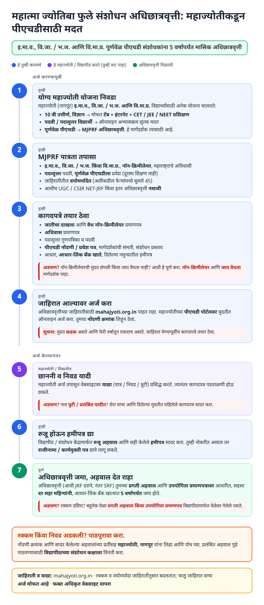
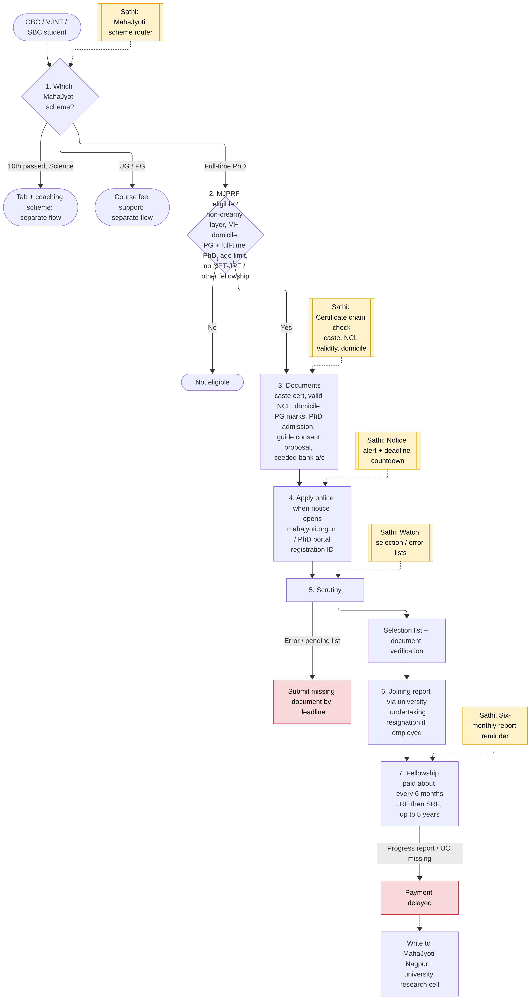
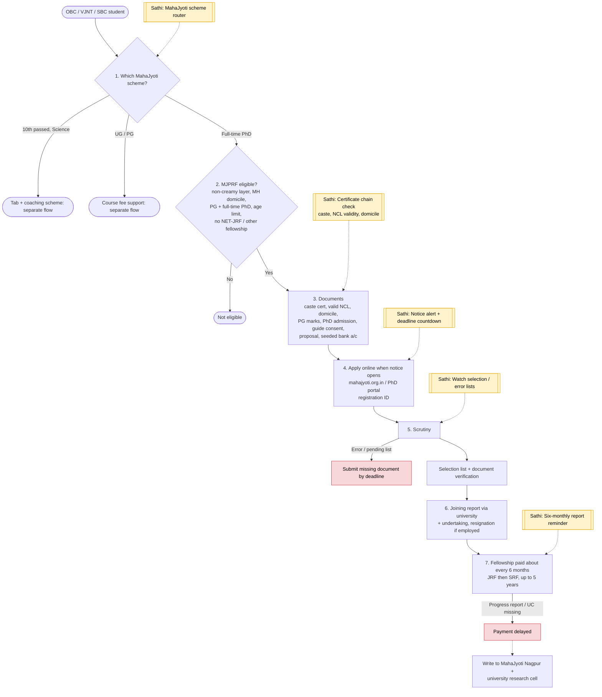

# Mahatma Jyotiba Phule Research Fellowship (MJPRF) - MahaJyoti - End-to-End Workflow

MahaJyoti (Mahatma Jyotiba Phule Research and Training Institute, Nagpur), under the Other Backward Bahujan Welfare Department, runs student schemes for **OBC, VJ / NT and SBC** students. This page covers the **MJPRF PhD fellowship**; step 1 routes students to MahaJyoti's tablet + coaching and course-fee schemes. Official site: https://mahajyoti.org.in.

Related: [MahaDBT scholarship](mahadbt-scholarship.md) (college fee / maintenance scholarships), [NCL](ncl-certificate.md), [caste validity](caste-validity.md).

## For students: step by step

Blue = you do this. Purple = MahaJyoti / university does this (you wait). Green = fellowship received. Red = what to do if stuck. Orange = how to follow up.

### English

### मराठी (Marathi)

Sources: [`mjprf-guide.html`](mjprf-guide.html), [`mjprf-guide-mr.html`](mjprf-guide-mr.html), generated from [`mjprf_content.py`](mjprf_content.py) with `python3 gen_guide.py mjprf_content.py`. Marathi text pending native-speaker review.

## For the Sathi team: system workflow

Yellow boxes = where Sathi plugs in. Red boxes = common blockers.

Mermaid source (editable)

## Stages

| # | Stage | Owner | Common blocker | Sathi action |
|---|---|---|---|---|
| 1 | Pick scheme | Student | Doesn't know MahaJyoti has tab, course-fee and PhD schemes | MahaJyoti scheme router |
| 2 | Eligibility | Student | Already has NET-JRF / other fellowship; distance-mode PhD; over age | Eligibility check |
| 3 | Documents | Student | NCL expired, no caste validity | Certificate chain check; links to [NCL](ncl-certificate.md), [caste validity](caste-validity.md), [domicile](domicile-certificate.md) |
| 4 | Apply | Student | Misses once-a-year notice / deadline | Notice alert + countdown |
| 5 | Scrutiny + lists | MahaJyoti | Name on error / pending list | Watch lists, explain remark |
| 6 | Joining | Student / university | Employed candidate unaware of resignation rule | Joining checklist |
| 7 | Six-monthly payment | MahaJyoti / university | Progress report / utilisation certificate not sent | Six-monthly report reminder; follow-up draft |

**Why this matters for Sathi:** MJPRF sits at the end of the full certificate chain (caste → NCL → validity → domicile) and runs for up to 5 years with six-monthly reporting. That makes it a strong "long-lived file" use case: one profile, recurring deadlines, and a known failure point (late reports) that reminders fix.

## Verification (27 Oct 2026)

- **Confirmed (MahaJyoti documents, 2023 round):** OBC / VJ-NT / SBC **non-creamy layer**, Maharashtra; full-time PhD (distance mode excluded); age limit **45** (as of 31 Dec 2022 for that round); candidates already holding **UGC-NET / CSIR-NET JRF not eligible**; up to **5 years**; payments **every six months** based on progress, into an Aadhaar-linked account; employed candidates submit resignation / relieving letter.
- **Conflicting, so kept out of the guide:** monthly amount (₹21,000 in 2021 letters; ₹31,000 JRF / ₹35,000 SRF in 2023 undertaking; ₹37,000 on a MahaJyoti Marathi page). Guide says "JRF level first, then SRF".
- **Reported (secondary):** application via MahaJyoti PhD MIS portal; MahaJyoti also runs a tablet + internet + CET/JEE/NEET coaching scheme for 10th-passed science students and course-fee support for UG/PG.
- **Still unverified:** current-round dates, selection method (test / merit), exact document list, whether caste validity is mandatory at application.

Sources: [MahaJyoti: PhD scheme guidelines 2023](https://mahajyoti.org.in/wp-content/uploads/2023/06/Guidelines-for-PhD-Scheme-2023-23.06.2023-Final-Approved-1.pdf) · [MahaJyoti: MJPRF undertaking](https://mahajyoti.org.in/wp-content/uploads/2024/10/undertaking-2023-2.pdf) · [MahaJyoti: PhD financial assistance scheme (Marathi)](https://mahajyoti.org.in/en/%E0%A4%AA%E0%A5%80%E0%A4%8F%E0%A4%9A%E0%A4%A1%E0%A5%80-%E0%A4%95%E0%A4%B0%E0%A4%BF%E0%A4%A4%E0%A4%BE-%E0%A4%85%E0%A4%B0%E0%A5%8D%E0%A4%A5%E0%A4%B8%E0%A4%B9%E0%A4%BE%E0%A4%AF%E0%A5%8D%E0%A4%AF-2/) · [MahaJyoti: utilisation certificate format](https://mahajyoti.org.in/wp-content/uploads/2023/01/Annexure-IV-utilization-certificate.pdf) · [TheInternship: MahaJyoti scholarship 2026](https://theinternship.in/maha-jyoti-scholarship/) · [ScholarshipsX: MahaJyoti 2026](https://scholarshipsx.com/mahajyoti-scholarship-2026/)
