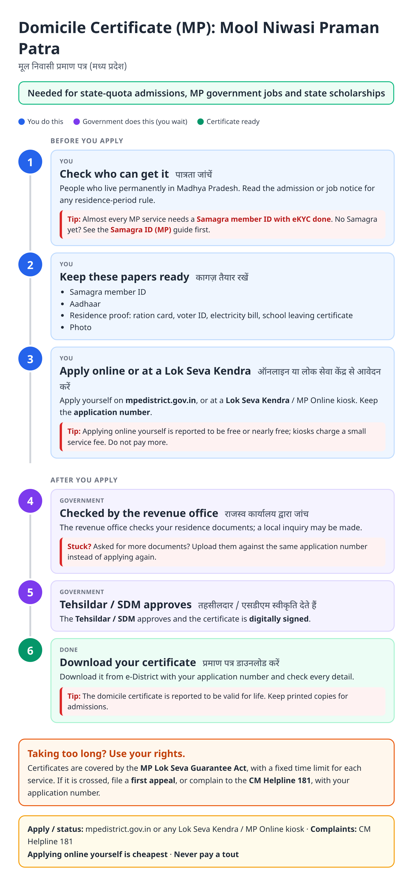
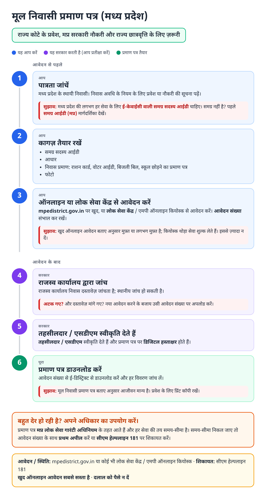
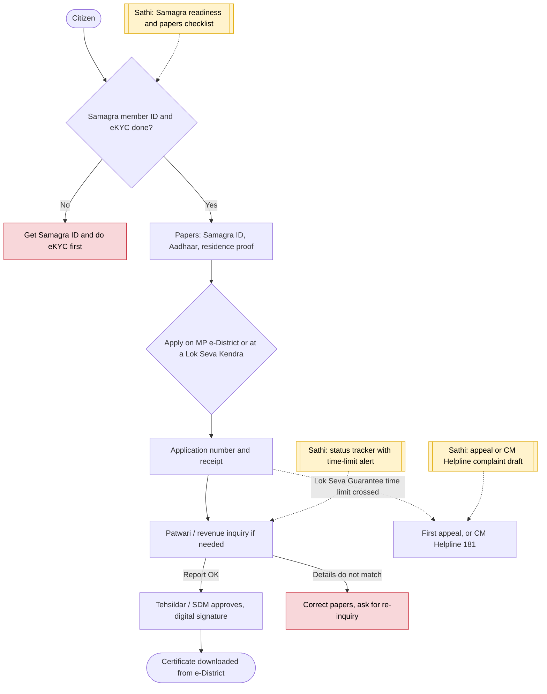

# Domicile certificate (MP) - End-to-End Workflow

मूल निवासी प्रमाण पत्र · For: Students and job seekers needing MP residence proof

## For citizens: step by step

Blue = you do this. Purple = government does this (you wait). Green = done. Red = what to do if stuck. Orange = your rights if it is late.

### English

### हिंदी (Hindi)

Sources: [`mp-domicile-certificate-guide.html`](mp-domicile-certificate-guide.html), [`mp-domicile-certificate-guide-hi.html`](mp-domicile-certificate-guide-hi.html), generated from [`mp_domicile_certificate_content.py`](mp_domicile_certificate_content.py) with `python3 ../gen_guide.py mp_domicile_certificate_content.py`. Hindi text pending native-speaker review.

## Official links

Use only these addresses. Checked on 28 Oct 2026 through search results; the government sites could not be opened directly from our build environment. "Third-party sites only" means several non-government sites agree on the address but no government page confirmed it yet, so open it and check before you share it.

| What | Link | Checked via |
| :--- | :--- | :--- |
| MP e-District: certificates, status, download | <https://mpedistrict.gov.in> | Third-party sites only |
| Samagra portal: family / member ID, eKYC | <https://samagra.gov.in> | Third-party sites only |
| CM Helpline: 181 | - | Third-party sites only |

## For the Sathi team: system workflow

## Verification (28 Oct 2026)

- **Reported:** apply on mpedistrict.gov.in or at a Lok Seva Kendra; Samagra ID required to apply online; valid for life.
- **Conflicting, left out:** fee (₹20 to ₹40) and processing time (7 to 30 days by source).
- **Still unverified:** issuing officer level in the current notification.

Sources: [CitizenNest: MP domicile certificate](https://www.citizennest.com/guide/mp-domicile-certificate-apply-online) · [ClearTax: MP domicile certificate](https://cleartax.in/s/mp-domicile-certificate) · [Bajaj Finserv: MP domicile certificate](https://www.bajajfinserv.in/mp-domicile-certificate)
