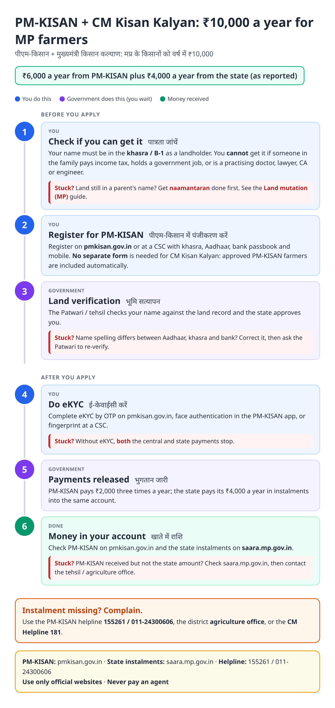
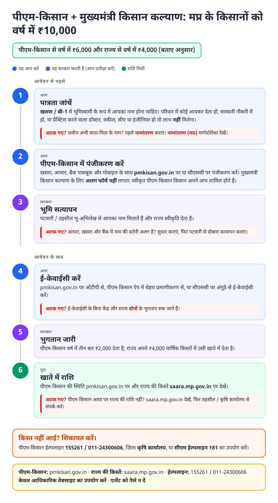
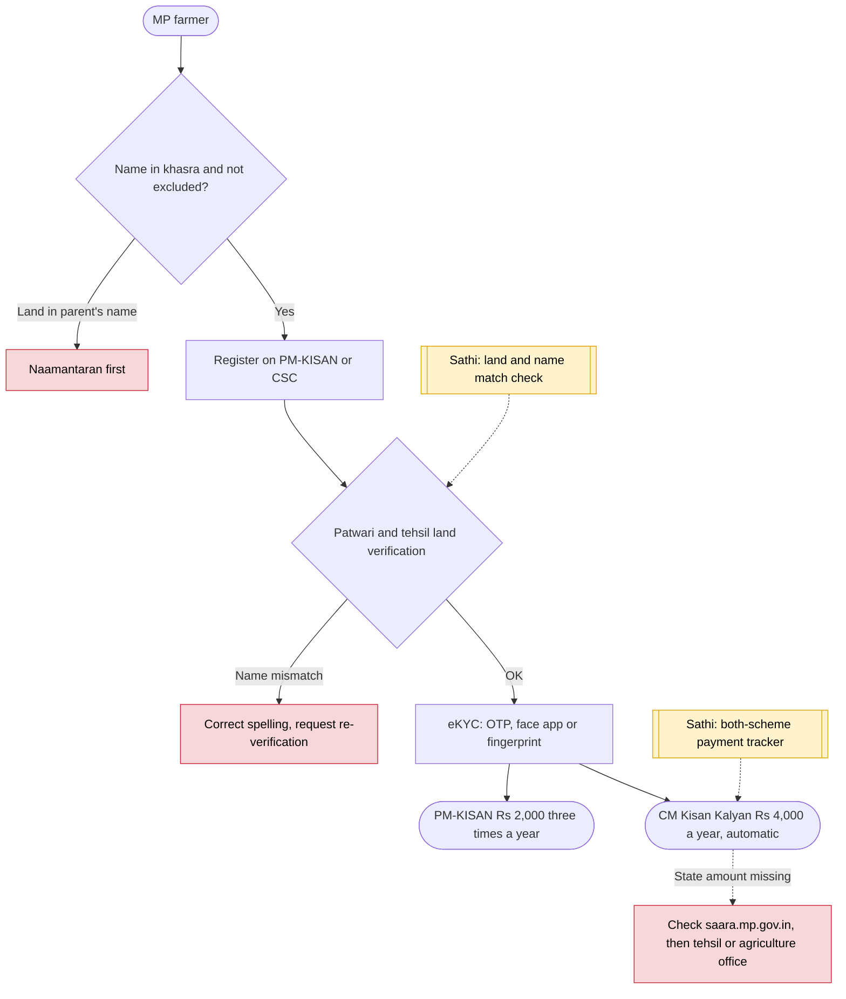

# PM-KISAN + CM Kisan Kalyan (MP) - End-to-End Workflow

पीएम-किसान + मुख्यमंत्री किसान कल्याण · For: Landholding farmers in Madhya Pradesh

## For citizens: step by step

Blue = you do this. Purple = government does this (you wait). Green = done. Red = what to do if stuck. Orange = your rights if it is late.

### English

### हिंदी (Hindi)

Sources: [`mp-kisan-kalyan-guide.html`](mp-kisan-kalyan-guide.html), [`mp-kisan-kalyan-guide-hi.html`](mp-kisan-kalyan-guide-hi.html), generated from [`mp_kisan_kalyan_content.py`](mp_kisan_kalyan_content.py) with `python3 ../gen_guide.py mp_kisan_kalyan_content.py`. Hindi text pending native-speaker review.

## Official links

Use only these addresses. Checked on 28 Oct 2026 through search results; the government sites could not be opened directly from our build environment. "Third-party sites only" means several non-government sites agree on the address but no government page confirmed it yet, so open it and check before you share it.

| What | Link | Checked via |
| :--- | :--- | :--- |
| PM-KISAN: register, eKYC, status | <https://pmkisan.gov.in> | Government page |
| SAARA portal: state instalments | <https://saara.mp.gov.in> | Third-party sites only |
| PM-KISAN helpline: 155261 / 011-24300606 | - | Government page |
| CM Helpline: 181 | - | Third-party sites only |

## For the Sathi team: system workflow

## Verification (28 Oct 2026)

- **Reported (2026):** CM Kisan Kalyan adds ₹4,000 a year for MP farmers enrolled in PM-KISAN, with no separate application; state status on saara.mp.gov.in.
- **Caution:** one page labelled 2026 repackages a 2023 article. Instalment split (₹2,000 × 2) as reported, not confirmed by a government notice.
- **Confirmed (government page):** PM-KISAN ₹6,000 a year in three instalments, eKYC mandatory.

Sources: [eGovtSchemes: Mukhyamantri Kisan Kalyan 2026](https://www.egovtschemes.com/mukhyamantri-kisaan-kalyaan-yojana/) · [sarkariyojana.com: Kisan Kalyan Yojana](https://sarkariyojana.com/kisan-kalyan-yojana/) · [pmkisan.gov.in](https://pmkisan.gov.in/)
