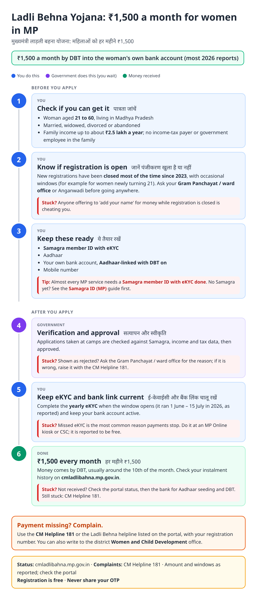
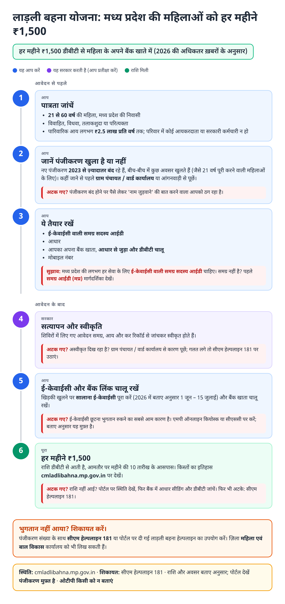
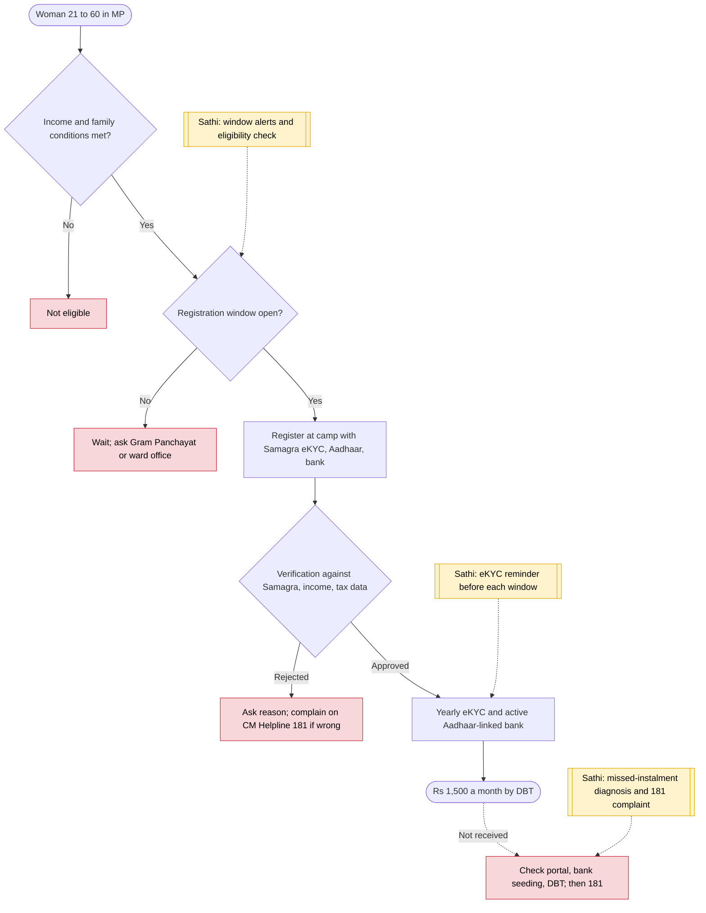

# Ladli Behna Yojana (MP) - End-to-End Workflow

मुख्यमंत्री लाड़ली बहना योजना · For: Women 21–60 in Madhya Pradesh, family income up to ₹2.5 lakh

## For citizens: step by step

Blue = you do this. Purple = government does this (you wait). Green = done. Red = what to do if stuck. Orange = your rights if it is late.

### English

### हिंदी (Hindi)

Sources: [`mp-ladli-behna-guide.html`](mp-ladli-behna-guide.html), [`mp-ladli-behna-guide-hi.html`](mp-ladli-behna-guide-hi.html), generated from [`mp_ladli_behna_content.py`](mp_ladli_behna_content.py) with `python3 ../gen_guide.py mp_ladli_behna_content.py`. Hindi text pending native-speaker review.

## Official links

Use only these addresses. Checked on 28 Oct 2026 through search results; the government sites could not be opened directly from our build environment. "Third-party sites only" means several non-government sites agree on the address but no government page confirmed it yet, so open it and check before you share it.

| What | Link | Checked via |
| :--- | :--- | :--- |
| Ladli Behna portal: status, instalment history | <https://cmladlibahna.mp.gov.in> | Third-party sites only |
| Samagra portal: family / member ID, eKYC | <https://samagra.gov.in> | Third-party sites only |
| CM Helpline: 181 | - | Third-party sites only |

## For the Sathi team: system workflow

## Verification (28 Oct 2026)

- **Reported (2026):** ₹1,500 a month (41st instalment in Oct 2026, Outlook Money); women 21 to 60, family income up to ₹2.5 lakh; yearly eKYC window 1 June to 15 July 2026; 39th instalment was delayed in August 2026.
- **Conflicting:** some pages still list ₹1,250, and whether new registration is open (mostly closed since August 2023, with occasional windows). The guide says to ask the Gram Panchayat / ward office first.
- **Still unverified:** the scheme helpline number listed by one source (0755-2700800).

Sources: [Outlook Money: 41st instalment of ₹1,500](https://www.outlookmoney.com/news/ladli-behna-yojana-madhya-pradesh-releases-41st-instalment-of-rs-1500) · [Outlook Money: 39th instalment pending](https://www.outlookmoney.com/news/ladli-behna-yojana-39th-instalment-august-payment-date-amount-and-status-check) · [Bajaj Finserv: Ladli Behna guide](https://www.bajajfinserv.in/chief-minister-ladli-behna-yojana-guide) · [LegalDev: Ladli Behna 2026](https://legaldev.in/latest/ladli-behna-yojana) · [Free Press Journal: 35th instalment](https://www.freepressjournal.in/bhopal/madhya-pradesh-cm-mohan-yadav-transfers-1836-crore-35th-installment-of-ladli-behna-yojana-in-ashta-video)
