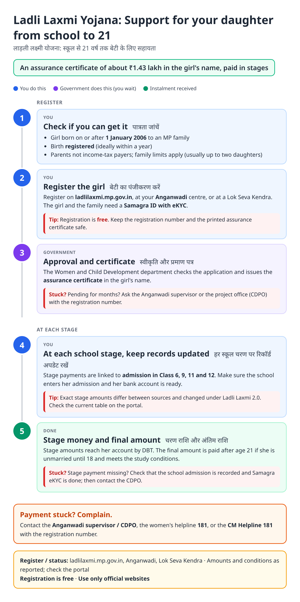
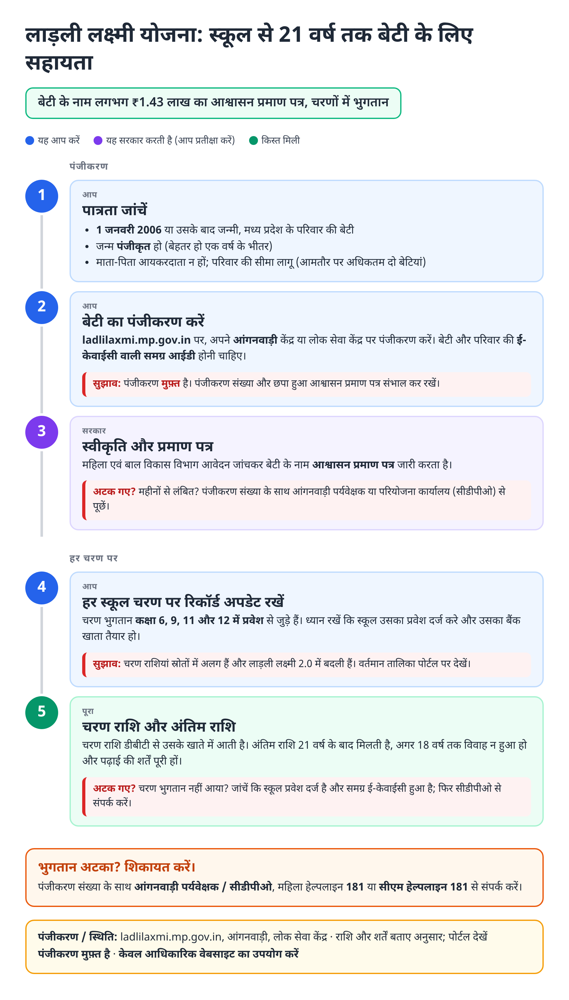
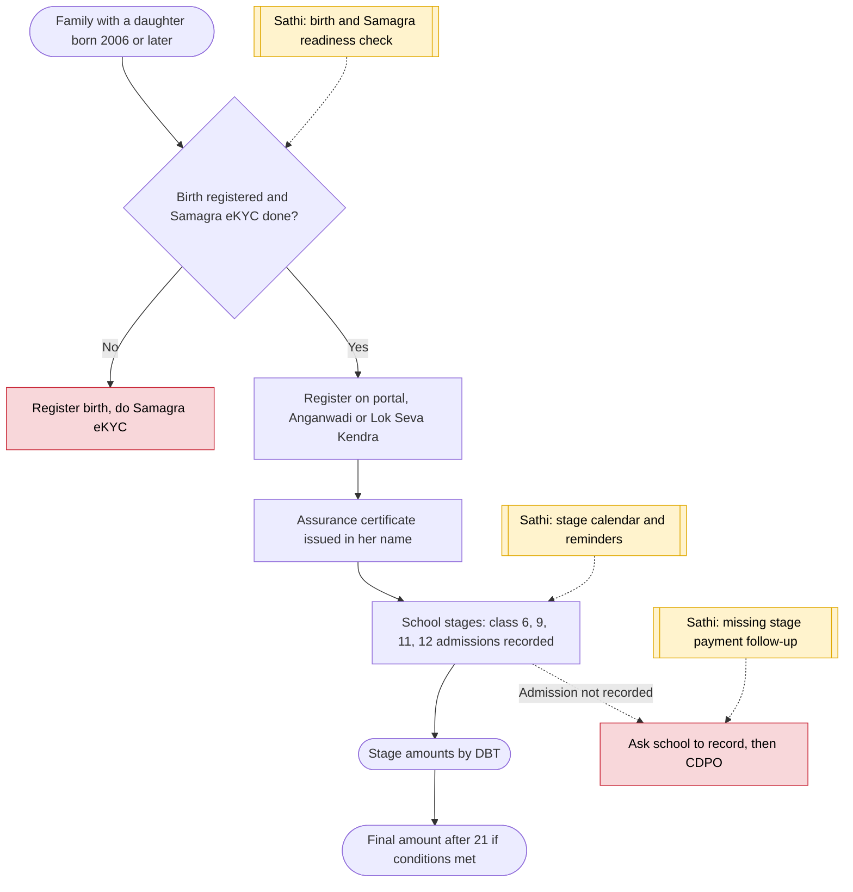

# Ladli Laxmi Yojana (MP) - End-to-End Workflow

लाड़ली लक्ष्मी योजना · For: Families with a daughter born on or after 1 Jan 2006

## For citizens: step by step

Blue = you do this. Purple = government does this (you wait). Green = done. Red = what to do if stuck. Orange = your rights if it is late.

### English

### हिंदी (Hindi)

Sources: [`mp-ladli-laxmi-guide.html`](mp-ladli-laxmi-guide.html), [`mp-ladli-laxmi-guide-hi.html`](mp-ladli-laxmi-guide-hi.html), generated from [`mp_ladli_laxmi_content.py`](mp_ladli_laxmi_content.py) with `python3 ../gen_guide.py mp_ladli_laxmi_content.py`. Hindi text pending native-speaker review.

## Official links

Use only these addresses. Checked on 28 Oct 2026 through search results; the government sites could not be opened directly from our build environment. "Third-party sites only" means several non-government sites agree on the address but no government page confirmed it yet, so open it and check before you share it.

| What | Link | Checked via |
| :--- | :--- | :--- |
| Ladli Laxmi portal: register, status | <https://ladlilaxmi.mp.gov.in> | Third-party sites only |
| Samagra portal: family / member ID, eKYC | <https://samagra.gov.in> | Third-party sites only |
| Women helpline: 181 | - | Third-party sites only |

## For the Sathi team: system workflow

## Verification (28 Oct 2026)

- **Reported:** about ₹1.43 lakh assurance certificate; girls born on or after 1 Jan 2006; registration online, at Anganwadi or Lok Seva Kendra; Samagra eKYC needed.
- **Conflicting, left out:** exact stage amounts (sources differ, Ladli Laxmi 2.0 changes) and the income limit (₹2.5 lakh vs no limit except income tax). The guide says stage payments are linked to Class 6, 9, 11 and 12 admissions and to check the portal.
- **Still unverified:** final amount conditions under 2.0.

Sources: [IndiaScholarships: Ladli Laxmi MP](https://www.indiascholarships.in/scholarships/ladli-lakshmi-yojana-mp) · [Anantam IAS: Ladli Laxmi by stage](https://anantamias.com/ladli-laxmi-yojana/) · [Bajaj Finserv: Ladli Laxmi 2.0](https://www.bajajfinserv.in/ladli-laxmi-yojana-2-0-apply-online) · [sarkariyojana.com: Ladli Laxmi](https://sarkariyojana.com/scheme/ladli-laxmi-yojana/)
