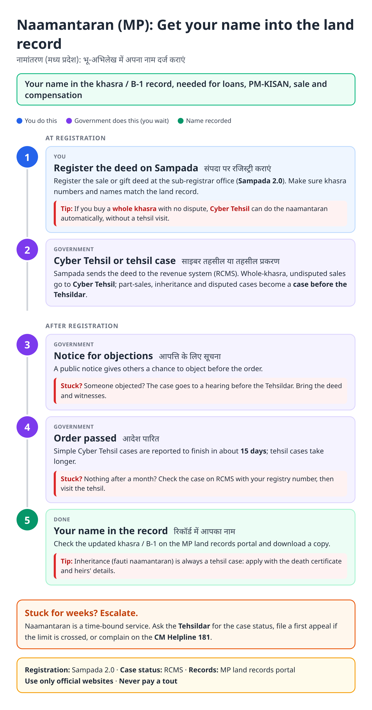
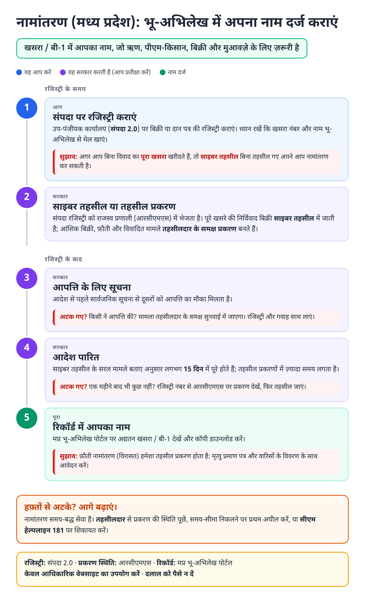
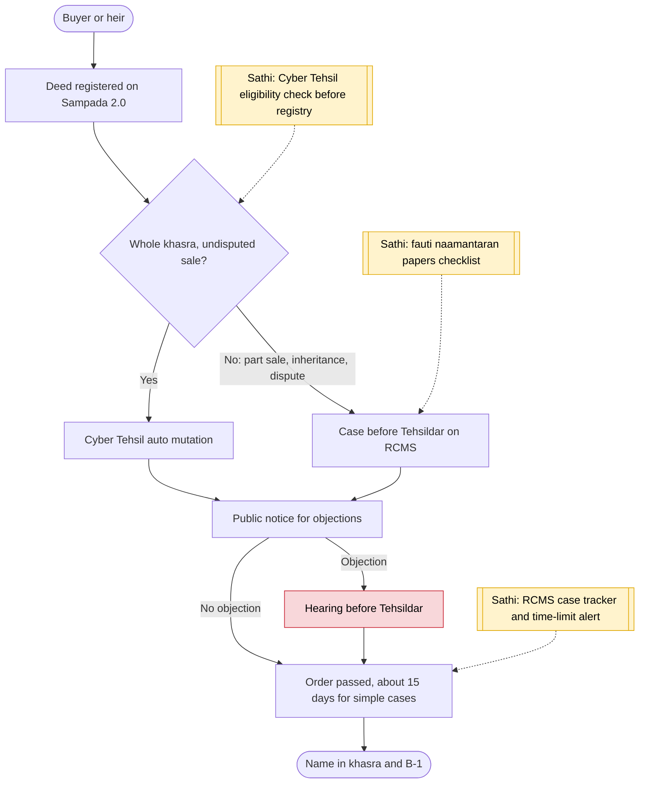

# Land mutation / naamantaran (MP) - End-to-End Workflow

नामांतरण · For: Land buyers, gift receivers, heirs

## For citizens: step by step

Blue = you do this. Purple = government does this (you wait). Green = done. Red = what to do if stuck. Orange = your rights if it is late.

### English

### हिंदी (Hindi)

Sources: [`mp-land-mutation-guide.html`](mp-land-mutation-guide.html), [`mp-land-mutation-guide-hi.html`](mp-land-mutation-guide-hi.html), generated from [`mp_land_mutation_content.py`](mp_land_mutation_content.py) with `python3 ../gen_guide.py mp_land_mutation_content.py`. Hindi text pending native-speaker review.

## Official links

Use only these addresses. Checked on 28 Oct 2026 through search results; the government sites could not be opened directly from our build environment. "Third-party sites only" means several non-government sites agree on the address but no government page confirmed it yet, so open it and check before you share it.

| What | Link | Checked via |
| :--- | :--- | :--- |
| MP land records (Bhulekh) portal | <https://mpbhulekh.gov.in> | Third-party sites only |
| Sampada 2.0: registration | <https://sampada.mpigr.gov.in> | Third-party sites only |
| CM Helpline: 181 | - | Third-party sites only |

## For the Sathi team: system workflow

## Verification (28 Oct 2026)

- **Reported:** Cyber Tehsil links Sampada with RCMS; Indore pilot auto-mutated 3,296 registries in 6 months; started with undisputed, whole-khasra agricultural land; simple cases in about 15 days; part sales, inheritance and disputes go to the Tehsildar.
- **Still unverified:** exact portal addresses for land records and Sampada (listed as third-party only).

Sources: [Free Press Journal: Indore Cyber Tehsil 3,296 mutations](https://www.freepressjournal.in/indore/indore-under-cyber-tehsil-mutation-of-3296-registries-done-in-6-months) · [Drishti IAS: Cyber Tehsil](https://drishtiias.com/state-pcs-current-affairs/cyber-tehsil-1) · [Realty Hunting: MP Bhulekh](https://realtyhunting.com/mp-bhulekh/) · [IMPRI: Sampada 2.0](https://www.impriindia.com/insights/sampada-2-0-revolutionizing-property-registration-in-madhya-pradesh-2024/)
