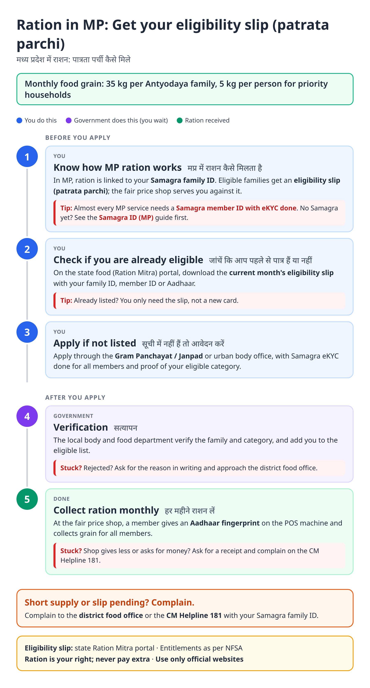
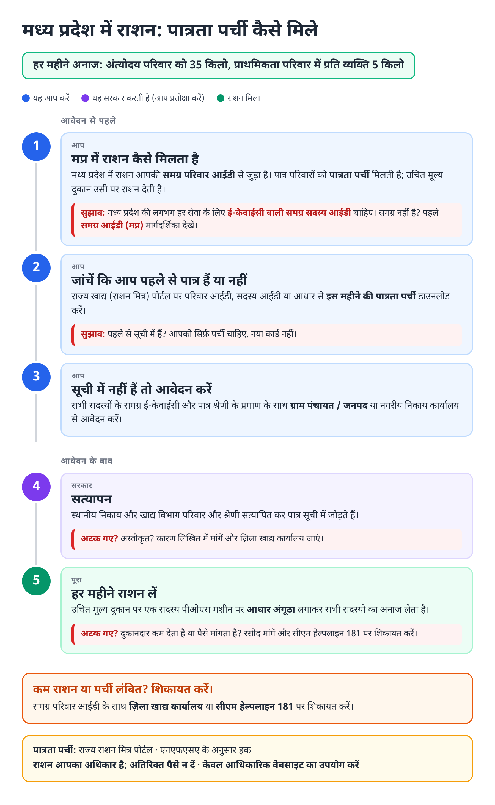
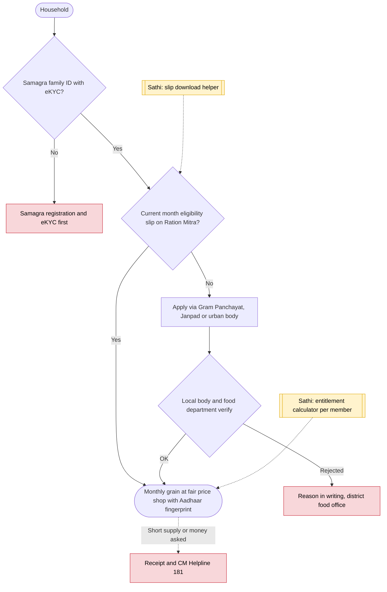

# Ration eligibility slip (MP) - End-to-End Workflow

पात्रता पर्ची (राशन) · For: Low-income households

## For citizens: step by step

Blue = you do this. Purple = government does this (you wait). Green = done. Red = what to do if stuck. Orange = your rights if it is late.

### English

### हिंदी (Hindi)

Sources: [`mp-ration-card-guide.html`](mp-ration-card-guide.html), [`mp-ration-card-guide-hi.html`](mp-ration-card-guide-hi.html), generated from [`mp_ration_card_content.py`](mp_ration_card_content.py) with `python3 ../gen_guide.py mp_ration_card_content.py`. Hindi text pending native-speaker review.

## Official links

Use only these addresses. Checked on 28 Oct 2026 through search results; the government sites could not be opened directly from our build environment. "Third-party sites only" means several non-government sites agree on the address but no government page confirmed it yet, so open it and check before you share it.

| What | Link | Checked via |
| :--- | :--- | :--- |
| Ration Mitra (state food portal): eligibility slip | <https://rationmitra.nic.in> | Third-party sites only |
| Samagra portal: family / member ID, eKYC | <https://samagra.gov.in> | Third-party sites only |
| CM Helpline: 181 | - | Third-party sites only |

## For the Sathi team: system workflow

## Verification (28 Oct 2026)

- **Reported:** Samagra ID mandatory for ration in MP; eligibility slip downloadable for the current month with family ID, member ID or Aadhaar; AAY 35 kg per household, PHH 5 kg per person a month.
- **Conflicting:** the slip portal address (rationmitra.nic.in vs a csmsmpscsc subdomain) and card categories (APL/BPL vs AAY/PHH). The guide uses NFSA categories.
- **Still unverified:** current application route for families not listed.

Sources: [Bajaj Finserv: MP ration card 2026](https://www.bajajfinserv.in/madhya-pradesh-ration-card) · [BankBazaar: MP ration card](https://www.bankbazaar.com/ration-card/madhya-pradesh-ration-card.html)
