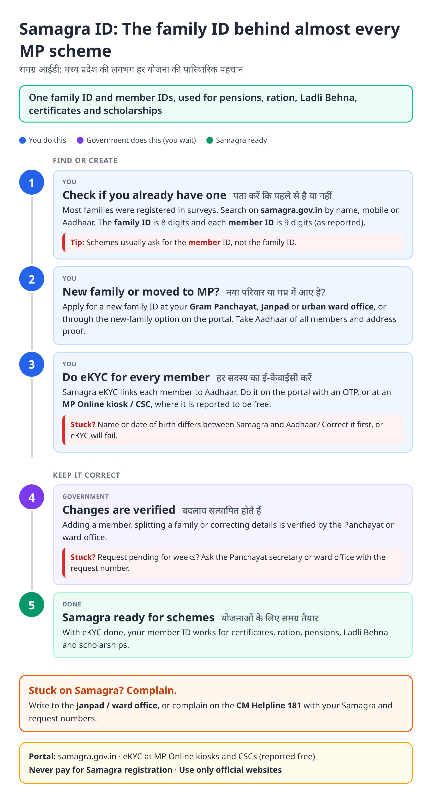
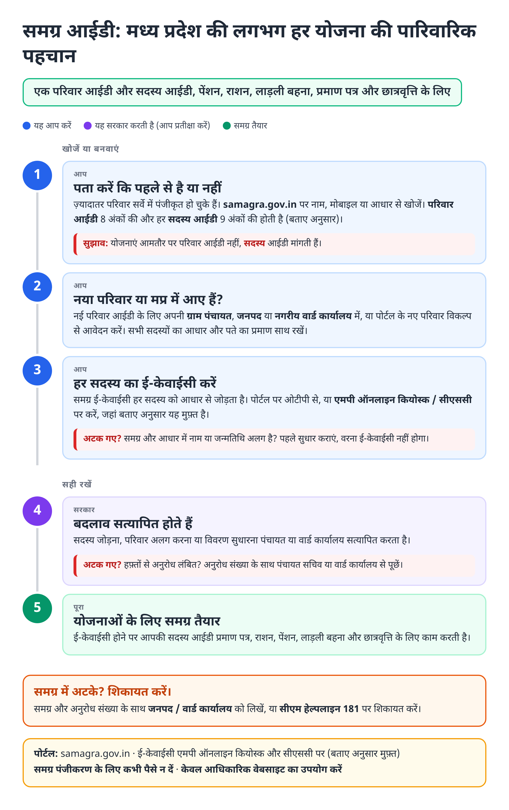
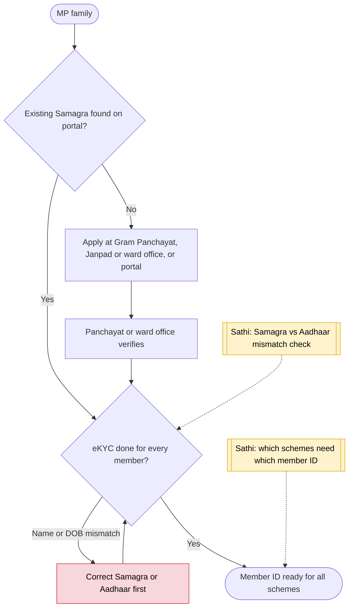

# Samagra ID (MP) - End-to-End Workflow

समग्र आईडी · For: Every MP family: needed for almost all schemes

## For citizens: step by step

Blue = you do this. Purple = government does this (you wait). Green = done. Red = what to do if stuck. Orange = your rights if it is late.

### English

### हिंदी (Hindi)

Sources: [`mp-samagra-id-guide.html`](mp-samagra-id-guide.html), [`mp-samagra-id-guide-hi.html`](mp-samagra-id-guide-hi.html), generated from [`mp_samagra_id_content.py`](mp_samagra_id_content.py) with `python3 ../gen_guide.py mp_samagra_id_content.py`. Hindi text pending native-speaker review.

## Official links

Use only these addresses. Checked on 28 Oct 2026 through search results; the government sites could not be opened directly from our build environment. "Third-party sites only" means several non-government sites agree on the address but no government page confirmed it yet, so open it and check before you share it.

| What | Link | Checked via |
| :--- | :--- | :--- |
| Samagra portal: family / member ID, eKYC | <https://samagra.gov.in> | Third-party sites only |
| CM Helpline: 181 | - | Third-party sites only |

## For the Sathi team: system workflow

## Verification (28 Oct 2026)

- **Reported:** family ID 8 digits, member ID 9 digits; citizen login with mobile OTP; eKYC free at MP Online centres and CSCs (Free Press Journal); new families apply via Gram Panchayat, Janpad or ward office.
- **Conflicting:** one source swaps the 8 and 9 digit lengths.
- **Still unverified:** the current online new-family procedure.

Sources: [Free Press Journal: Samagra eKYC a must](https://www.freepressjournal.in/bhopal/mp-updates-now-e-kyc-of-samagra-id-a-must-to-access-government-schemes-facilities-first-ac-added-to-bhind-gwalior-trains) · [Anantam IAS: Samagra portal login and eKYC](https://anantamias.com/samagra-portal-login/) · [Bajaj Finserv: Samagra ID card](https://www.bajajfinserv.in/samagra-id-card-how-to-apply-and-download)
