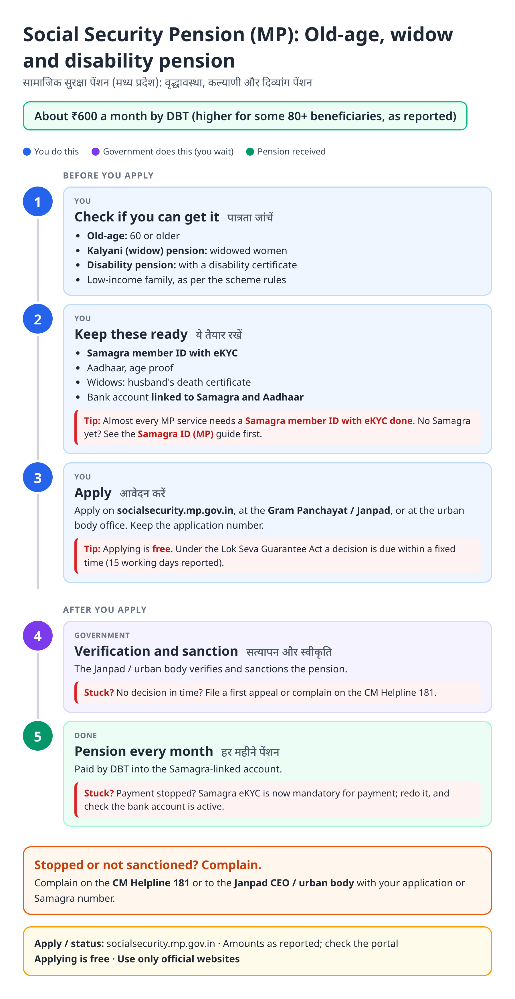
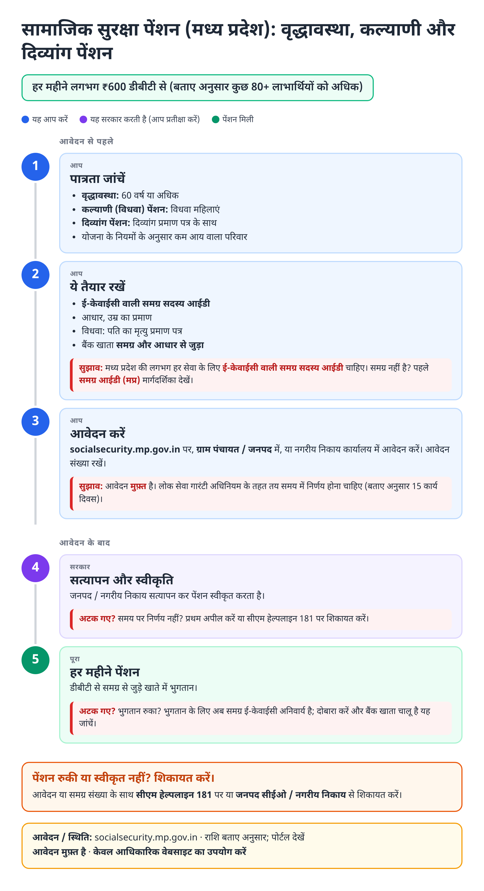
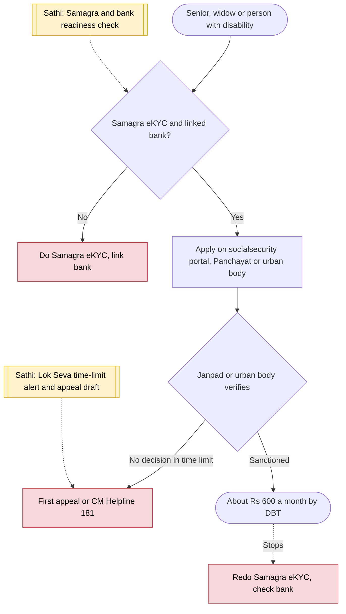

# Old-age and widow pension (MP) - End-to-End Workflow

वृद्धावस्था एवं कल्याणी पेंशन · For: Seniors 60+, widows (Kalyani), persons with disabilities

## For citizens: step by step

Blue = you do this. Purple = government does this (you wait). Green = done. Red = what to do if stuck. Orange = your rights if it is late.

### English

### हिंदी (Hindi)

Sources: [`mp-social-pension-guide.html`](mp-social-pension-guide.html), [`mp-social-pension-guide-hi.html`](mp-social-pension-guide-hi.html), generated from [`mp_social_pension_content.py`](mp_social_pension_content.py) with `python3 ../gen_guide.py mp_social_pension_content.py`. Hindi text pending native-speaker review.

## Official links

Use only these addresses. Checked on 28 Oct 2026 through search results; the government sites could not be opened directly from our build environment. "Third-party sites only" means several non-government sites agree on the address but no government page confirmed it yet, so open it and check before you share it.

| What | Link | Checked via |
| :--- | :--- | :--- |
| Social Security portal: apply, status | <https://socialsecurity.mp.gov.in> | Third-party sites only |
| Samagra portal: family / member ID, eKYC | <https://samagra.gov.in> | Third-party sites only |
| CM Helpline: 181 | - | Third-party sites only |

## For the Sathi team: system workflow

## Verification (28 Oct 2026)

- **Reported:** ₹600 a month for old-age, widow (Kalyani) and disability pensions; Samagra eKYC mandatory for payment; decision within 15 working days under the Public Service Guarantee Act; no change as of August 2026.
- **Conflicting:** 80+ rate (₹800, ₹1,000, or unchanged ₹600 by source); a hike toward ₹1,500 is only proposed.
- **Still unverified:** income criteria for each pension.

Sources: [schemesinindia: MP Mukhyamantri pension](https://schemesinindia.in/schemes/madhya-pradesh/mp-mukhyamantri-pension-yojana-socialsecurity) · [sarkariyojana.com: Kalyani Sahayata (widows)](https://sarkariyojana.com/mukhyamantri-kalyani-sahayata-yojana-mp-widows/) · [sarkariyojana.com: pension schemes in MP](https://sarkariyojana.com/pension-schemes-in-madhya-pradesh/)
