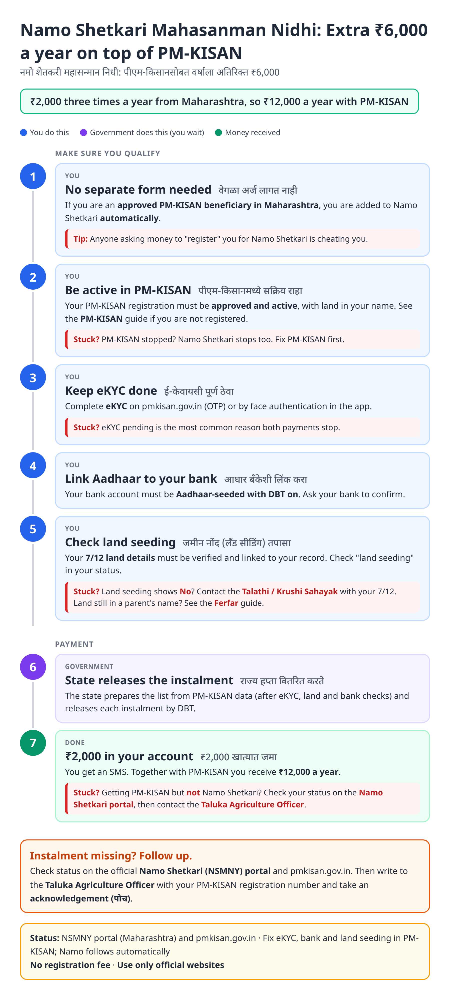
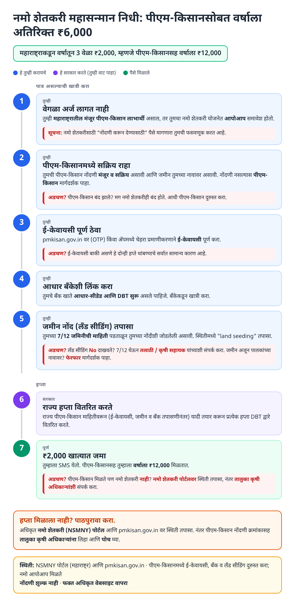
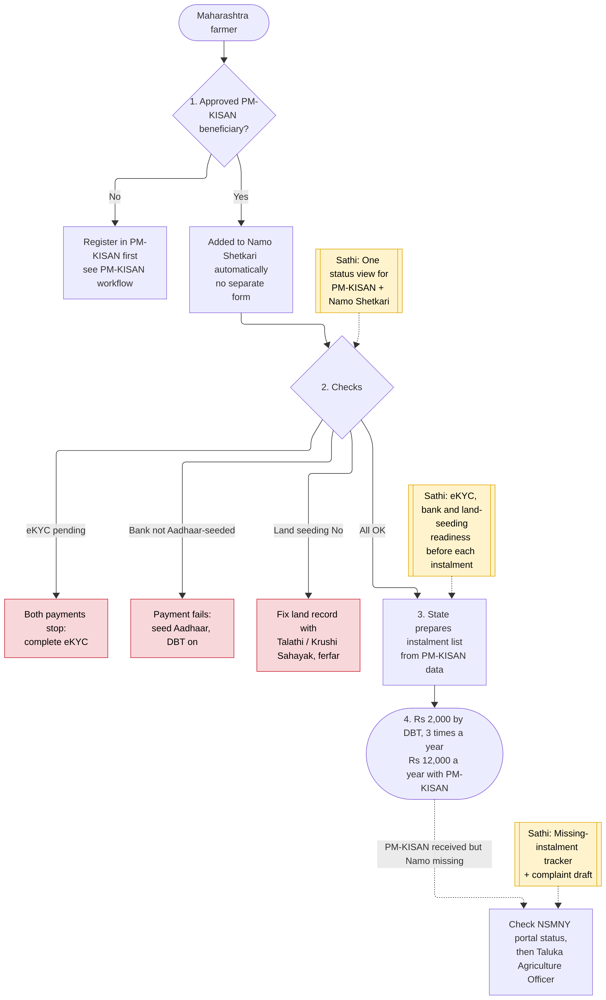
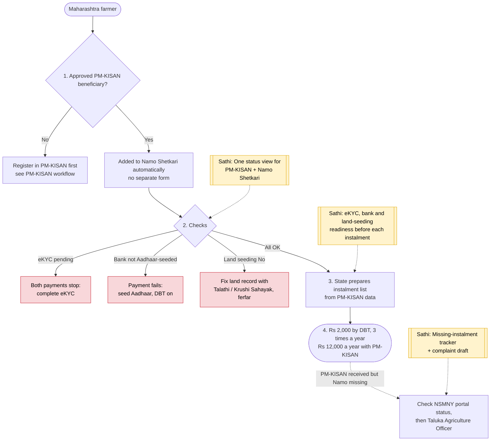

# Namo Shetkari Mahasanman Nidhi Yojana - End-to-End Workflow

Maharashtra's top-up to PM-KISAN: **₹6,000 a year in three ₹2,000 instalments**, so eligible farmers get **₹12,000 a year** in total. **No separate application**: approved PM-KISAN beneficiaries in Maharashtra are included automatically; payment depends on eKYC, Aadhaar-bank seeding and land seeding. See [PM-KISAN](pm-kisan.md) first.

## For farmers: step by step

Blue = you do this. Purple = government does this (you wait). Green = money received. Red = what to do if stuck. Orange = how to follow up.

### English

### मराठी (Marathi)

Sources: [`namo-shetkari-guide.html`](namo-shetkari-guide.html), [`namo-shetkari-guide-mr.html`](namo-shetkari-guide-mr.html), generated from [`namo_shetkari_content.py`](namo_shetkari_content.py) with `python3 gen_guide.py namo_shetkari_content.py`. Marathi text pending native-speaker review.

## Official links

Use only these addresses. Checked on 27 Oct 2026 through search results; the government sites could not be opened directly from our build environment. "Third-party sites only" means several non-government sites agree on the address but no government page confirmed it yet, so open it and check before you share it.

| What | Link | Checked via |
| :--- | :--- | :--- |
| Namo Shetkari (NSMNY) beneficiary status | <https://nsmny.mahait.org> | Third-party sites only |
| PM-KISAN: eKYC, Know Your Status | <https://pmkisan.gov.in> | Government page |
| Vikaspedia: scheme summary | <https://en.vikaspedia.in/viewcontent/schemesall/state-specific-schemes/welfare-schemes-of-maharashtra/namo-shetkari-maha-samman-nidhi-yojana> | Government page |

## For the Sathi team: system workflow

Yellow boxes = where Sathi plugs in. Red boxes = common blockers.

Mermaid source (editable)

## Stages

| # | Stage | Owner | Common blocker | Sathi action |
|---|---|---|---|---|
| 1 | Automatic inclusion | State | Farmer pays agent to "register" | Fraud warning: no form, no fee |
| 2 | PM-KISAN active | Farmer | PM-KISAN stopped → Namo stops | Link to [PM-KISAN](pm-kisan.md) fixes |
| 3 | eKYC | Farmer | eKYC pending (most common) | eKYC reminder before each instalment |
| 4 | Bank seeding | Farmer / bank | Not Aadhaar-seeded / DBT off | Bank checklist |
| 5 | Land seeding | Talathi / Krushi Sahayak | Land seeding "No"; land in parent's name | Land fix via [Ferfar](ferfar.md) |
| 6 | Instalment release | State | List trimmed after checks | Explain why dropped |
| 7 | Payment | Bank | PM-KISAN received but Namo missing | One status view for both; complaint draft |

**Why this matters for Sathi:** this is the clearest case for a **single combined status**: the same farmer, the same three checks (eKYC, bank, land), two payments. Most farmers don't know Namo follows PM-KISAN automatically, so when one stops they chase the wrong office. One screen that shows both, with the exact failing check, saves real trips.

## Verification (27 Oct 2026)

- **Confirmed (multiple sources, consistent):** **₹6,000/year in three ₹2,000 instalments**, total **₹12,000/year with PM-KISAN**; **no separate form**: approved Maharashtra PM-KISAN beneficiaries are added automatically; **eKYC and Aadhaar-bank seeding** decide payment; tighter land-record and eKYC checks have reduced the beneficiary list (about 91.65 lakh in the 7th instalment to about 89.75 lakh in the 8th).
- **Reported (secondary):** 8th instalment released around **25 March 2026** (figures vary: ~84-90 lakh farmers, ~₹1,768-1,774 crore).
- **Still unverified:** the exact official NSMNY portal address (sources reference an NSMNY portal; not opened), and any change to the amount after July 2026.

Sources: [sarkariyojana.com: Namo Shetkari 2026](https://sarkariyojana.com/namo-shetkari-maha-samman-nidhi-yojana/) · [schemesinindia.in: Namo Shetkari 2026](https://schemesinindia.in/schemes/maharashtra/namo-shetkari-yojana) · [MACS College: 8th instalment update](https://macscollege.com/nsmny-8th-installment-date/) · [Anantam IAS: Namo Shetkari](https://anantamias.com/namo-shetkari-yojana/) · [Sarkari Yojana Tracker: Namo Shetkari 2025-26](https://sarkariyojanatracker.com/namo-shetkari-yojana-maharashtra/) · [govtschemes.in: Namo Shetkari](https://translate.google.com/translate?u=https%3A%2F%2Fwww.govtschemes.in%2Fmaharashtra-namo-shetkari-maha-samman-nidhi-yojana&hl=hi&sl=en&tl=hi&client=srp) · [Wikipedia: PM-KISAN](https://en.wikipedia.org/wiki/Pradhan_Mantri_Kisan_Samman_Nidhi)
