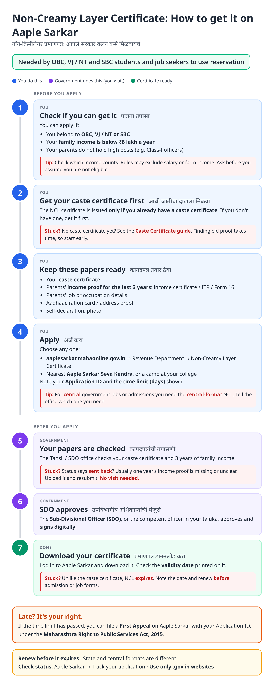
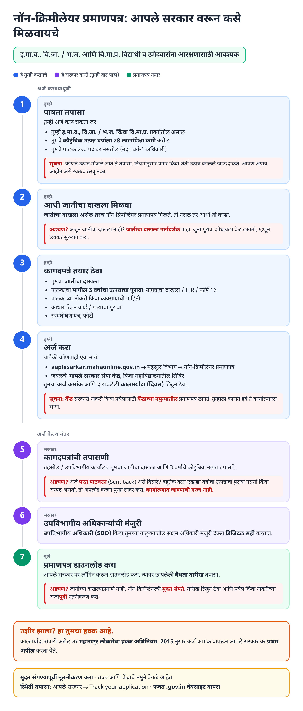
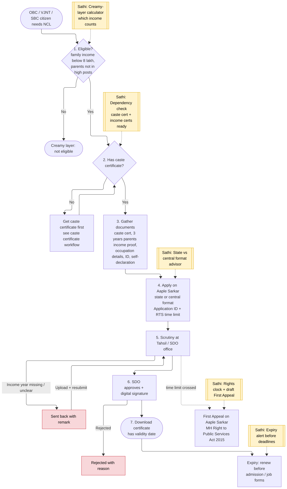
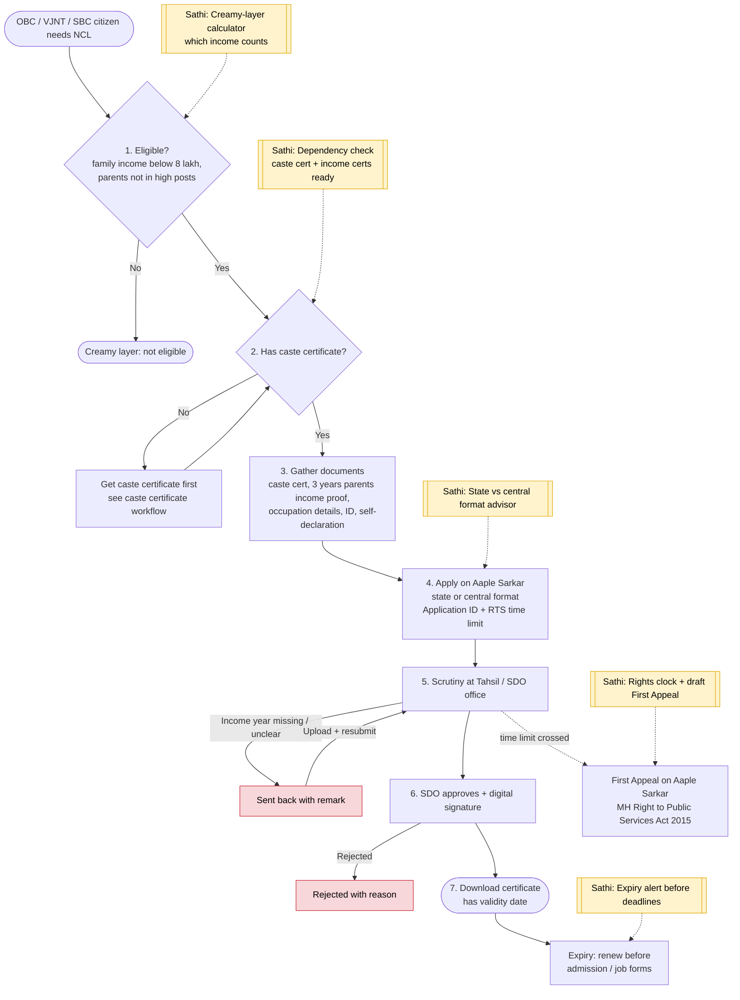

# Non-Creamy Layer (NCL) Certificate (Maharashtra) - End-to-End Workflow

For OBC, VJ / NT and SBC citizens. Official site: https://aaplesarkar.mahaonline.gov.in (Revenue Department). Requires a [caste certificate](caste-certificate.md) first.

## For citizens: step by step

Blue = you do this. Purple = government does this (you wait). Green = certificate ready. Red = what to do if stuck. Orange = your rights if it is late.

### English

### मराठी (Marathi)

Sources: [`ncl-certificate-guide.html`](ncl-certificate-guide.html), [`ncl-certificate-guide-mr.html`](ncl-certificate-guide-mr.html), generated from [`ncl_certificate_content.py`](ncl_certificate_content.py) with `python3 gen_guide.py ncl_certificate_content.py`. Marathi text pending native-speaker review.

## For the Sathi team: system workflow

Yellow boxes = where Sathi plugs in. Red boxes = common blockers.

Mermaid source (editable)

## Stages

| # | Stage | Owner | Common blocker | Sathi action |
|---|---|---|---|---|
| 1 | Eligibility | Citizen | Wrongly assumes creamy layer (counts salary / farm income) | Creamy-layer calculator: which income counts |
| 2 | Caste certificate | Citizen | Doesn't have one yet | Dependency check; link to [caste certificate guide](caste-certificate.md) |
| 3 | Documents | Citizen | Missing one of 3 income years | Income-year checklist; link to [income certificate guide](income-certificate.md) |
| 4 | Apply | Citizen / Seva Kendra / college camp | Gets state format when central is needed | State vs central format advisor |
| 5 | Scrutiny | Tahsil / SDO office | Sent back: income proof missing | Decode remark in Marathi |
| 6 | Approval | SDO | Rejected | Explain reason |
| 7 | Download | Citizen | Expires before admission / job form | Expiry alert; feeds [MahaDBT scholarship](mahadbt-scholarship.md) |
| - | Late beyond time limit | Citizen | Doesn't know about appeal | Auto-draft First Appeal |

**Why this matters for Sathi:** NCL sits at the end of a dependency chain (caste certificate → 3 years of income proof → NCL → scholarship / admission) and it expires. That chain is exactly what a "readiness" engine is for: one family profile, every certificate's expiry tracked, the next missing link flagged before a deadline.

## Verification (27 Oct 2026, batch 2)

- **Confirmed (consistent across sources):** ₹8 lakh family income ceiling (from the central 2017 memorandum); applied via Aaple Sarkar under Revenue Department; Class-I / Group A parental posts are excluded while lower government cadres are judged by cadre, not income.
- **Unclear, so guide kept general:** which income counts (agricultural income excluded under central norms but Maharashtra practice may differ); **validity period** (sources say 1 year or 3 years). Guide tells users to check the validity date printed on the certificate.
- **Changed in guide:** issuing officer now reads "SDO, or the competent officer in your taluka".

Sources: [mahadocguide: NCL Maharashtra](https://mahadocguide.in/non-creamy-layer-certificate-maharashtra/) · [navimumbai.com: NCL](https://navimumbai.com/non-creamy-layer-certificate-maharashtra/) · [LegalRaasta: NCL Maharashtra](https://www.legalraasta.com/blog/maharashtra-non-creamy-layer-certificate/) · [IndiaFilings: NCL Maharashtra](https://www.indiafilings.com/learn/maharashtra-non-creamy-layer-certificate)
