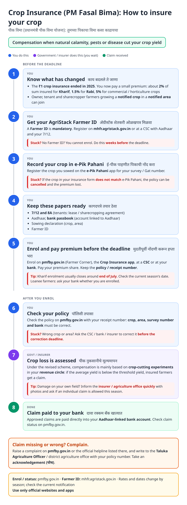
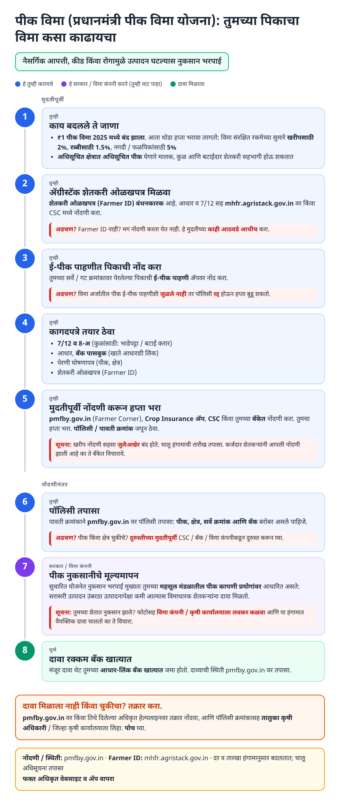
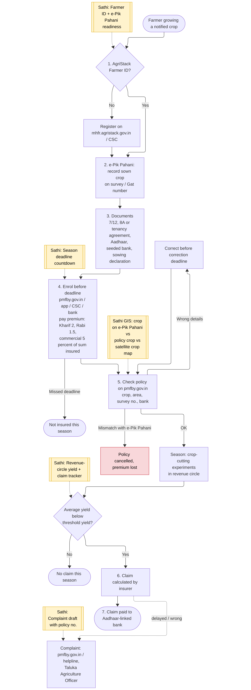
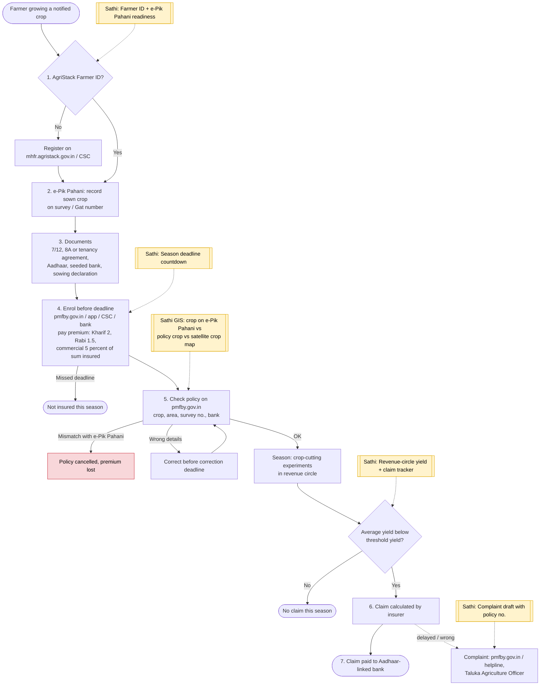

# Crop Insurance (PM Fasal Bima Yojana, Maharashtra) - End-to-End Workflow

Crop insurance for notified crops in notified areas, covering yield loss from natural calamities, pests and diseases. **Revised in Maharashtra from Kharif 2025:** the ₹1 premium scheme ended (standard farmer premium now applies), an **AgriStack Farmer ID** and a matching **e-Pik Pahani** crop entry are mandatory, and compensation is **yield-based** (crop-cutting experiments per revenue circle). Enrol at https://pmfby.gov.in.

Related: [PM-KISAN](pm-kisan.md), [Ferfar](ferfar.md) (7/12 must be correct), farm irrigation guides ([Magel Tyala Shettale](magel-tyala-shettale.md), [Saur Krushi Pump](saur-krushi-pump.md)).

## For farmers: step by step

Blue = you do this. Purple = government / insurer does this (you wait). Green = claim received. Red = what to do if stuck. Orange = how to complain.

### English

### मराठी (Marathi)

Sources: [`pik-vima-guide.html`](pik-vima-guide.html), [`pik-vima-guide-mr.html`](pik-vima-guide-mr.html), generated from [`pik_vima_content.py`](pik_vima_content.py) with `python3 gen_guide.py pik_vima_content.py`. Marathi text pending native-speaker review.

## For the Sathi team: system workflow

Yellow boxes = where Sathi plugs in. Red boxes = common blockers.

Mermaid source (editable)

## Stages

| # | Stage | Owner | Common blocker | Sathi action |
|---|---|---|---|---|
| 1 | Know the change | Farmer | Still expects ₹1 premium | Explain 2025 change and premium rates |
| 2 | AgriStack Farmer ID | Farmer / CSC | No Farmer ID → cannot enrol | Farmer ID readiness, weeks before deadline |
| 3 | e-Pik Pahani | Farmer | Crop not recorded / mismatch → policy cancelled | **GIS**: compare e-Pik Pahani crop, policy crop and satellite crop map |
| 4 | Documents | Farmer | Tenant without agreement; bank not seeded | Checklist |
| 5 | Enrol + premium | Farmer / CSC / bank | Misses deadline (Kharif ~end July) | Season deadline countdown |
| 6 | Check policy | Farmer | Wrong crop / area / survey no. | Policy check before correction deadline |
| 7 | Loss assessment | Govt / insurer | Doesn't know claims are yield-based | Revenue-circle yield + claim tracker |
| 8 | Claim payment | Insurer | Claim delayed / wrong | Complaint draft with policy number |

**Why this matters for Sathi (and GIS patents):** the 2025 rules make crop insurance a **data-matching** problem: Farmer ID ↔ 7/12 parcel ↔ e-Pik Pahani crop ↔ policy. A mismatch now cancels the policy. Cross-checking the declared crop against **satellite crop classification** for that parcel *before* the deadline, and estimating revenue-circle yield shortfalls from remote sensing to flag likely claims, are strong GIS + AI validation ideas squarely in your patent area.

## Verification (27 Oct 2026)

- **Confirmed (news + PIB):** Maharashtra implemented the **revised PMFBY from Kharif 2025 and Rabi 2025-26**; the **₹1 premium variant ended** and the standard shared premium returned; national farmer-premium caps **2% Kharif, 1.5% Rabi, 5% commercial / horticulture**; **AgriStack Farmer ID mandatory** from Kharif 2025; **e-Pik Pahani** registration required and a mismatch can cancel the insurance; Kharif 2025 enrolment deadline was **31 July**; PMFBY running in Kharif 2026.
- **Confirmed (state scheme summary):** compensation when the **average crop-cutting yield in the revenue circle is below the threshold yield**; covered risks include drought, excess rain, flood, hailstorm, storm, pests and diseases.
- **Not confirmed, so hedged:** whether individual-farm triggers (localised calamity, post-harvest loss, 72-hour intimation) still apply under the revised scheme. Guide tells farmers to inform the insurer / agriculture office quickly and ask.
- **Not added:** helpline number (refer to pmfby.gov.in), season-specific dates for 2026-27.

Sources: [Free Press Journal: PMFBY Kharif-Rabi 2025 open, e-survey and AgriStack mandatory](https://www.freepressjournal.in/mumbai/raigad-pmfby-kharif-rabi-2025-crop-insurance-now-open-e-survey-agristack-id-mandatory) · [PIB press release](https://www.pib.gov.in/PressReleasePage.aspx?PRID=2304549&reg=48&lang=2) · [MahaBharti: Maharashtra revised crop insurance scheme](https://mahabharti.in/maharashtra-sudharit-pik-vima-yojana/) · [Kshema: PMFBY 2026](https://kshema.co/blogs/pmfby-crop-insurance-india-2026/) · [AgriStack Farmer ID registration](https://www.egovtschemes.com/agristack-registration/) · [Agrijob: PMFBY benefits 2016-2025](https://www.agrijob.in/pmfby-farmer-benefits-claims-data-2016-2025/) · [Zee News: crop insurance fraud report](https://zeenews.india.com/marathi/video/fraud-in-peek-vima-yojna/899329)
