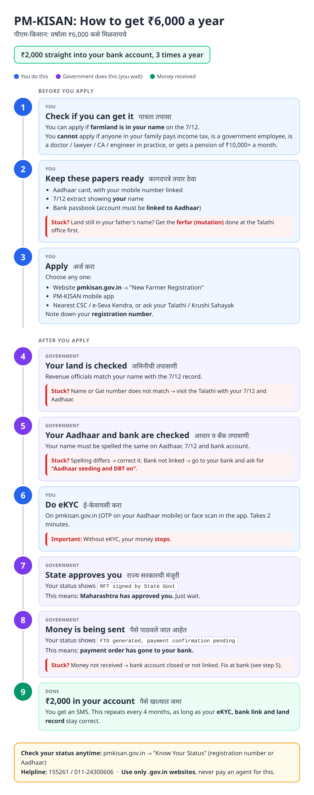
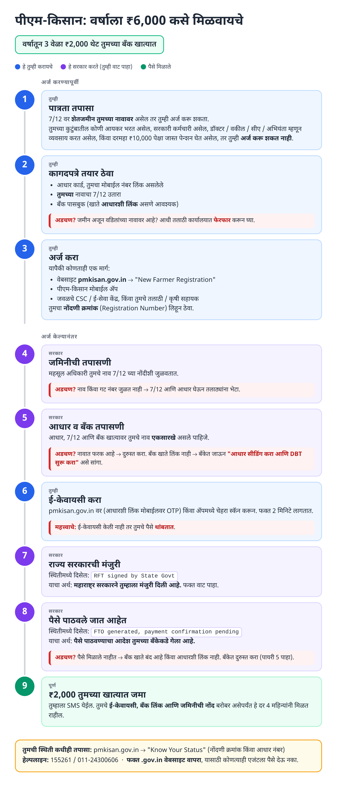
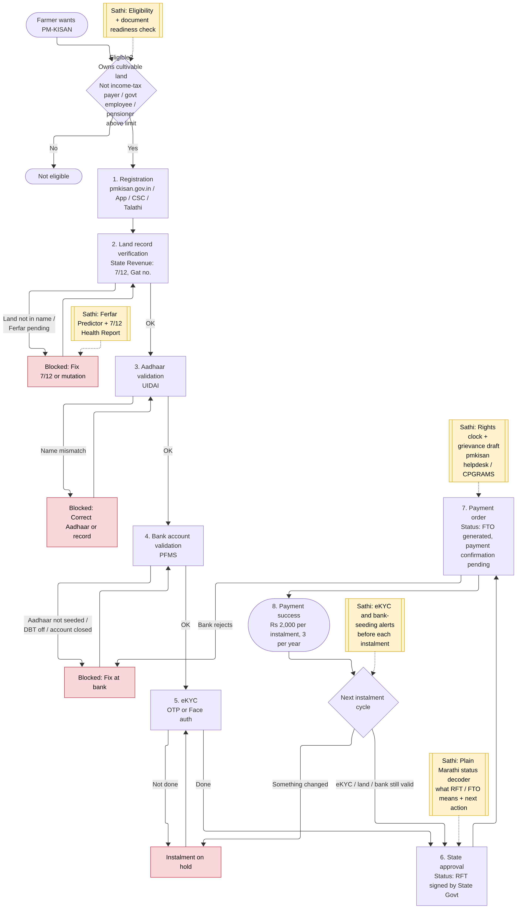
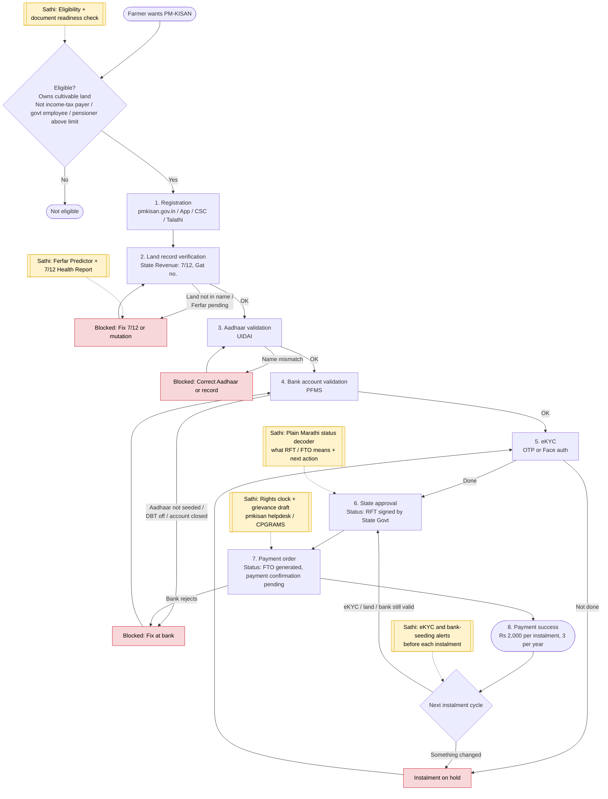

# PM-KISAN - End-to-End Workflow

Official site: https://pmkisan.gov.in (Operational Guidelines PDF + "Know Your Status").

## For farmers: step by step

Blue = you do this. Purple = government does this (you wait). Green = money received. Red = what to do if stuck.

Source to edit: [`pm-kisan-farmer-guide.html`](pm-kisan-farmer-guide.html)

### मराठी (Marathi)

Source to edit: [`pm-kisan-farmer-guide-mr.html`](pm-kisan-farmer-guide-mr.html). Marathi text pending native-speaker review.

## For the Sathi team: system workflow

Yellow boxes = where Sathi plugs in. Red boxes = common blockers.

Mermaid source (editable)

## Stages

| # | Stage | Owner | Status text farmer sees | Common blocker | Sathi action |
|---|---|---|---|---|---|
| 1 | Registration | Farmer / CSC / Talathi | Registration | Wrong name or Aadhaar | Readiness check before applying |
| 2 | Land record verification | State Revenue | Land seeding | Land not in name, Ferfar pending, Gat mismatch | 7/12 Health Report, Ferfar Predictor |
| 3 | Aadhaar validation | UIDAI | Aadhaar validation | Name mismatch Aadhaar vs 7/12 | Show exact mismatch, how to fix |
| 4 | Bank validation | PFMS | Bank / Aadhaar seeding | Not seeded, DBT off, account closed | Bank-side checklist in Marathi |
| 5 | eKYC | Farmer | eKYC | Not done, instalment on hold | Alert before each instalment |
| 6 | State approval | State nodal officer | RFT signed by State Govt | Stuck at state | Decode status, rights clock |
| 7 | Payment order | Centre / PFMS | FTO generated, payment confirmation pending | Bank rejects | Grievance draft (helpdesk / CPGRAMS) |
| 8 | Payment | Bank | Payment success | Missed instalments | Instalment history check |

Helpline: 155261 / 011-24300606

## Verification (27 Oct 2026, batch 3)

- **Confirmed:** "RFT signed by State Govt" = state has verified and requested release; "FTO generated, payment confirmation pending" = transfer order created, money due soon. A "temporary hold" status is also reported.
- **No change needed** to the guide.
- **Still unverified:** exclusion list incl. ₹10,000 pension threshold, helpline numbers, eKYC rule details.

Sources: [AgriFarming: FTO processed but money not received](https://www.agrifarming.in/pm-kisan-fto-processed-but-money-not-received) · [BiharHelp: RFT signed by state](https://biharhelp.in/pm-kisan-rft-signed-by-state/) · [GovtSchemes: temporary hold](https://www.govtschemes.in/pm-kissan-temporary-hold)
