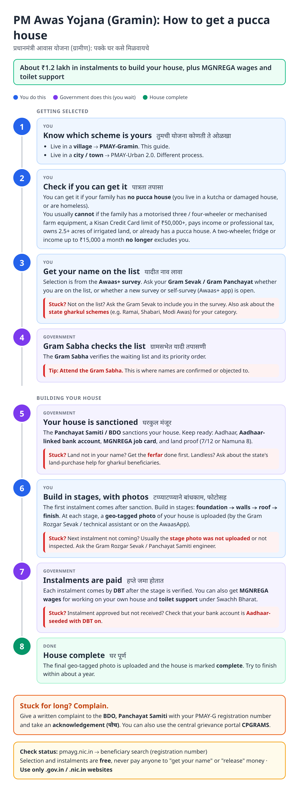
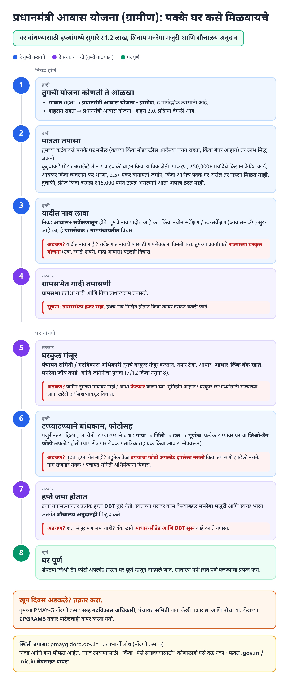
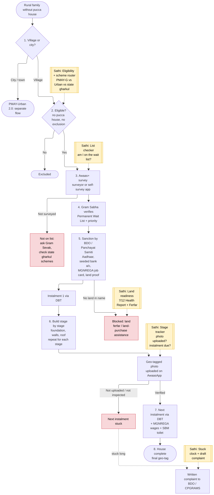
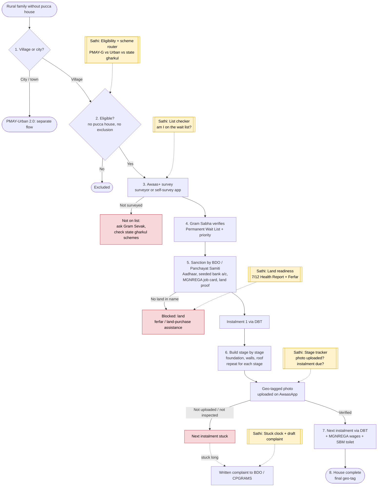

# PM Awas Yojana - Gramin (PMAY-G) - End-to-End Workflow

Rural housing: financial help to build a pucca house, released in stages as construction progresses. Official site: https://pmayg.nic.in. Urban families use [PMAY-Urban 2.0](pmay-urban.md).

## For citizens: step by step

Blue = you do this. Purple = government does this (you wait). Green = house complete. Red = what to do if stuck. Orange = how to complain.

### English

### मराठी (Marathi)

Sources: [`pmay-gramin-guide.html`](pmay-gramin-guide.html), [`pmay-gramin-guide-mr.html`](pmay-gramin-guide-mr.html), generated from [`pmay_gramin_content.py`](pmay_gramin_content.py) with `python3 gen_guide.py pmay_gramin_content.py`. Marathi text pending native-speaker review.

## Official links

Use only these addresses. Checked on 27 Oct 2026 through search results; the government sites could not be opened directly from our build environment. "Third-party sites only" means several non-government sites agree on the address but no government page confirmed it yet, so open it and check before you share it.

| What | Link | Checked via |
| :--- | :--- | :--- |
| PMAY-G: beneficiary search and reports | <https://pmayg.nic.in> | Third-party sites only |
| PIB: PMAY-G document (PDF) | <https://static.pib.gov.in/WriteReadData/specificdocs/documents/2024/nov/doc20241119437801.pdf> | Government page |

## For the Sathi team: system workflow

Yellow boxes = where Sathi plugs in. Red boxes = common blockers.

Mermaid source (editable)

## Stages

| # | Stage | Owner | Common blocker | Sathi action |
|---|---|---|---|---|
| 1 | Rural vs urban | Citizen | Applies to wrong scheme | Scheme router: PMAY-G / Urban 2.0 / state gharkul |
| 2 | Eligibility | Citizen | Unsure about exclusions | Plain-Marathi eligibility check |
| 3 | Awaas+ survey | Surveyor / self-survey | Not on the list | List checker; route to state gharkul schemes (Ramai, Shabari, Modi Awas) |
| 4 | Gram Sabha verification | Gram Sabha | Name objected / low priority | Gram Sabha date reminder |
| 5 | Sanction | BDO / Panchayat Samiti | No land in name; bank not seeded; no job card | Land readiness: [7/12 Health Report + Ferfar](ferfar.md); bank + job card checklist |
| 6 | Construction + geo-tag | Beneficiary / Gram Rozgar Sevak | Stage photo not uploaded or inspected | Stage tracker: photo uploaded? instalment due? |
| 7 | Instalments | PFMS / bank | Payment failed | Bank-seeding check |
| 8 | Completion | Beneficiary | House left incomplete | Completion nudges |
| - | Stuck | Citizen | No escalation path | Stuck clock + draft complaint to BDO / CPGRAMS |

**Why this matters for Sathi (and GIS):** PMAY-G is a geo-tagged, stage-gated workflow tied to a land parcel. That connects directly to the land wedge: the same parcel's 7/12 must be clean for sanction, and every instalment depends on a verified geo-tagged photo. A stage tracker that checks photo location against the parcel, and flags "instalment due but photo missing", is a natural fit for GIS-based validation and a candidate for narrow patent claims.

## Verification (27 Oct 2026, batch 3)

- **Confirmed (official):** 2024-29 phase, 2 crore houses; unit assistance **₹1.20 lakh** (plains) / **₹1.30 lakh** (NE, hill states, J&K, Ladakh); **90/95 days MGNREGA** wages; **₹12,000** toilet support; identification via **Awaas+ 2024 app** (launched 17 Sep 2024).
- **Changed in guide:** exclusion list updated to the **Sept 2024 relaxed criteria**: still excluded for motorised 3/4-wheelers, mechanised farm equipment, KCC limit ₹50,000+, income/professional tax payers, 2.5+ acres irrigated land; two-wheelers, fridges and income up to ₹15,000/month **no longer** exclude.
- **Still unverified:** instalment count/stages, state gharkul scheme names, land-purchase assistance, grievance route.

Sources: [PIB: PMAY-G document](https://static.pib.gov.in/WriteReadData/specificdocs/documents/2024/nov/doc20241119437801.pdf) · [Sansad: parliamentary reply](https://eparlib.sansad.in/bitstream/123456789/3006401/1/AU1336_CA4fLm.pdf) · [Business Today: exclusion norms relaxed](https://www.businesstoday.in/amp/india/story/pmay-g-automatic-exclusion-norms-relaxed-details-on-centres-rural-housing-scheme-here-445380-2024-09-11) · [Vajiram & Ravi: new eligibility norms](https://vajiramandravi.com/current-affairs/centre-eases-exclusion-criteria-for-pmay-gramin-new-eligibility-norms-explained/)
