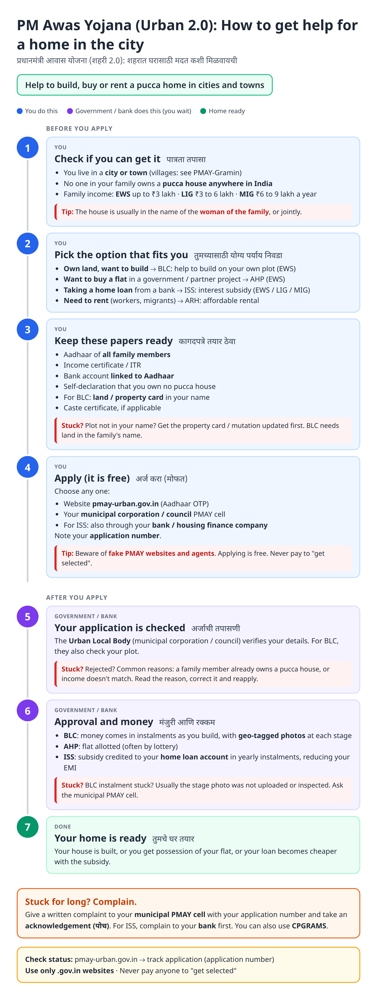
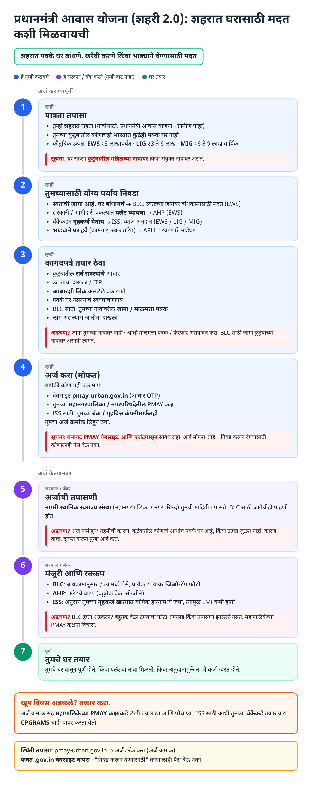
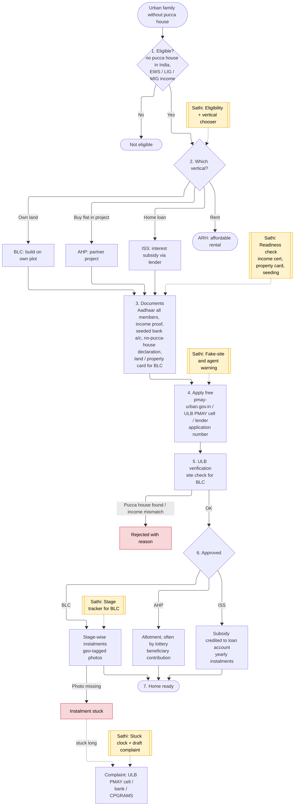
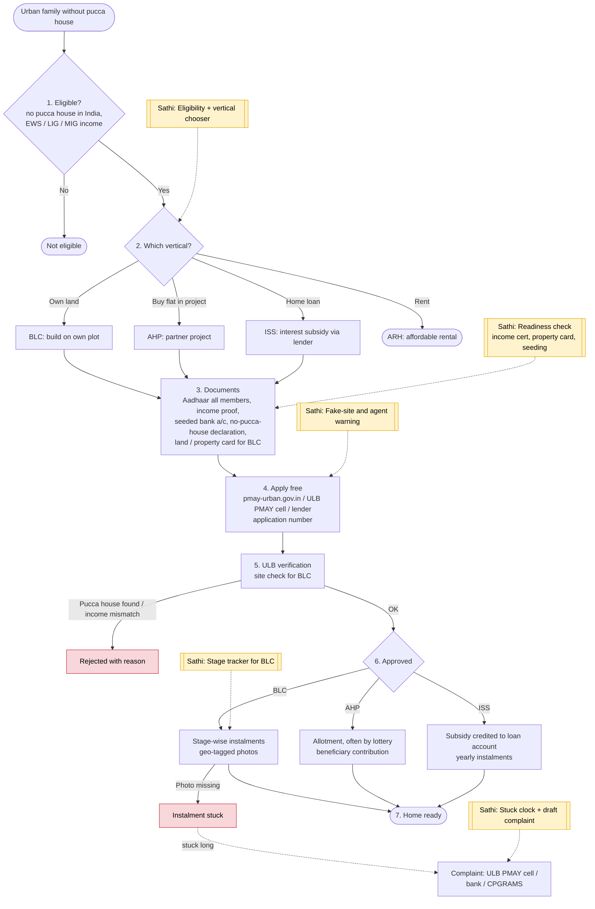

# PM Awas Yojana - Urban 2.0 (PMAY-U 2.0) - End-to-End Workflow

Urban housing for EWS / LIG / MIG families with four options: build on own land (BLC), buy in a partner project (AHP), interest subsidy on a home loan (ISS), or affordable rental (ARH). Official site: https://pmay-urban.gov.in. Rural families use [PMAY-Gramin](pmay-gramin.md).

## For citizens: step by step

Blue = you do this. Purple = government / bank does this (you wait). Green = home ready. Red = what to do if stuck. Orange = how to complain.

### English

### मराठी (Marathi)

Sources: [`pmay-urban-guide.html`](pmay-urban-guide.html), [`pmay-urban-guide-mr.html`](pmay-urban-guide-mr.html), generated from [`pmay_urban_content.py`](pmay_urban_content.py) with `python3 gen_guide.py pmay_urban_content.py`. Marathi text pending native-speaker review.

## For the Sathi team: system workflow

Yellow boxes = where Sathi plugs in. Red boxes = common blockers.

Mermaid source (editable)

## Stages

| # | Stage | Owner | Common blocker | Sathi action |
|---|---|---|---|---|
| 1 | Eligibility | Citizen | Family member owns a pucca house elsewhere; wrong income band | Eligibility check incl. "anywhere in India" rule |
| 2 | Choose vertical | Citizen | Doesn't know BLC / AHP / ISS / ARH differences | Vertical chooser in plain Marathi |
| 3 | Documents | Citizen | No income certificate; plot not in family name | Readiness; links to [income](income-certificate.md) and [ferfar](ferfar.md) guides |
| 4 | Apply | Citizen / ULB / lender | Fake PMAY websites and agents | Official-link only, fraud warning |
| 5 | ULB verification | Urban Local Body | Rejected: pucca house found / income mismatch | Decode reason |
| 6 | Approval + money | ULB / lender / CNA | BLC stage photo missing; ISS subsidy not credited | BLC stage tracker; ISS subsidy tracker |
| 7 | Home ready | Citizen | - | Family vault for allotment / sanction letters |
| - | Stuck | Citizen | No escalation path | Draft complaint to ULB PMAY cell / bank / CPGRAMS |

**Why this matters for Sathi:** PMAY-U 2.0 has four very different paths behind one name, and fake "PMAY" websites are common. A trusted vertical chooser plus readiness check is high-value; ISS also opens a B2B channel with banks and housing finance companies.

> Note: Working assumptions, not yet verified: income bands, the four verticals and who each is for, BLC / AHP assistance amounts, ISS loan / house-value caps and subsidy amount, female ownership rule, application channels, status labels, and grievance route. Verify against PMAY-U 2.0 operational guidelines, Maharashtra housing GRs, and pmay-urban.gov.in before building.
