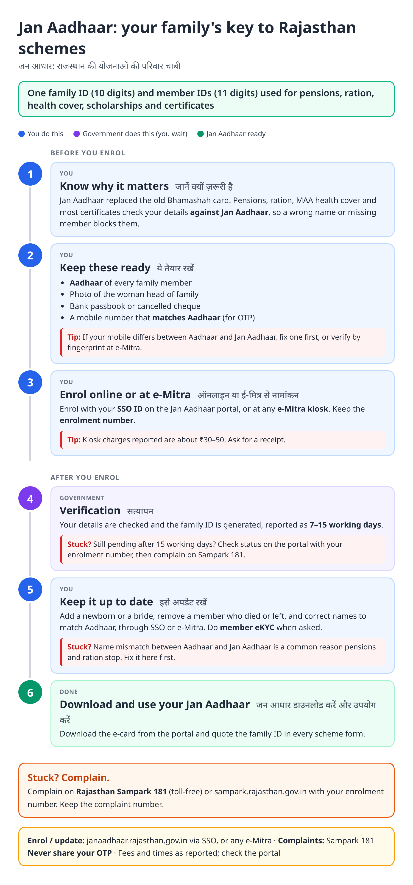
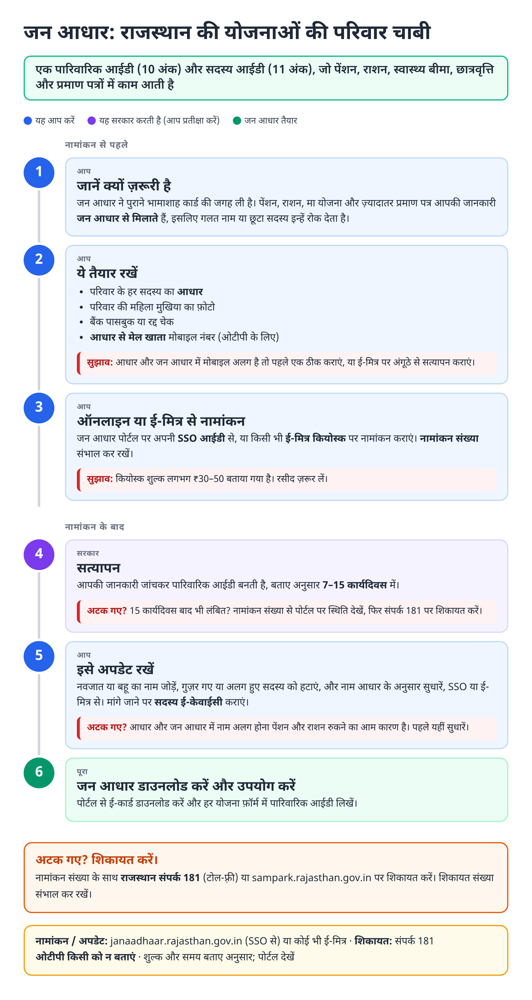
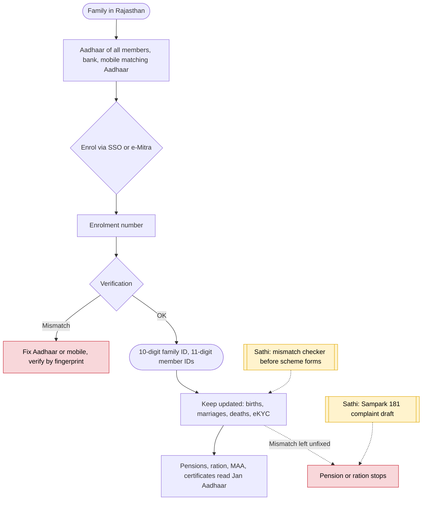

# Jan Aadhaar card (Rajasthan) - End-to-End Workflow

जन आधार कार्ड · For: Every family living in Rajasthan

## For citizens: step by step

Blue = you do this. Purple = government does this (you wait). Green = done. Red = what to do if stuck. Orange = your rights if it is late.

### English

### हिंदी (Hindi)

Sources: [`rj-jan-aadhaar-guide.html`](rj-jan-aadhaar-guide.html), [`rj-jan-aadhaar-guide-hi.html`](rj-jan-aadhaar-guide-hi.html), generated from [`rj_jan_aadhaar_content.py`](rj_jan_aadhaar_content.py) with `python3 ../gen_guide.py rj_jan_aadhaar_content.py`. Hindi text pending native-speaker review.

## Official links

Use only these addresses. Checked on 28 Oct 2026 through search results; the government sites could not be opened directly from our build environment. "Third-party sites only" means several non-government sites agree on the address but no government page confirmed it yet, so open it and check before you share it.

| What | Link | Checked via |
| :--- | :--- | :--- |
| Jan Aadhaar portal: family ID, update, eKYC | <https://janaadhaar.rajasthan.gov.in> | Third-party sites only |
| Rajasthan SSO: one login for state services | <https://sso.rajasthan.gov.in> | Third-party sites only |
| e-Mitra: apply, pay, status, download | <https://emitra.rajasthan.gov.in> | Third-party sites only |
| Rajasthan Sampark: grievances, also toll-free 181 | <https://sampark.rajasthan.gov.in> | Third-party sites only |

## For the Sathi team: system workflow

## Verification (28 Oct 2026)

- Family ID 10 digits and member ID 11 digits; replaces Bhamashah; run by the Rajasthan Jan Aadhaar Authority (Planning Department), per third-party guides.
- Kiosk charge ₹30–50 and 7–15 working days come from a single non-government guide; marked as reported.
- Pension stoppages linked to Aadhaar / Jan Aadhaar name mismatch are reported by The Quint and Deccan Herald.

Sources: [CitizenNest: Jan Aadhaar](https://www.citizennest.com/guide/jan-aadhaar-card-rajasthan) · [Anantam IAS: Jan Aadhaar](https://anantamias.com/jan-aadhaar/) · [The Quint: pensions and eKYC](https://www.thequint.com/my-report/rajasthan-elderly-disabled-struggle-to-access-pensions-due-to-e-kyc-digitisation)
