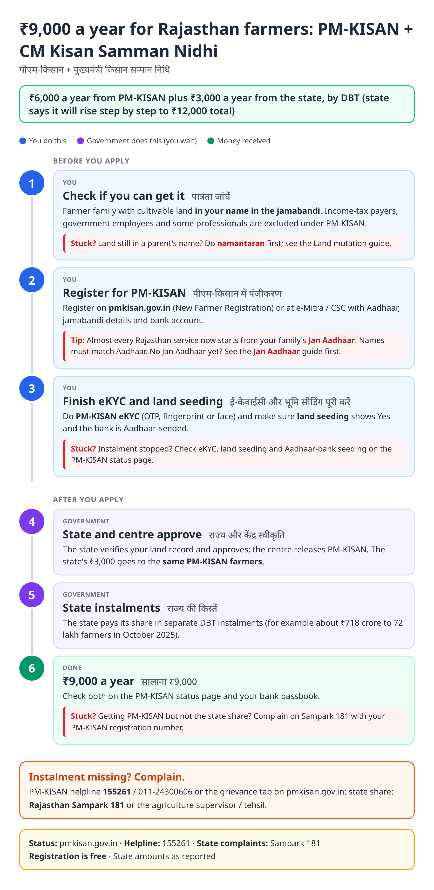
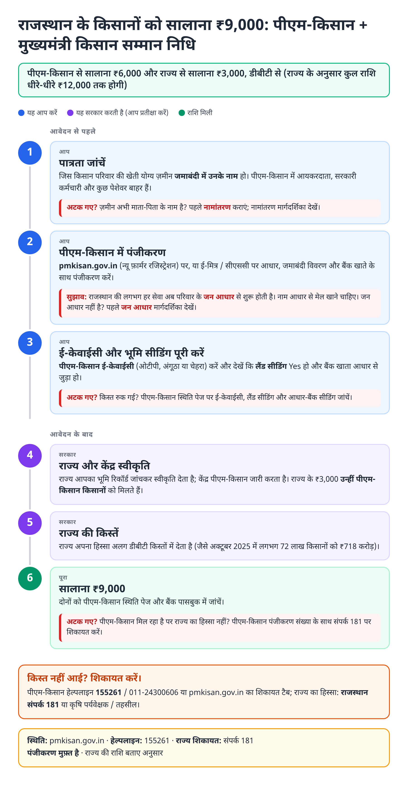
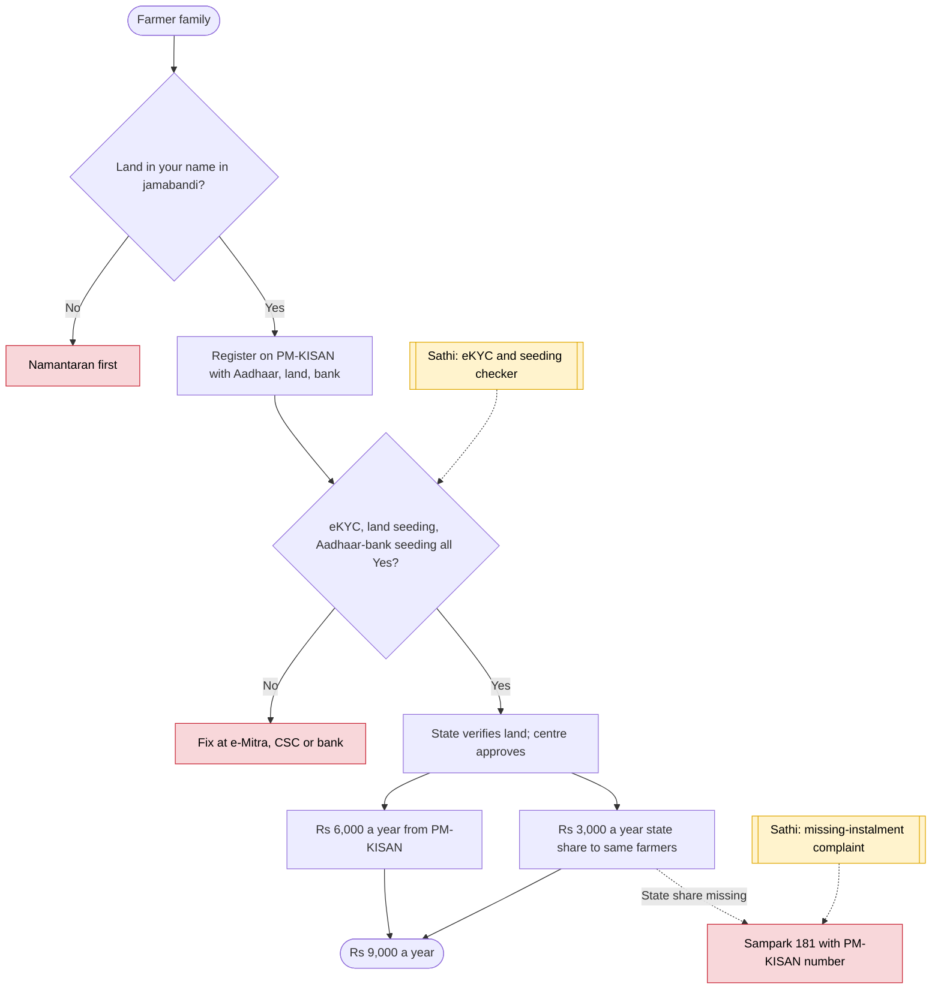

# PM-KISAN + CM Kisan Samman Nidhi (Rajasthan) - End-to-End Workflow

पीएम-किसान + मुख्यमंत्री किसान सम्मान निधि · For: Land-holding farmer families in Rajasthan

## For citizens: step by step

Blue = you do this. Purple = government does this (you wait). Green = done. Red = what to do if stuck. Orange = your rights if it is late.

### English

### हिंदी (Hindi)

Sources: [`rj-kisan-samman-guide.html`](rj-kisan-samman-guide.html), [`rj-kisan-samman-guide-hi.html`](rj-kisan-samman-guide-hi.html), generated from [`rj_kisan_samman_content.py`](rj_kisan_samman_content.py) with `python3 ../gen_guide.py rj_kisan_samman_content.py`. Hindi text pending native-speaker review.

## Official links

Use only these addresses. Checked on 28 Oct 2026 through search results; the government sites could not be opened directly from our build environment. "Third-party sites only" means several non-government sites agree on the address but no government page confirmed it yet, so open it and check before you share it.

| What | Link | Checked via |
| :--- | :--- | :--- |
| PM-KISAN portal | <https://pmkisan.gov.in> | Government page |
| Rajasthan Agriculture Department | <https://agriculture.rajasthan.gov.in> | Third-party sites only |
| e-Mitra: apply, pay, status, download | <https://emitra.rajasthan.gov.in> | Third-party sites only |
| Rajasthan Sampark: grievances, also toll-free 181 | <https://sampark.rajasthan.gov.in> | Third-party sites only |

## For the Sathi team: system workflow

## Verification (28 Oct 2026)

- State adds ₹3,000 to the central ₹6,000, so ₹9,000 a year, with a stated plan to reach ₹12,000 (ThePrint, The Week, Nov 2025).
- Fourth state instalment 18 Oct 2025: about ₹718 crore to 72 lakh farmers (ThePrint). No 2026 state instalment found in our search.
- PM-KISAN eligibility, eKYC and helpline from the central portal, as in the Maharashtra PM-KISAN guide.

Sources: [ThePrint: ₹718 crore to 72 lakh farmers](https://theprint.in/india/rajasthan-cm-transfers-rs-718-cr-to-72-lakh-farmers-under-mukhyamantri-kisan-samman-nidhi/2766869) · [The Week: ₹9,000 rising to ₹12,000](https://www.theweek.in/wire-updates/national/2025/11/19/des67-rj-sharma-farmers.html) · [PM-KISAN](https://pmkisan.gov.in)
