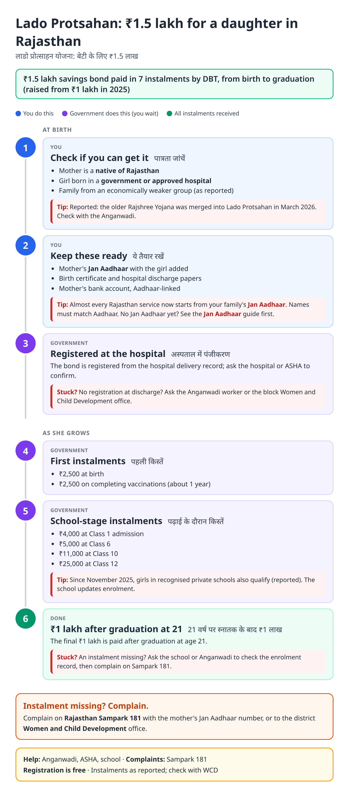
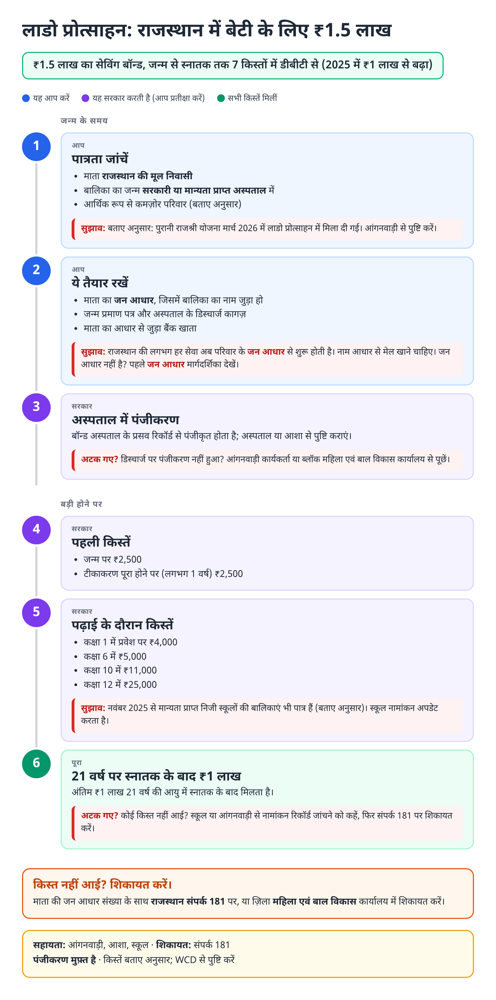
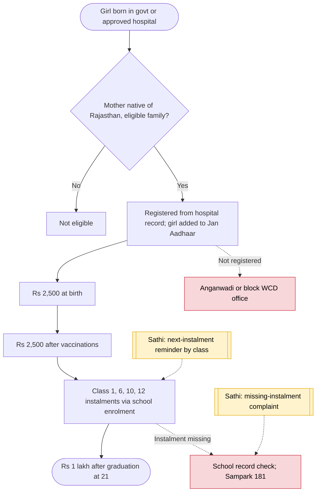

# Lado Protsahan Yojana (Rajasthan) - End-to-End Workflow

लाडो प्रोत्साहन योजना · For: Families with a girl born in a government or approved hospital in Rajasthan

## For citizens: step by step

Blue = you do this. Purple = government does this (you wait). Green = done. Red = what to do if stuck. Orange = your rights if it is late.

### English

### हिंदी (Hindi)

Sources: [`rj-lado-protsahan-guide.html`](rj-lado-protsahan-guide.html), [`rj-lado-protsahan-guide-hi.html`](rj-lado-protsahan-guide-hi.html), generated from [`rj_lado_protsahan_content.py`](rj_lado_protsahan_content.py) with `python3 ../gen_guide.py rj_lado_protsahan_content.py`. Hindi text pending native-speaker review.

## Official links

Use only these addresses. Checked on 28 Oct 2026 through search results; the government sites could not be opened directly from our build environment. "Third-party sites only" means several non-government sites agree on the address but no government page confirmed it yet, so open it and check before you share it.

| What | Link | Checked via |
| :--- | :--- | :--- |
| Women and Child Development Department | <https://wcd.rajasthan.gov.in> | Third-party sites only |
| Jan Aadhaar portal: family ID, update, eKYC | <https://janaadhaar.rajasthan.gov.in> | Third-party sites only |
| Rajasthan Sampark: grievances, also toll-free 181 | <https://sampark.rajasthan.gov.in> | Third-party sites only |

## For the Sathi team: system workflow

## Verification (28 Oct 2026)

- Seven instalments totalling ₹1.5 lakh (₹2,500 + 2,500 + 4,000 + 5,000 + 11,000 + 25,000 + 1,00,000) per a government scheme listing on publicservicesmap; raise from ₹1 lakh announced March 2025 (Lokmat Times).
- Private-school girls eligible from November 2025 (Patrika, Feb 2026). Rajshree merger in March 2026 from a single insurance-site article; marked as reported.
- We did not find the application steps; the guide routes users to the hospital, ASHA and Anganwadi.

Sources: [Lokmat Times: bond raised to ₹1.5 lakh](https://www.lokmattimes.com/national/rajasthan-cm-announces-increase-in-saving-bond-under-lado-protsahan-yojana) · [Public Services Map: LPY](https://www.publicservicesmap.in/schemes/laado-protsahan-yojana--lpy) · [Patrika: private schools included](https://www.patrika.com/amp/en/dausa-news/rajasthan-government-expands-lado-protsahan-scheme-to-include-private-schools-benefiting-girls-with-%e2%82%b91-50-lakh-20090326)
