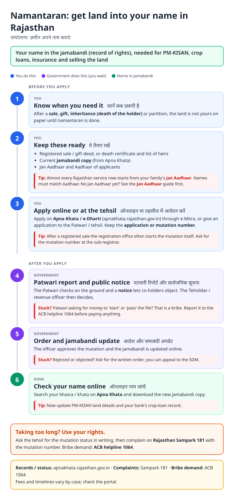
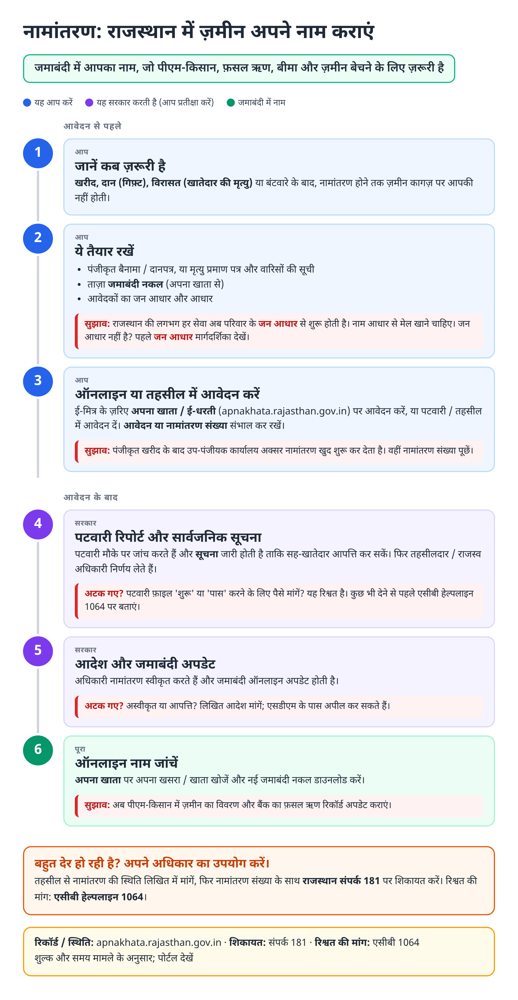
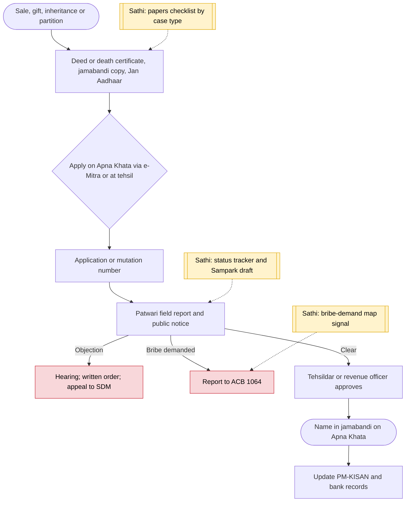

# Land mutation / Namantaran (Rajasthan) - End-to-End Workflow

नामांतरण (भूमि दाखिल-खारिज) · For: Buyers, heirs, gift or partition receivers of farm land in Rajasthan

## For citizens: step by step

Blue = you do this. Purple = government does this (you wait). Green = done. Red = what to do if stuck. Orange = your rights if it is late.

### English

### हिंदी (Hindi)

Sources: [`rj-land-mutation-guide.html`](rj-land-mutation-guide.html), [`rj-land-mutation-guide-hi.html`](rj-land-mutation-guide-hi.html), generated from [`rj_land_mutation_content.py`](rj_land_mutation_content.py) with `python3 ../gen_guide.py rj_land_mutation_content.py`. Hindi text pending native-speaker review.

## Official links

Use only these addresses. Checked on 28 Oct 2026 through search results; the government sites could not be opened directly from our build environment. "Third-party sites only" means several non-government sites agree on the address but no government page confirmed it yet, so open it and check before you share it.

| What | Link | Checked via |
| :--- | :--- | :--- |
| Apna Khata: jamabandi copy, mutation status | <https://apnakhata.rajasthan.gov.in> | Third-party sites only |
| e-Mitra: apply, pay, status, download | <https://emitra.rajasthan.gov.in> | Third-party sites only |
| Rajasthan Sampark: grievances, also toll-free 181 | <https://sampark.rajasthan.gov.in> | Third-party sites only |
| ACB Rajasthan helpline: 1064 | - | Third-party sites only |

## For the Sathi team: system workflow

## Verification (28 Oct 2026)

- Apna Khata (Board of Revenue) takes online mutation, partition and demarcation applications, integrated with e-Dharti; the Patwari still does a field check and notice is issued, per third-party guides.
- Mutation follows sections 133 and 135 of the Rajasthan Land Revenue Act, 1956, per one guide. No statutory day limit found, so the guide gives none.
- 2026 ACB traps of patwaris over mutation and partition work were reported in Rajsamand (gift-deed mutation, May), Sri Ganganagar (joint khata partition, June) and Bhilwara (July). ACB helpline 1064 is widely published; check before relying on it.

Sources: [Anantam IAS: Apna Khata](https://anantamias.com/apna-khata-rajasthan/) · [1acre: Apna Khata mutation](https://1acre.in/guides/rajasthan/apna-khata-mutation) · [SocialNews / IANS: Rajsamand trap](https://www.socialnews.xyz/2026/05/26/rajasthan-acb-arrests-patwari-taking-bribe-in-land-mutation-case/amp/)
