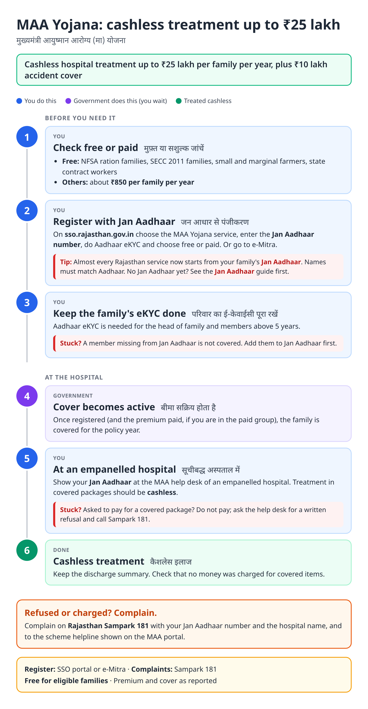
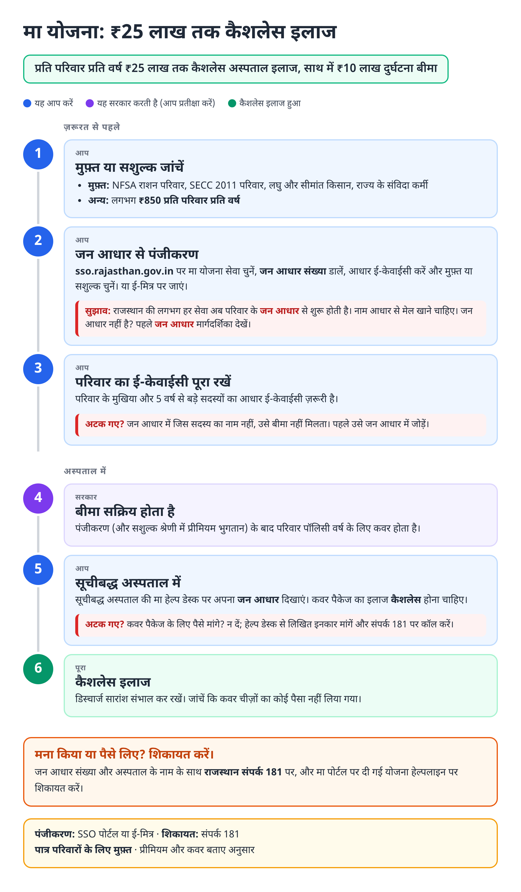
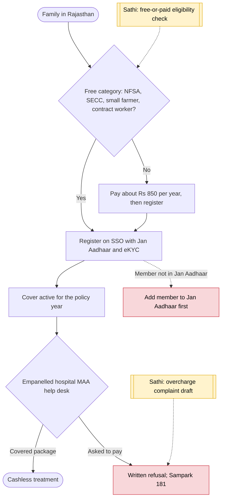

# MAA Yojana health cover (Rajasthan) - End-to-End Workflow

मुख्यमंत्री आयुष्मान आरोग्य (मा) योजना · For: Families in Rajasthan; free for NFSA, SECC, small farmers and contract workers

## For citizens: step by step

Blue = you do this. Purple = government does this (you wait). Green = done. Red = what to do if stuck. Orange = your rights if it is late.

### English

### हिंदी (Hindi)

Sources: [`rj-maa-yojana-guide.html`](rj-maa-yojana-guide.html), [`rj-maa-yojana-guide-hi.html`](rj-maa-yojana-guide-hi.html), generated from [`rj_maa_yojana_content.py`](rj_maa_yojana_content.py) with `python3 ../gen_guide.py rj_maa_yojana_content.py`. Hindi text pending native-speaker review.

## Official links

Use only these addresses. Checked on 28 Oct 2026 through search results; the government sites could not be opened directly from our build environment. "Third-party sites only" means several non-government sites agree on the address but no government page confirmed it yet, so open it and check before you share it.

| What | Link | Checked via |
| :--- | :--- | :--- |
| MAA Yojana portal | <https://maayojana.rajasthan.gov.in> | Third-party sites only |
| Rajasthan SSO: one login for state services | <https://sso.rajasthan.gov.in> | Third-party sites only |
| Jan Aadhaar portal: family ID, update, eKYC | <https://janaadhaar.rajasthan.gov.in> | Third-party sites only |
| Rajasthan Sampark: grievances, also toll-free 181 | <https://sampark.rajasthan.gov.in> | Third-party sites only |

## For the Sathi team: system workflow

## Verification (28 Oct 2026)

- Launched 1 May 2021 as Chiranjeevi; renamed MAAY in February 2024. ₹25 lakh cashless plus ₹10 lakh accident cover; free for NFSA, SECC 2011, small / marginal farmers, contract workers; ₹850 a year for others (Adda247, Joinditto, Coverfox).
- No 2026 notice of changes found; premium and categories marked as reported.

Sources: [Adda247: MAAY eligibility and how to apply](https://currentaffairs.adda247.com/rajasthan-mukhyamantri-ayushman-arogya-yojana-maay-eligibility-benefits-coverage-and-how-to-apply/) · [Joinditto: MAAY](https://www.joinditto.in/articles/health-insurance/mukhyamantri-ayushman-arogya-yojana/) · [Coverfox: MAAY](https://www.coverfox.com/government-schemes/health/mukhyamantri-ayushman-arogya-yojana-maay-rajasthan/)
