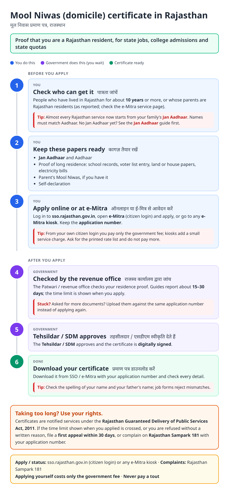
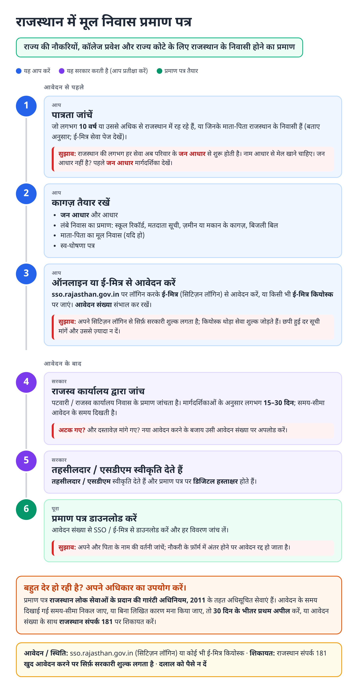
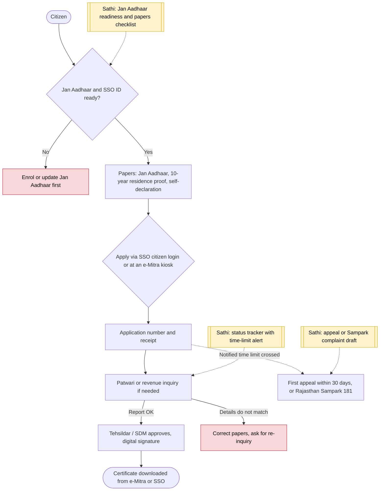

# Mool Niwas (domicile) certificate (Rajasthan) - End-to-End Workflow

मूल निवास प्रमाण पत्र · For: Residents of Rajasthan applying for jobs, admissions or quotas

## For citizens: step by step

Blue = you do this. Purple = government does this (you wait). Green = done. Red = what to do if stuck. Orange = your rights if it is late.

### English

### हिंदी (Hindi)

Sources: [`rj-mool-niwas-guide.html`](rj-mool-niwas-guide.html), [`rj-mool-niwas-guide-hi.html`](rj-mool-niwas-guide-hi.html), generated from [`rj_mool_niwas_content.py`](rj_mool_niwas_content.py) with `python3 ../gen_guide.py rj_mool_niwas_content.py`. Hindi text pending native-speaker review.

## Official links

Use only these addresses. Checked on 28 Oct 2026 through search results; the government sites could not be opened directly from our build environment. "Third-party sites only" means several non-government sites agree on the address but no government page confirmed it yet, so open it and check before you share it.

| What | Link | Checked via |
| :--- | :--- | :--- |
| Rajasthan SSO: one login for state services | <https://sso.rajasthan.gov.in> | Third-party sites only |
| e-Mitra: apply, pay, status, download | <https://emitra.rajasthan.gov.in> | Third-party sites only |
| Jan Aadhaar portal: family ID, update, eKYC | <https://janaadhaar.rajasthan.gov.in> | Third-party sites only |
| Rajasthan Sampark: grievances, also toll-free 181 | <https://sampark.rajasthan.gov.in> | Third-party sites only |

## For the Sathi team: system workflow

## Verification (28 Oct 2026)

- Apply through a Jan Aadhaar-linked SSO ID (citizen login) or any e-Mitra kiosk; several guides agree. Fees reported vary (about ₹10–50 plus kiosk charge), so the e-Mitra rate list is the reference.
- The Rajasthan Guaranteed Delivery of Public Services Act, 2011 lets the state notify each service's time limit; Section 6(1) allows a first appeal within 30 days of refusal or of the limit expiring. We did not find the current notified day limits, so the guide tells users to read the limit shown at application.
- The 10-year residence rule and ₹25–50 fee come from third-party guides (CitizenNest, MyCoaching); marked as reported.

Sources: [CitizenNest: domicile guide](https://www.citizennest.com/guide/rajasthan-domicile-certificate-apply-online) · [RGDPS Act 2011 text (LatestLaws)](https://www.latestlaws.com/bare-acts/state-acts-rules/rajasthan-state-laws/rajasthan-guaranteed-delivery-of-public-service-act-2011/)
