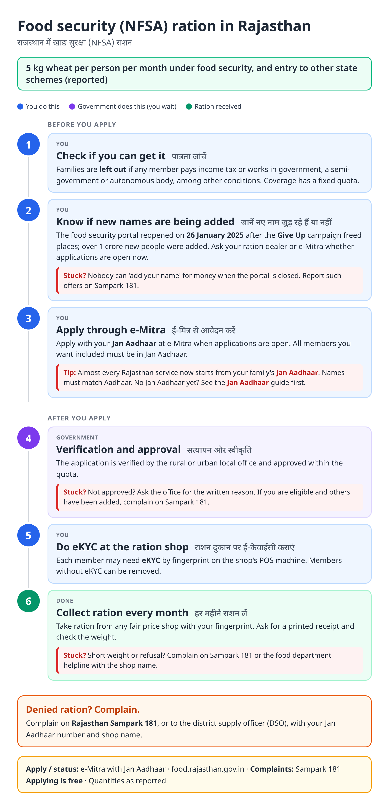
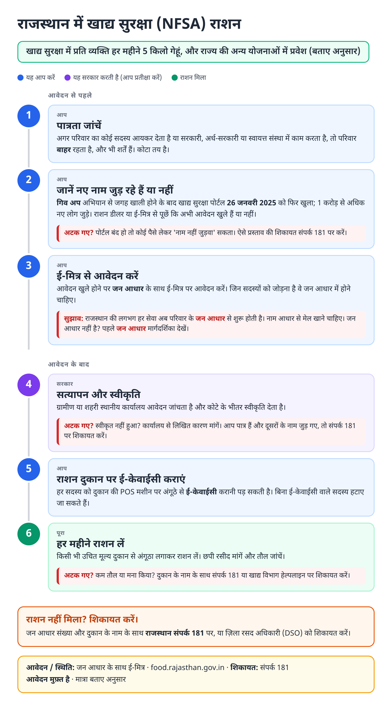
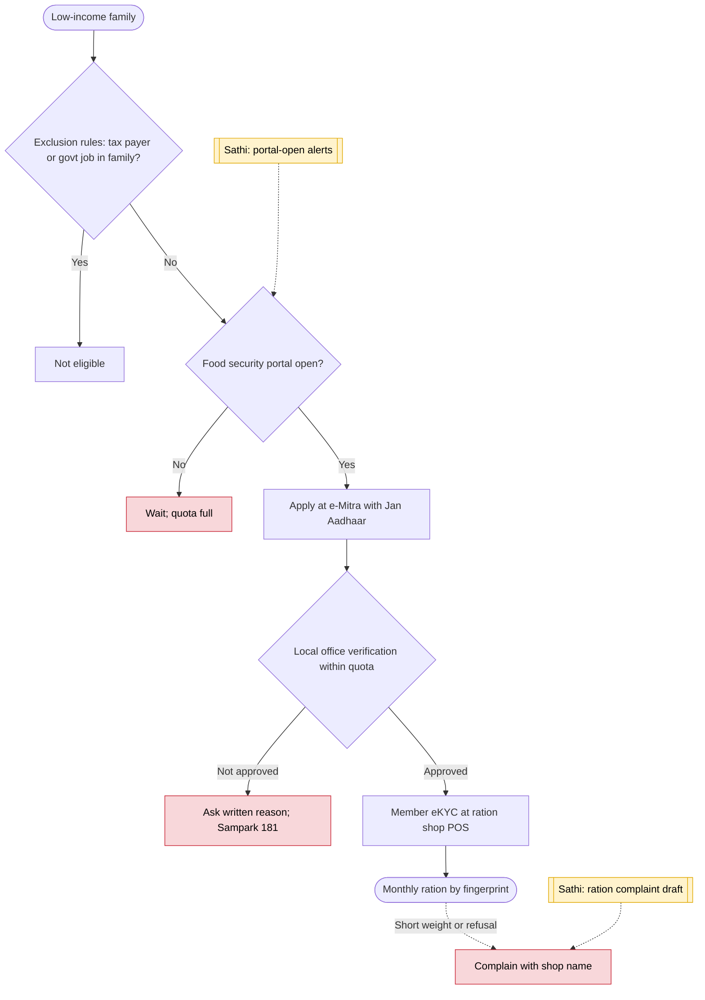

# Ration card and food security (Rajasthan) - End-to-End Workflow

राशन कार्ड और खाद्य सुरक्षा · For: Low-income families in Rajasthan

## For citizens: step by step

Blue = you do this. Purple = government does this (you wait). Green = done. Red = what to do if stuck. Orange = your rights if it is late.

### English

### हिंदी (Hindi)

Sources: [`rj-ration-card-guide.html`](rj-ration-card-guide.html), [`rj-ration-card-guide-hi.html`](rj-ration-card-guide-hi.html), generated from [`rj_ration_card_content.py`](rj_ration_card_content.py) with `python3 ../gen_guide.py rj_ration_card_content.py`. Hindi text pending native-speaker review.

## Official links

Use only these addresses. Checked on 28 Oct 2026 through search results; the government sites could not be opened directly from our build environment. "Third-party sites only" means several non-government sites agree on the address but no government page confirmed it yet, so open it and check before you share it.

| What | Link | Checked via |
| :--- | :--- | :--- |
| Food and Civil Supplies Department | <https://food.rajasthan.gov.in> | Third-party sites only |
| e-Mitra: apply, pay, status, download | <https://emitra.rajasthan.gov.in> | Third-party sites only |
| Jan Aadhaar portal: family ID, update, eKYC | <https://janaadhaar.rajasthan.gov.in> | Third-party sites only |
| Rajasthan Sampark: grievances, also toll-free 181 | <https://sampark.rajasthan.gov.in> | Third-party sites only |

## For the Sathi team: system workflow

## Verification (28 Oct 2026)

- Give Up campaign from 1 Nov 2024: 93.5 lakh gave up benefits; portal reopened 26 Jan 2025; 1.0 crore new beneficiaries added (Free Press Journal; NewKerala July 2026).
- 5 kg wheat per person per month for new enrollees, per the July 2026 report.
- Exclusion rules (tax payer, government job) from an undated report; marked as reported. No 2026 reopening found.

Sources: [Free Press Journal: Give Up campaign](https://freepressjournal.in/india/rajasthans-give-up-campaign-sees-93-lakh-voluntarily-exit-food-security-enabling-1-crore-new-beneficiaries) · [NewKerala: 1 crore added](https://www.newkerala.com/news/a/rajasthan-govt-adds-crore-beneficiaries-food-security-net-176.htm) · [Drishti IAS: Give Up Abhiyan](https://www.drishtiias.com/state-pcs-current-affairs/give-up-abhiyan/print_manually)
