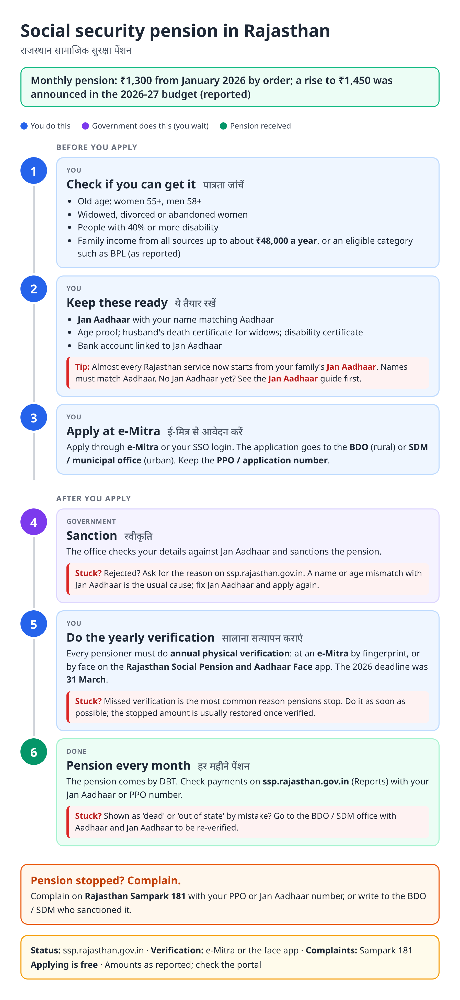
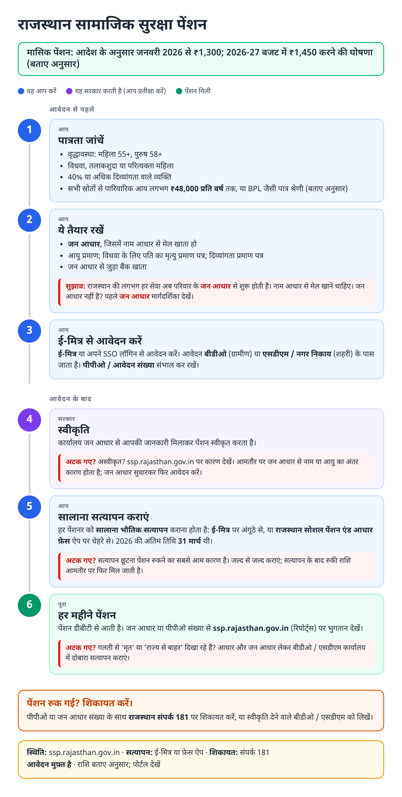
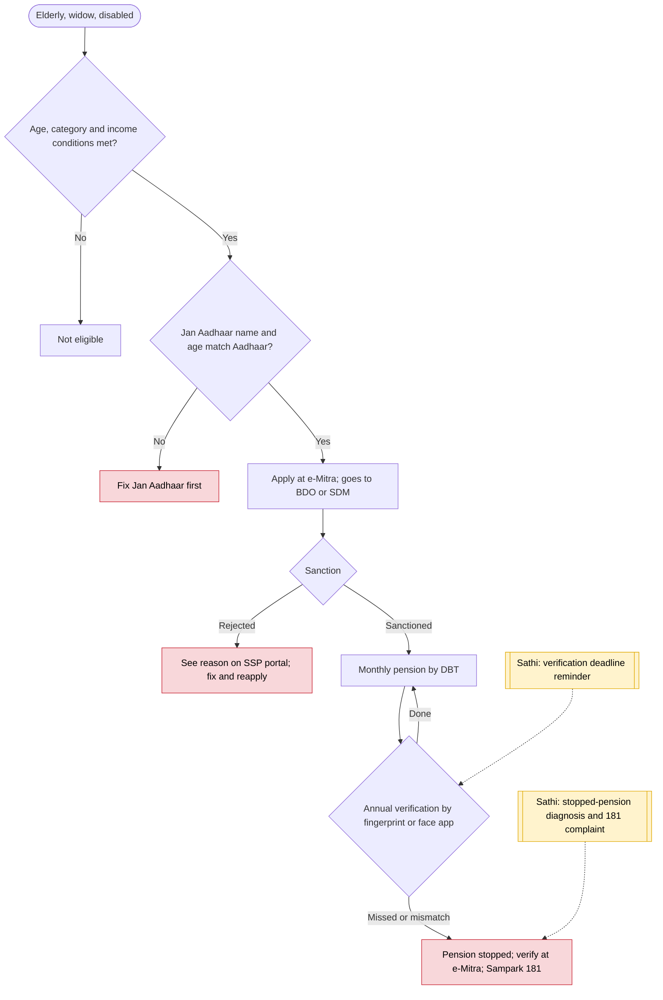

# Social security pension (Rajasthan) - End-to-End Workflow

सामाजिक सुरक्षा पेंशन · For: Elderly, widowed, divorced / abandoned women and disabled people in Rajasthan

## For citizens: step by step

Blue = you do this. Purple = government does this (you wait). Green = done. Red = what to do if stuck. Orange = your rights if it is late.

### English

### हिंदी (Hindi)

Sources: [`rj-social-pension-guide.html`](rj-social-pension-guide.html), [`rj-social-pension-guide-hi.html`](rj-social-pension-guide-hi.html), generated from [`rj_social_pension_content.py`](rj_social_pension_content.py) with `python3 ../gen_guide.py rj_social_pension_content.py`. Hindi text pending native-speaker review.

## Official links

Use only these addresses. Checked on 28 Oct 2026 through search results; the government sites could not be opened directly from our build environment. "Third-party sites only" means several non-government sites agree on the address but no government page confirmed it yet, so open it and check before you share it.

| What | Link | Checked via |
| :--- | :--- | :--- |
| Social Security Pension portal (status, reports) | <https://ssp.rajasthan.gov.in> | Third-party sites only |
| e-Mitra: apply, pay, status, download | <https://emitra.rajasthan.gov.in> | Third-party sites only |
| Jan Aadhaar portal: family ID, update, eKYC | <https://janaadhaar.rajasthan.gov.in> | Third-party sites only |
| Rajasthan Sampark: grievances, also toll-free 181 | <https://sampark.rajasthan.gov.in> | Third-party sites only |

## For the Sathi team: system workflow

## Verification (28 Oct 2026)

- Amount: ₹1,250 → ₹1,300 from 1 Jan 2026 by a February 2026 order under the Minimum Income Guarantee Act, 2023 (Udaipur Times, RAS Only); a rise to ₹1,450 was announced in the 11 Feb 2026 budget (Outlook Money). Whether ₹1,450 is being paid was not confirmed.
- Annual physical verification by 31 March 2026, at e-Mitra or by the Aadhaar face app; 1.36 lakh unverified in Jaipur district alone (Patrika, March 2026).
- Age thresholds (55 / 58) and the ₹48,000 income limit come from third-party guides; marked as reported.
- Stoppages after mismatches and failed biometrics: The Wire reports 13 lakh unverified between Nov 2024 and Apr 2025.

Sources: [Udaipur Times: ₹1,300](https://udaipurtimes.com/administration/social-security-monthly-pension-increased/cid18264779.htm) · [Outlook Money: ₹1,450 budget](https://www.outlookmoney.com/retirement/pension/social-security-pension-hiked-to-rs-1450-in-rajasthan-91-lakh-beneficiaries-to-gain) · [Patrika: verification by 31 March](https://www.patrika.com/en/jaipur-news/rajasthan-pension-scheme-1-36-lakh-beneficiaries-risk-losing-pension-if-task-not-completed-by-march-31-20439716) · [The Wire: unverified pensioners](https://thewire.in/rights/companies-gain-elders-lose-in-rajasthans-turn-to-cradle-to-grave-digital-governance)
