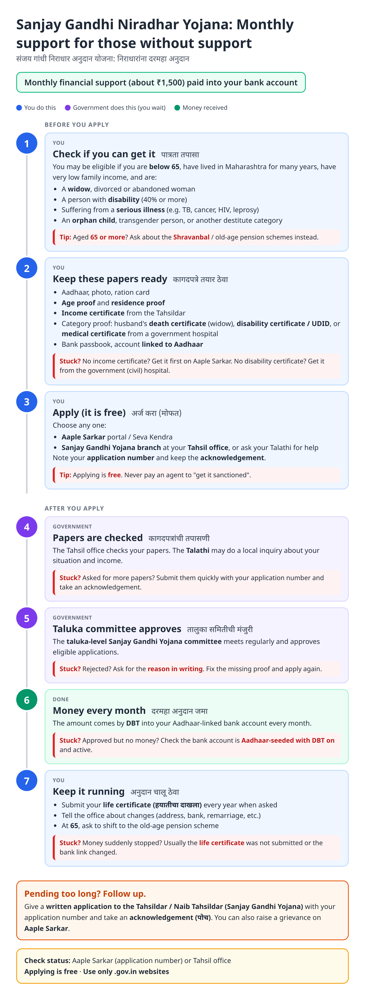
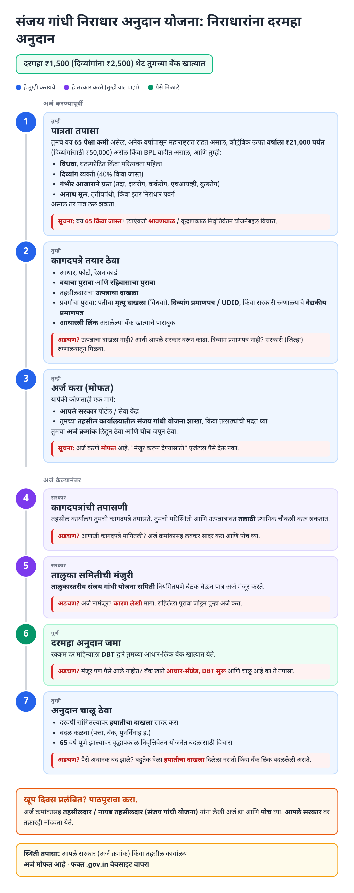
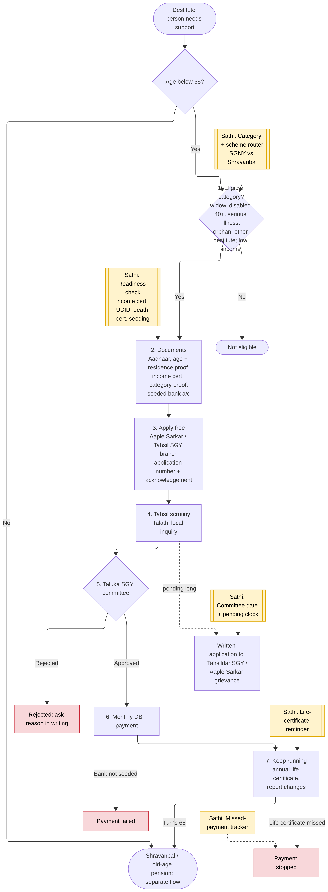
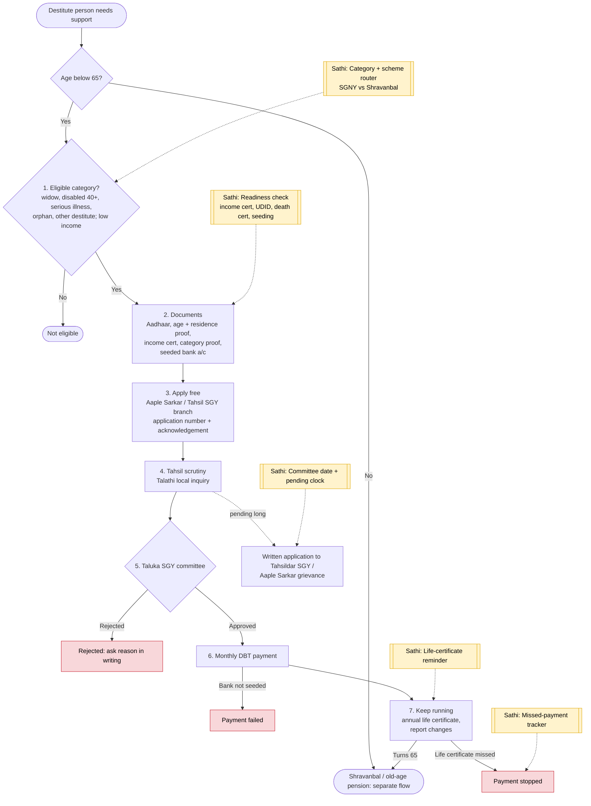

# Sanjay Gandhi Niradhar Anudan Yojana (SGNY) - End-to-End Workflow

Maharashtra state scheme: monthly financial support for destitute persons below 65 (widows, persons with disabilities, persons with serious illness, orphans and other destitute categories). Applied through Aaple Sarkar or the Sanjay Gandhi Yojana branch at the Tahsil office; approved by a taluka-level committee. Aged 65+, see [Shravanbal Yojana](shravanbal.md).

## For citizens: step by step

Blue = you do this. Purple = government does this (you wait). Green = money received. Red = what to do if stuck. Orange = how to follow up.

### English

### मराठी (Marathi)

Sources: [`sanjay-gandhi-guide.html`](sanjay-gandhi-guide.html), [`sanjay-gandhi-guide-mr.html`](sanjay-gandhi-guide-mr.html), generated from [`sanjay_gandhi_content.py`](sanjay_gandhi_content.py) with `python3 gen_guide.py sanjay_gandhi_content.py`. Marathi text pending native-speaker review.

## For the Sathi team: system workflow

Yellow boxes = where Sathi plugs in. Red boxes = common blockers.

Mermaid source (editable)

## Stages

| # | Stage | Owner | Common blocker | Sathi action |
|---|---|---|---|---|
| 1 | Eligibility | Citizen | Unsure of category; 65+ applies to wrong scheme | Category + scheme router (SGNY vs Shravanbal / old-age pension) |
| 2 | Documents | Citizen | No income certificate, UDID or death certificate | Readiness; link to [income certificate guide](income-certificate.md) |
| 3 | Apply | Citizen / Tahsil SGY branch | Pays agent | "It is free" messaging |
| 4 | Scrutiny + Talathi inquiry | Tahsil office | Extra papers asked | Explain what is missing |
| 5 | Taluka committee | SGY committee | Pending until next meeting; rejected | Committee-date + pending clock; ask reason in writing |
| 6 | Monthly DBT | Treasury / bank | Bank not seeded | Bank-seeding check |
| 7 | Keep running | Beneficiary | Life certificate missed → payment stopped | Annual life-certificate reminder; 65+ transition |

**Why this matters for Sathi:** SGNY beneficiaries are among the most vulnerable and least able to visit offices repeatedly. The most common silent failure is a missed annual life certificate, which a simple reminder prevents. This is a strong case for assisted-mode (e-Seva operator / family member) use of Sathi.

## Verification (27 Oct 2026, batch 3)

- **Confirmed (official district sites):** **₹1,500/month by DBT**; **₹2,500** for beneficiaries with disability (from Oct 2025); family income **up to ₹21,000/year** or BPL (**₹50,000** for disability); below 65; apply via Aaple Sarkar / MahaDBT or Tahsil / Talathi office.
- **Changed in guide:** exact amounts and income limits added.
- **Still unverified:** life-certificate rule, full category list, committee process.

Sources: [Thane district: Sanjay Gandhi Niradhar Yojana](https://thane.nic.in/en/sanjay-ghandhi-niradhar-yojana/) · [Gadchiroli district: Sanjay Gandhi Yojana](https://gadchiroli.gov.in/sanjay-gandhi-yojana/) · [Vikaspedia: SGNY](https://en.vikaspedia.in/viewcontent/schemesall/state-specific-schemes/welfare-schemes-of-maharashtra/sanjay-gandhi-niradhar-anudan-yojana-of-maharashtra-govt?lgn=en)
