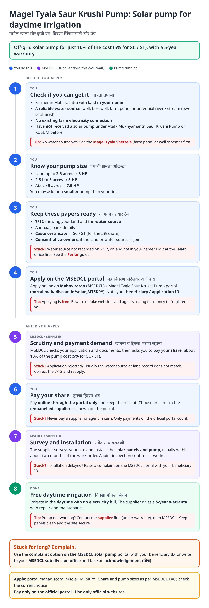
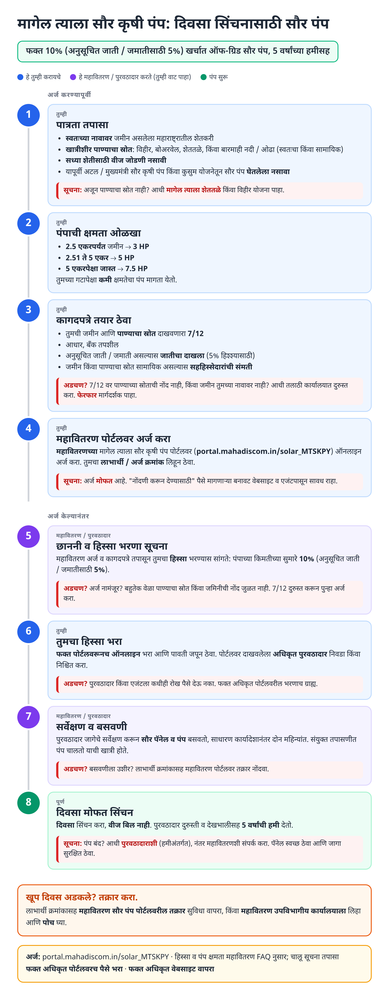
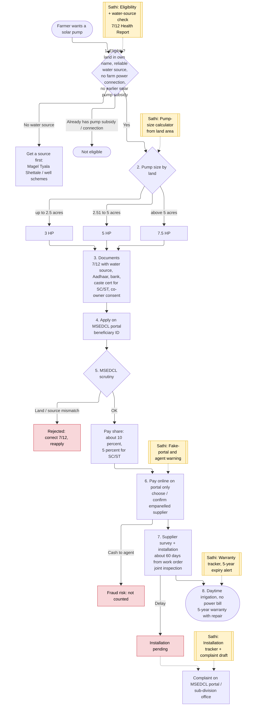
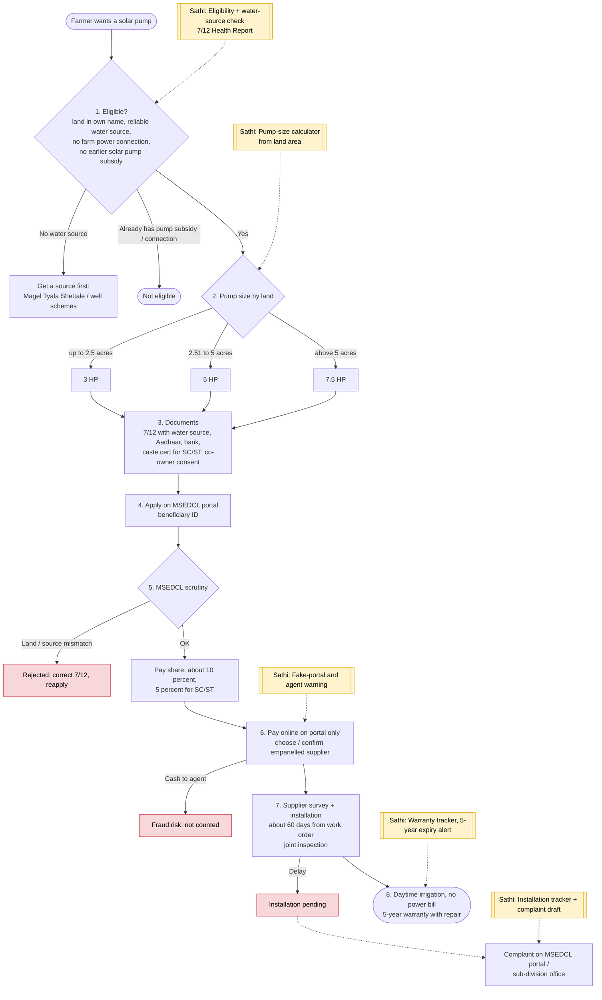

# Magel Tyala Saur Krushi Pump Yojana (Solar Pump on Demand) - End-to-End Workflow

Off-grid solar agricultural pump for farmers without a farm electricity connection, run by **Mahavitaran (MSEDCL)**. The farmer pays about **10%** of the system cost (**5%** for SC / ST); the rest is paid by state and central funds. Pump size by land: up to 2.5 acres → 3 HP, 2.51-5 acres → 5 HP, above 5 acres → 7.5 HP. Needs a water source, so it follows naturally from [Magel Tyala Shettale](magel-tyala-shettale.md), [Krushi Swavalamban](krushi-swavalamban.md) or [Birsa Munda](birsa-munda.md).

## For farmers: step by step

Blue = you do this. Purple = MSEDCL / supplier does this (you wait). Green = pump running. Red = what to do if stuck. Orange = how to complain.

### English

### मराठी (Marathi)

Sources: [`saur-krushi-pump-guide.html`](saur-krushi-pump-guide.html), [`saur-krushi-pump-guide-mr.html`](saur-krushi-pump-guide-mr.html), generated from [`saur_krushi_pump_content.py`](saur_krushi_pump_content.py) with `python3 gen_guide.py saur_krushi_pump_content.py`. Marathi text pending native-speaker review.

## For the Sathi team: system workflow

Yellow boxes = where Sathi plugs in. Red boxes = common blockers.

Mermaid source (editable)

## Stages

| # | Stage | Owner | Common blocker | Sathi action |
|---|---|---|---|---|
| 1 | Eligibility | Farmer | No water source; already has farm power connection or earlier solar pump | Eligibility + water-source check; route to pond / well schemes |
| 2 | Pump size | Farmer | Unsure of HP tier | Pump-size calculator from 7/12 area |
| 3 | Documents | Farmer | Water source not on 7/12; joint land without co-owner consent | 7/12 Health Report; consent checklist |
| 4 | Apply | Farmer | Fake portals / agents | Official-link only, fraud warning |
| 5 | Scrutiny + demand | MSEDCL | Land / source mismatch | Explain rejection |
| 6 | Pay share | Farmer | Cash paid to agent | "Pay on portal only" warning |
| 7 | Survey + install | Supplier / MSEDCL | Installation delay | Installation tracker + complaint draft |
| 8 | Running + warranty | Supplier | Breakdown; warranty expiry | Warranty tracker with 5-year expiry alert |

**Why this matters for Sathi:** this completes the **farm water chain**: water source ([pond](magel-tyala-shettale.md) / [well](krushi-swavalamban.md)) → solar pump → drip / sprinkler. A farmer-level profile can sequence these schemes correctly (a pump application fails without a recorded water source) and track warranties for years after installation.

## Verification (27 Oct 2026)

- **Confirmed (official MSEDCL FAQ):** pump size by land: **up to 2.5 acres → 3 HP; 2.51-5 acres → 5 HP; above 5 acres → 7.5 HP**; a smaller pump than the tier can be requested; application on **portal.mahadiscom.in/solar_MTSKPY**.
- **Confirmed (supplier announcements on MSEDCL orders):** suppliers are **empanelled by MSEDCL**; systems carry a **5-year comprehensive warranty with repair and maintenance**; work orders typically due in about **60 days**.
- **Reported (secondary, consistent):** farmer share **10% general / 5% SC-ST**; reliable water source required (well, borewell, farm pond, perennial river / stream; own or shared); not for farmers already having a farm electricity connection or an earlier Atal / Mukhyamantri Saur Krushi Pump / KUSUM pump.
- **Still unverified:** exact vendor-selection step for farmers, document list (water-source entry on 7/12, co-owner consent format), complaint helpline number.

Sources: [MSEDCL: Magel Tyala Saur Krushi Pump FAQ](https://www.mahadiscom.in/solar_MTSKPY/faq.php) · [MSEDCL: off-grid solar pump guidelines](https://mahadiscom.in/solar_MTSKPY/media/Guidelines%20and%20Clarifications%20for%20offgrid%20Solar%20Pump%20Installations.pdf) · [Vikaspedia: Magel Tyala Saur Krushi Pump Yojana](https://en.vikaspedia.in/viewcontent/schemesall/state-specific-schemes/welfare-schemes-of-maharashtra/magel-tyala-saur-krushi-pump-yojana?lgn=en) · [PV Magazine: KLK Ventures tender](https://www.pv-magazine-india.com/press-releases/klk-ventures-secures-tender-for-solar-water-pumping-systems-under-magel-tyala-saur-krushi-pump-scheme-in-maharashtra) · [Renewable Watch: Shakti and Oswal orders](https://renewablewatch.in/2026/07/07/shakti-pumps-and-oswal-pumps-secure-solar-pump-orders-from-msedcl/) · [The Machine Maker: Shakti Pumps order](https://themachinemaker.com/news/shakti-pumps-secures-order-for-6580-off-grid-solar-water-pumping-systems-in-maharashtra/) · [Powerline: Jupiter International LoE](https://powerline.net.in/2026/01/20/jupiter-international-secures-loe-for-rs-650-million-solar-pump-project-from-msedcl/) · [sarkariyojana.com: Magel Tyala Solar Pump](https://sarkariyojana.com/magel-tyala-solar-pump-yojana/) · [govtschemes.in: Magel Tyala Saur Krushi Pump](https://www.govtschemes.in/maharashtra-magel-tyala-saur-krushi-pump-yojana)
