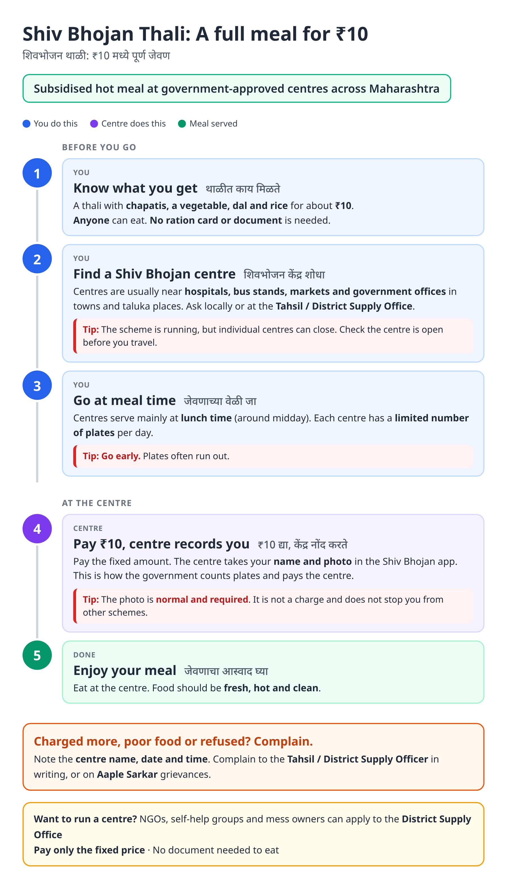
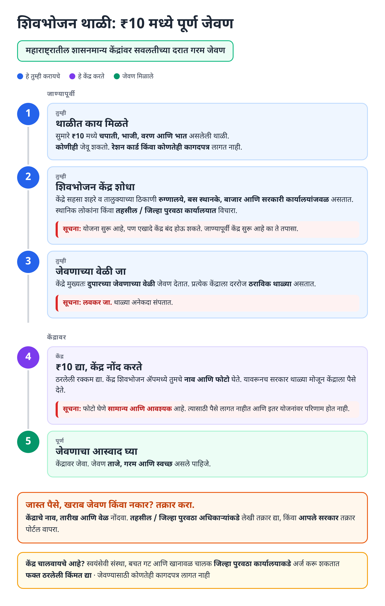
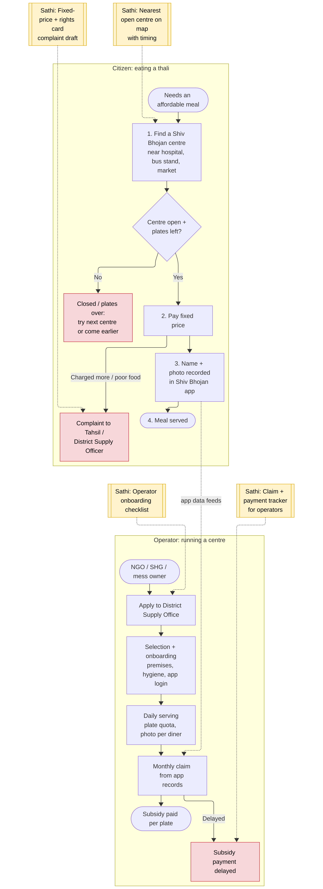
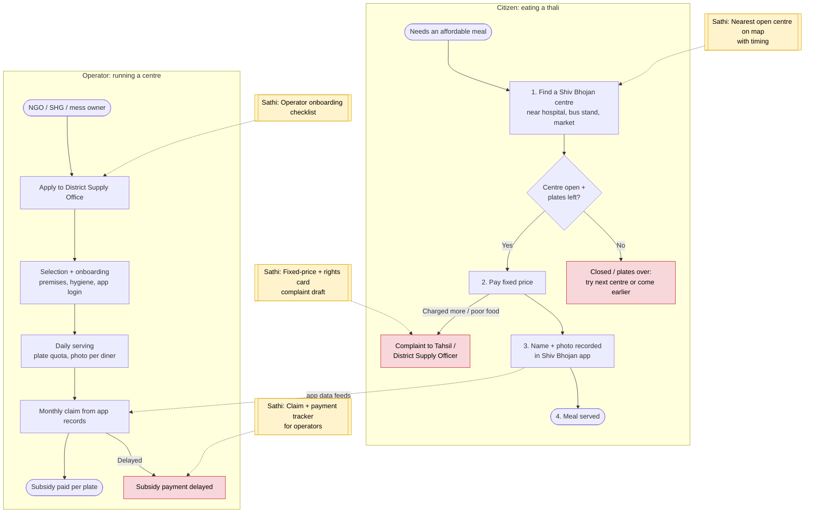

# Shiv Bhojan Thali - End-to-End Workflow

Maharashtra's subsidised meal scheme (Food, Civil Supplies and Consumer Protection Department): a full thali at a fixed low price at approved Shiv Bhojan centres, mainly near hospitals, bus stands, markets and government offices. No documents are needed to eat. This page covers two users: the **diner** and the **centre operator**.

## For citizens: step by step

Blue = you do this. Purple = centre does this. Green = meal served. Red = tips. Orange = how to complain.

### English

### मराठी (Marathi)

Sources: [`shiv-bhojan-guide.html`](shiv-bhojan-guide.html), [`shiv-bhojan-guide-mr.html`](shiv-bhojan-guide-mr.html), generated from [`shiv_bhojan_content.py`](shiv_bhojan_content.py) with `python3 gen_guide.py shiv_bhojan_content.py`. Marathi text pending native-speaker review.

## For the Sathi team: system workflow (diner + operator)

Yellow boxes = where Sathi plugs in. Red boxes = common blockers.

Mermaid source (editable)

## Stages

| # | Stage | Owner | Common blocker | Sathi action |
|---|---|---|---|---|
| 1 | Find centre | Diner | Doesn't know nearest open centre; centre closed | Nearest open centre on map, with timing |
| 2 | Pay | Diner | Charged more than fixed price | Fixed-price + rights card |
| 3 | Photo / name recorded | Centre | Diner thinks photo is a charge or risk | Explain it is routine |
| 4 | Meal | Centre | Poor quality / refused | Complaint draft to Tahsil / District Supply Officer |
| Op-1 | Apply to run a centre | NGO / SHG / mess owner | Doesn't know process | Operator onboarding checklist |
| Op-2 | Monthly subsidy claim | Operator / DSO | Payment delayed | Claim + payment tracker |

**Why this matters for Sathi:** for diners this is a pure *location* problem ("which centre near me is open now?"), a clean geospatial use case. For operators (SHGs, NGOs) it is a classic government-payment-tracking problem, which opens a small B2B segment.

## Verification (27 Oct 2026, batch 1)

- **Confirmed:** the scheme is **continuing**: in March 2025 the Deputy CM told the Assembly there is no decision to discontinue it; the diner still pays **₹10** (actual cost about ₹50 urban / ₹35 rural, rest paid by the Food & Civil Supplies Department).
- **Confirmed:** **vendor payment delays** have been reported, which supports the operator claim/payment tracker idea.
- **Reported (secondary):** about 1,900 centres operating.
- **Changed in guide:** tip now says the scheme is running but individual centres can close.

Sources: [Free Press Journal: Govt won't discontinue Shiv Bhojan Thali](https://www.freepressjournal.in/mumbai/maha-govt-wont-discontinue-10-shiv-bhojan-thali-anandacha-shidha-schemes-dy-cm-ajit-pawar-confirms) · [Deccan Herald: schemes to continue](https://www.deccanherald.com/amp/story/india%2Fmaharashtra%2Fladki-bahin-yojana-ladka-bhau-yojana-shiv-bhojan-thali-anandacha-shidha-to-continue-maharashtra-government-3394717) · [Deccan Herald: ₹10 meal costs ₹50](https://www.deccanherald.com/amp/story/india%2Fmaharashtras-rs-10-shiv-bhojan-meal-actually-costs-rs-50-in-cities-govt-808884.html) · [sarkariyojana.com: Shiv Bhojan](https://sarkariyojana.com/shiv-bhojan-yojana/)
